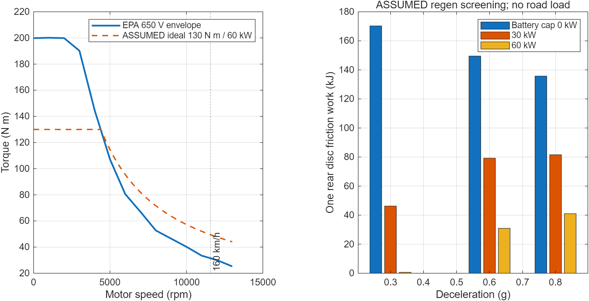

# 1. 审查结论与范围

本次完成 M0 参数、原始资料获取及动力学可行性审查。研究对象为 1800 kg 后驱概念车：后轴左右各一台参考 Prius MG2 的电机、一台两级 9:1 减速器及一个减速器输出端内移摩擦盘，无差速器；前轴保留普通摩擦制动器。当前拓扑以仓库 V0.4 配置及权威说明为准。

EPA 官方 MG2 数据包已实际下载、解包及读取。完整数值电功率表覆盖正转速下正、负转矩，但负转矩区域是由驱动损耗镜像估计，不能称为 ORNL 实测再生图。包内另外含有独立电机、逆变器的稀疏驱动效率数据。电机总损耗仍不能全部视为绕组发热。

在当前假设下，160 km/h 的转速与短时动力筛查通过。持续高速、真实再生能力、内移盘安装强度与热容量均未验证。0.6g 零再生时单侧后盘制动转矩约 752.84 N·m，初始接触摩擦功率 63.37 kW，一次 100→0 km/h 的接触摩擦功 149.53 kJ。

本次未建立 M1 瞬态热源模型，未运行 ANSYS、热网络、CAD 或优化。制动功与损耗分项仅用于 M0 参数和整车能量核算，不生成温度、空间热流密度或部件热源分配。进入 M1 需用户另行确认。

# 2. 资料来源与证据边界

原始文件位于 `data/raw/m0/`。`manifest.json` 记录请求地址、最终地址、获取时刻、文件字节数和 SHA-256；EPA 包内各文件校验值见 `results/m0/epa_zip_inventory.json`。S1 表示官方原始参考，S3 表示明确的工程估算；缺失值保持 null。参考部件的 S1 证据不代表概念总成经过实测。

| 资料 | 本次获取与定位 | 支持内容及限制 |
|---|---|---|
| EPA MG2 EMOT 包，2023-04 | 官方 ZIP，32,352,137 字节，12 个文件 | 联合电功率表、生成方法、稀疏原始效率数据；再生为估计 |
| ORNL/TM-2010/253，2011-03 | ORNL 官方 PDF，88 页；EPA 包也附有一份 | 额定能力、拆解尺寸、效率和特定条件持续负荷测试 |
| Toyota 第三代 Prius 发布，2009-05-18 | 官方网页已保存 | 电机最大 60 kW、207 N·m，系统最高 650 V；不证明连续输出 |
| Volkswagen MY23 ID.3 | 官方 PDF；PDF 第5页轮胎、第9页性能 | 215/55 R18、160 km/h；不支持概念质量及重心 |
| Volkswagen MY21 ID.3 | 官方 PDF 第19页图示 L101，已目视核查 | 轴距 2765 mm；是较早版本车身参照 |
| Volkswagen 2020 技术页 | 搜索索引仍有内容，直接访问为 HTTP 404 | Cd=0.27 仅保留未验证筛查值；不标为本次完整原文核实 |
| Brembo 09.9908.21 | 官方目录网页已保存 | 后轴通风盘 280×22 mm、高42 mm、中孔68 mm；不证明内移可装 |

EPA ZIP 的 SHA-256：

`9351bd93e82a58d6c2d7fd5220f4913b0966adb9e4922f34f98c0b4f957f39cd`

所有原始资料保留原有归属和版权标识。包内未附一份统一覆盖全部 OEM/ORNL 附件的再分发许可证，不能将第三方资料笼统宣称为无版权。仓库保留原包用于本研究证据追溯，引用采用 EPA 建议的 2023-04 版本说明。ORNL 官网 PDF 与包内 PDF 字节数及哈希不同，分别留存，不把二者当作二进制相同文件。

# 3. EPA 数据包审计

## 3.1 格式与可读取性

包内包含 3 个 DOCX、1 个 HTML、2 个 XLSX、5 个 PDF、1 个 MATLAB `.m` 文件。没有 MAT 原始文件。`.m` 是 ALPHA/REVS 对象定义，依赖 `class_REVS_emachine_geared` 等外部类；不能仅凭拥有 MATLAB 就声称完整运行了 ALPHA。生成 HTML 还引用未随包提供的 `Extracted_Data_emach`。本次不执行下载的代码，以数值赋值解析方式提取原表，并与示例 XLSX 交叉核对，生成了可供 MATLAB 读取的 JSON/MAT 和 CSV。

`3c` XLSX 含 `650V Motor Only` 与 `650V Inv Only` 两张工作表。每张正转矩候选网格为 20×14；各有 137 个有效值、143 个缺失值，配对有效驱动点为 137 个。0 N·m 行虽有数值，EPA 生成说明指出其效率不符合物理意义并排除，不能作为静止损耗验证数据。

`6` XLSX 是 ALPHA 导出的示例数据，共272行，并非完整矩形网格；其电功率与 `.m` 中相应数值的插值结果一致。

## 3.2 转矩、转速、功率范围

| 项目 | 核查结果 |
|---|---|
| `.m` 完整电功率表 | 14 个转速点×39 个转矩点，共546个有限值，无空值 |
| 转速轴 | 0–13000 rpm，步长1000 rpm；仅非负转速 |
| 转矩轴 | −200 至 +200 N·m，非等间距 |
| 物理最高转速声明 | 13500 rpm；13000–13500 rpm 无表格覆盖 |
| 工作电压 | 单一650 V；不代表任意直流母线电压 |
| 驱动／发电功率声明 | 各60 kW，但再生声明不是实测承诺 |
| 正负限扭线 | 数值互为相反数；绝对值约200 N·m低速、25.23 N·m在13000 rpm |
| 同时满足限扭线及60 kW的网格点 | 268点；矩形表内其他点不能直接当可行工作点 |

有完整数值表并不意味着全部矩形区域均可运行。必须同时满足电压、转速、正负转矩包络、功率以及未来的电流与温度限制。硬件207 N·m与低速图中约200 N·m的限扭线是不同层次的参数，不能用207 N·m替换整张图。

本次用边界内线性插值验证网格点和示例数据，显式检查13500 rpm查询会被拒绝。未生成13000 rpm以外的外推图，也没有验证负转速运行象限。

## 3.3 再生证据及损耗定义

NCAT 报告及生成 HTML 明确说明：ORNL 的 MG2 原始数据来自驱动模式，EPA 将驱动损耗转换成曲面后，以1.05系数镜像构造再生损耗。该系数是 EPA 根据其掌握的其他资料使用的经验修正，不是这台 MG2 的负转矩实测标定。

取电机轴机械功率为 $P_{\mathrm{mech}}=T_m\omega_m$，从直流侧输入为正的电功率为 $P_{\mathrm{dc}}$，则联合损耗满足

$$P_{\mathrm{loss,EMOT}}=P_{\mathrm{dc}}-P_{\mathrm{mech}}\geq0.$$

驱动效率使用 $P_{\mathrm{mech}}/P_{\mathrm{dc}}$；仅在机械输入且直流净输出时，再生效率使用 $(-P_{\mathrm{dc}})/(-P_{\mathrm{mech}})$。负转矩在低速下可能仍需直流输入，不能仅按转矩符号判定电池正在充电；零速、零输出附近也不宜用效率比值表示。

EMOT 包含电机和逆变器，不包含齿轮损耗。包内 `gear.ratio=2.636` 的生成说明将其列为原 Prius 行星速比参考，`gear.efficiency_norm=1`；本研究直接采用电机轴转速与转矩表，外部仅乘本方案9:1速比，不能再额外乘2.636。

在匹配的驱动测量点，独立电机效率和逆变器效率可用于后续总损耗拆分；但依然缺电机铜损、铁损、转子及机械损耗分配和其温度依赖。此次保留 `motor_loss_map_file`、`inverter_loss_map_file` 为 null，没有把稀疏效率工作表转换成绕组热源图。

另发现 NCAT 报告正文将电池写成270 V锂聚合物，而其表格及Toyota资料为镍氢体系。该明显不一致记录为资料勘误，不导入本车电池参数；本研究电池规格、SOC及实际充电能力仍未知。

# 4. 电机能力、几何与冷却资料

Toyota 发布资料支持最大60 kW、207 N·m；ORNL表2.1支持13500 rpm最高转速参照。ORNL正文第63页（PDF第72页）描述了在其试验条件下达到定子150°C之前维持60 kW共18秒的峰值能力验证。该测试不能解释成每侧60 kW连续能力，也不能把150°C直接认作新总成绕组允许温度。

ORNL表2.7（正文第46页，PDF第55页）提供下列拆解参考；已另存于 `configs/m0_ornl_reference_geometry.yaml`。

| MG2原始参考参数 | 数值 | 用途边界 |
|---|---:|---|
| 定子叠片外径／内径 | 264／161.9 mm | 不是电机壳外径 |
| 定子叠长 | 50.8 mm | 不含端部绕组及端盖空间 |
| 转子外径／叠长 | 160.4／50.165 mm | 不是完整轴系尺寸 |
| 气隙／叠片厚度 | 0.73／0.305 mm | 原始MG2设计参考 |
| 转子质量，含轴 | 6.7 kg | 不等于润滑油或热容 |
| 定子／叠片铁芯／铜质量 | 15.99／10.36／4.93 kg | 质量边界不同，不能重复相加 |
| 原电机壳质量 | 14.1 kg | 含旋变、泵等，不能全算铝壳 |
| 原壳体参考直径／轴向长度 | 302／161 mm | 不能当新内移盘总成装配包络 |
| 相电阻，21°C | 0.077 Ω | 来源定义为相间平均电阻除以2 |
| 磁体 | NdFeB，总质量0.768 kg | 缺精确牌号、退磁及温变参数 |

ORNL说明原系统通过循环油及乙二醇冷却回路散热，试验冷却液先经PCU后到ECVT换热器；第3.4节还给出不同功率、速度及冷却温度下的持续负荷结果。这些结果不能直接移植到两套独立减速器及新电机壳体。质量资料也不足以确定有效热容，仍需材料比热、浸漆、绝缘、接触热阻及实际冷却流路。

# 5. 1800 kg整车参数审查

| 参数 | 当前值与状态 | 审查意见 |
|---|---|---|
| 质量 | 1800 kg，S3概念基准 | 未区分整备、驾驶员及满载；后续至少补质量范围 |
| 轴距 | 2.765 m，S1车身参考 | MY21官方图已核实；不是概念车实测 |
| 后轴静载／重心高度 | 55%／0.55 m，S3 | 扫描50%–60%、0.45–0.65 m |
| 有效滚动半径 | 0.33 m，S3 | 扫描0.32–0.34 m；标称未加载半径0.34685 m不能直接替代 |
| 后轮距 | null | 参考车目录不能替代新电驱包装、半轴和轮胎位置 |
| Cd／迎风面积／滚阻系数 | 0.27／2.30 m²／0.012 | Cd原网页404，其他为假设；组合风阻面积0.621 m²未验证 |
| 转动惯量系数 | 1.0，S3 | 本次忽略车轮、转子及齿轮转动动能，需后续补齐 |
| 路面附着 | 0.8，S3 | 干路示例，0.8g已达理想附着边界，无鲁棒余量 |
| 牵引软件限扭 | 130 N·m／侧，S3 | 非硬件铭牌、非真实再生控制上限 |
| 驱动／反拖减速器效率 | 各0.96，S3 | 两个方向分别定义；不是常数效率实测图 |

单侧盘与自己的车轮同速；单侧电机转速为该侧轮速的9倍。左右可不同速，本次只算直线对称工况。任何单侧盘转矩都不乘电机减速比；电机再生转矩才需经过反拖效率换算。

加速时后轴增载。忽略路阻时，纯后驱附着约束应为

$$z_{\mathrm{drive}}\leq\frac{\mu f_{r0}}{1-\mu h/L}=0.52327.$$

旧V0.4文字中的正号分母及0.3796g已修正。当前130 N·m软件限扭、9:1及0.96驱动效率下，两侧轮端总转矩2246.4 N·m，对应低速力矩上限约0.38551g（忽略路阻），先于0.52327g附着上限；高速还受EPA包络约束。制动时的后轴减载公式保持负号，二者不能混用。

# 6. 最高车速、功率与速比匹配

$$n_m=\frac{v}{r}\,i\,\frac{60}{2\pi},\qquad P_w=2T_m\omega_m\eta_d.$$

| 车速 | 电机转速 | 理想60kW限扭 | EPA包络限扭 | 两侧轮端可用功率 |
|---:|---:|---:|---:|---:|
| 50 km/h | 3617.16 rpm | 130.00 N·m | 162.04 N·m | 94.55 kW |
| 100 km/h | 7234.32 rpm | 79.20 N·m | 63.58 N·m | 92.48 kW |
| 160 km/h | 11574.90 rpm | 49.50 N·m | 31.49 N·m | 73.29 kW |

实际筛查取软件限扭、60 kW及EPA包络的最小值。上述“可用”是参考峰值包络配工程效率计算，不是新总成台架能力。

130 N·m与60 kW的理想转折为4407.37 rpm；硬件207 N·m对应2767.91 rpm。两者均不代表实测曲线的恒功率起点。13500 rpm只按运动学对应186.61 km/h，而实际表格13000 rpm只覆盖至179.70 km/h；两者都不是已证明的整车最高车速。

160 km/h下，硬件转速允许总速比不超过10.497，现有数据表覆盖允许不超过10.108；候选9.0通过。半径0.32–0.34 m时转速约11936.62–11234.47 rpm，仍在表格范围内。

平路无风的路阻筛查使用

$$F_{\mathrm{road}}=mgC_{rr}+\tfrac12\rho C_dAv^2,\qquad P_{\mathrm{road}}=F_{\mathrm{road}}v.$$

额外假设空气密度1.225 kg/m³；该值作为独立筛查常数，并非按25°C和当地海拔测得。160 km/h路阻约963.23 N、42.81 kW，要求每侧电机轴功率约22.30 kW。参考短时包络支持的轮端73.29 kW高于路阻，但22.30 kW／侧能否持续、650 V供电是否可实现、坡度及逆风工况仍未确认，因此结论仅为平路短时筛查通过。

# 7. 单侧后盘制动转矩、功率与能量

## 7.1 定义、分配与效率方向

设减速度大小 $a=zg$，后轴动态载荷比例为

$$f_r=f_{r0}-z\frac{h}{L}.$$

无路阻基线取总制动力 $F_b=ma$；含路阻筛查取 $F_b=ma-F_{\mathrm{road}}$。按同附着利用率的参考分配，前轴承担 $(1-f_r)F_b$，后轴承担 $f_rF_b$。这是参数审查用理想分配，未建立量产EBD/ABS控制律。含路阻算例仍使用按总减速度计算的轴荷近似，未识别风阻作用高度等俯仰力矩。

对两侧对称，后轴总再生轮端力为 $F_{\mathrm{reg}}$，单盘转矩和功率为

$$T_d=\frac{(f_rF_b-F_{\mathrm{reg}})r}{2},\qquad P_d=T_d\frac{v}{r},\qquad E_d=\int_0^{v_0}\frac{P_d(v)}{a}\,dv.$$

M0再生筛查另作以下S3假设：联合EMOT再生效率0.90，反拖效率0.96，每侧再生轴转矩假设限130 N·m，并与EPA镜像限扭曲线取小值；5 km/h以下再生关闭；电池总充电功率上限分别0、30、60 kW。后两档为整车左右两台之和，实际SOC、温度及充电能力未知。未用0.90代替真实MAP，也未声称130 N·m为厂家再生上限。

反拖时，电机输入机械功率为轮端再生机械功率的0.96倍，不能沿用牵引的乘法换算轮端转矩。总再生轮端力采用约束最小值：

$$F_{\mathrm{reg}}=\min\left(f_rF_b,\ \mu mgf_r,\ \frac{2iT_{g,\max}(n)}{r\eta_b},\ \frac{2P_{m,\max}}{v\eta_b},\ \frac{P_{\mathrm{bat},\max}}{v\eta_b\eta_e}\right).$$

仅在速度高于关闭阈值时使用；零速再生功率强制为零。此公式只核算功率边界，不表示真实再生响应或电池控制策略。

## 7.2 无路阻基线：100→0 km/h

| 减速度 | 电池总上限 | 初始单盘转矩 | 初始单盘功率 | 单盘摩擦功 |
|---:|---:|---:|---:|---:|
| 0.3g | 0 kW | 428.58 N·m | 36.08 kW | 170.25 kJ |
| 0.3g | 30 kW | 222.33 N·m | 18.71 kW | 46.24 kJ |
| 0.3g | 60 kW | 16.08 N·m | 1.35 kW | 0.66 kJ |
| 0.6g | 0 kW | 752.84 N·m | 63.37 kW | 149.53 kJ |
| 0.6g | 30 kW | 546.59 N·m | 46.01 kW | 79.20 kJ |
| 0.6g | 60 kW | 340.34 N·m | 28.65 kW | 30.93 kJ |
| 0.8g | 0 kW | 911.06 N·m | 76.69 kW | 135.72 kJ |
| 0.8g | 30 kW | 704.81 N·m | 59.33 kW | 81.56 kJ |
| 0.8g | 60 kW | 498.56 N·m | 41.97 kW | 40.98 kJ |

后轴动态比例依次为0.49033、0.43065、0.39087。停车时间依次9.439、4.719、3.539秒；停车距离131.09、65.55、49.16米，不计驾驶员反应。减速度增大而后盘无再生摩擦功降低，源于本参考分配把更多负荷移至前轴，并非总制动能量下降。

表中转矩与功率为制动初始值。低速关闭再生后，峰值盘转矩仍会恢复到该减速度的零再生水平；例如0.6g即752.84 N·m，不能按60 kW档初始340.34 N·m选型。0.3g／60 kW的单盘峰值功率约1.80 kW，也高于初始1.35 kW。完整峰值、前轴、能量分项见CSV。

## 7.3 含路阻的筛查

| 减速度 | 电池总上限 | 初始单盘转矩 | 初始单盘功率 | 单盘摩擦功 |
|---:|---:|---:|---:|---:|
| 0.3g | 0 kW | 387.69 N·m | 32.63 kW | 158.73 kJ |
| 0.3g | 30 kW | 181.44 N·m | 15.27 kW | 36.65 kJ |
| 0.3g | 60 kW | 0.00 N·m | 0.00 kW | 0.41 kJ |
| 0.6g | 0 kW | 716.93 N·m | 60.35 kW | 144.47 kJ |
| 0.6g | 30 kW | 510.68 N·m | 42.99 kW | 74.37 kJ |
| 0.6g | 60 kW | 304.43 N·m | 25.62 kW | 26.99 kJ |
| 0.8g | 0 kW | 878.46 N·m | 73.94 kW | 132.27 kJ |
| 0.8g | 30 kW | 672.21 N·m | 56.58 kW | 78.22 kJ |
| 0.8g | 60 kW | 465.96 N·m | 39.22 kW | 38.02 kJ |

路阻帮助整车减速，不应仍把全部 $ma$ 同时分给制动器。再生关闭或失效时，摩擦器承担更多负荷；附着不足时不能保证原定减速度。0.8g在假设0.8附着下无余量，不能据此声称制动安全或法规符合性。

## 7.4 整车能量闭合与热量边界

初始平动动能为694.444 kJ。核算前轴摩擦、两侧后盘摩擦、两侧反拖减速器损耗、两侧EMOT联合损耗、电池回收及路阻功：

$$\Delta E_k=E_{f,\mathrm{front}}+2E_d+E_{\mathrm{gear}}+E_{\mathrm{EMOT}}+E_{\mathrm{bat}}+E_{\mathrm{road}}.$$

例如0.6g、30 kW、无路阻：前轴395.381 kJ、每侧后盘79.196 kJ、电池121.540 kJ、两侧齿轮合计5.627 kJ、两侧EMOT合计13.504 kJ。18组算例最大相对能量残差约 $7.91\times10^{-16}$。这是代数收支自洽，不能消除效率、轴荷及再生假设的不确定性。

上表 $E_d$ 是盘片接触产生的摩擦功，不是全部存入盘的热量，更不是传入电机绕组的能量。热分配、对流、辐射和盘毂轴承导热尚未计算。材料未知时，不把摩擦功直接换算温升。

以0.8g零再生911.06 N·m及假设摩擦系数0.40估算，若有效摩擦半径小于外半径0.14 m，两侧摩擦面法向力之和至少约16.27 kN。这只是几何下限，缺内径、接触压力与卡钳能力，不能完成制动器容量验证。

{width=16cm}

# 8. 仍需补充的输入与验证

`parameter_audit.csv` 覆盖当前配置全部叶子字段；39项保持null。下面按研究用途列出必须补齐的参数，不将工程假设升级为实测值。

| 参数组 | 缺口与需获取资料 | 后续影响 |
|---|---|---|
| 整车及工况 | 整备／满载质量、实测轴荷和重心、有效滚动半径、后轮距、各转动惯量；坡度、逆风及重复停车定义 | 制动力、能量、附着和高速功率 |
| 电机／逆变器 | 连续能力；不同电压、温度和速度下电流／转矩限制；实测再生；铜／铁／转子／机械损耗；逆变器位置和损耗 | M1损耗可信度、热源分离 |
| 电池 | 电压、SOC／温度状态、总充电功率曲线、限流及回生退出策略 | 实际回收功率与摩擦负荷 |
| 电机新包装 | 端部绕组、端盖、水套、轴伸、旋变、密封、安装面、接线及油路CAD；完整质量边界 | 不能只用264 mm定子外径冻结CAD |
| 两级减速器几何 | 级间速比分配、齿数、模数、压力／螺旋角、齿宽、中心距、齿轮外径；轴径跨距、键／花键、材料与热处理 | 强度、轴承载荷、空间及真实损耗 |
| 减速器热参数 | 驱动／反拖损耗图，轴承摩擦，搅油；油型、油量、粘温关系、喷油／油泵及油温限 | 机械与热边界不能由0.96常数替代 |
| 材料热物性 | 铜／电工钢／磁钢精确牌号、绝缘漆、浸渍层、轴承及壳体材料；密度、比热、各向异性导热率及温变 | 热容、热阻与温度响应 |
| 冷却边界 | 水套／油路几何、冷却液配比、入口温度、质量流量、压降与泵曲线、换热器能力；预热初温、环境及车底空气流场 | 不能从ORNL原系统直接移植 |
| 制动器 | 盘质量、内外摩擦半径、通风筋及厚度、材质物性、盘片热分配、摩擦温变、接触压力、片厚；活塞面积／液压／夹紧力与热限 | 不能由280×22 mm推出热容量和制动力矩 |
| 内移安装与热路 | 盘毂、输出轴、轴承寿命与热负荷、支架反力、密封耐温；盘壳间距、热变形、公差、接触热阻和辐射视角 | 安装可行性与固体／辐射热侵入 |
| 温限与验证 | 绕组绝缘／磁钢退磁、油液／密封／轴承、盘／片／卡钳允许温度；台架热与制动测量方案 | 无法建立优化硬约束及实验验证 |

优先顺序：先确认电压／电池再生边界和损耗证据，再确定减速器与内移盘机械包装、冷却及材料温限。几何、材料、冷却不足时不应发布定量温升或结构降温收益。已有隔热罩优化边界仅是历史候选范围，此次未冻结或优化。

# 9. 可复算交付与实际验证

输入配置保留YAML，经Python审查后生成保持null语义的JSON，MATLAB R2025a读取JSON并执行M0计算。Python 3.13.12、MATLAB 25.1.0.2943329（R2025a）已实际运行。基础仓库提交为 `8648dd9eb068f73eda92cd869db19cd0f98a31a3`；配置哈希及环境见 `audit_metadata.json`，本交付提交号由Git历史确定，避免自引用哈希。

| 验证项目 | 实际结果 |
|---|---|
| Python配置测试 | 3个测试通过；其中覆盖10种旧拓扑／非物理输入拒绝 |
| EPA下载及ZIP CRC | 通过；包内12文件SHA-256登记 |
| 完整网格及示例表 | 546个有限值；272行示例交叉核对；插值越界拒绝 |
| 拓扑、速度及未知项 | 通过；无差速器、盘轮同速、每侧独立电机；连续功率和绕组图保持未知 |
| 附着、功率及能量 | 18组制动积分通过；无负摩擦、遵守电池功率及电机转矩限制 |
| 独立解析检查 | 0.6g零再生转矩／能量回归、恒力与恒功率分段积分通过 |
| 积分步长细化 | 0.6g／30kW／含路阻，10001至40001速度点；单盘功相对变化约0.000739% |
| 假设扫描 | 18组再生效率／低速退出组合；27组轴荷／重心／半径组合，均另存CSV |
| MATLAB原始对象构造 | NOT EXECUTED：未安装ALPHA／REVS外部类；仅解析数字并交叉核对 |
| M1／ANSYS／优化 | NOT EXECUTED：不在本次授权范围 |

主要结果为 `braking_review.csv`、`speed_power_review.csv`、`parameter_audit.csv`、`epa_map_audit.json`、`validation.json` 和 `m0_results.mat`。图提供PNG及SVG。运行顺序及依赖说明见 `scripts/m0/README.md`；报告Markdown保留为可复用源文件，DOCX由Pandoc转换，公式以Word可编辑数学保存，并通过Word导出PDF进行目视检查。

# 10. M0验收状态

M0资料获取、数值表读取、参数审查、后轴单盘制动功及整车能量核算已完成。真实来源、工程假设、资料矛盾和未验证输入已分别登记。M0完成不代表M1输入全部齐备；尚未获得概念总成的实体或实验验证。

后续需用户确认是否进入M1。即使获准，也需先决定是否接受EPA镜像再生图作不确定性研究、采用何种电池边界、如何补充电机内部损耗分配及实际机械／冷却资料。本次交付在M0停止。

# 参考资料

1. [US EPA：Complete eMotor ALPHA Maps官方目录](https://www.epa.gov/vehicle-and-fuel-emissions-testing/combining-data-complete-emotor-alpha-maps)。
2. [US EPA：2010 Toyota Prius 60kW 650V MG2 EMOT，2023-04-06原始ZIP](https://www.epa.gov/system/files/other-files/2023-04/2010-Toyota-Prius-60kW-650V-MG2-EMOT-ALPHA-Map-Package-Dated-04-06-23.zip)。包内重点为3a生成HTML、3b NCAT报告、3c原始效率XLSX、6示例XLSX、7对象定义文件。
3. [ORNL：Evaluation of the 2010 Toyota Prius Hybrid Synergy Drive System，ORNL/TM-2010/253，2011-03](https://info.ornl.gov/sites/publications/files/Pub26762.pdf)。表2.1、表2.7及第3.3–3.4节。
4. [Toyota：Toyota Launches Third-generation Prius，2009-05-18](https://global.toyota/en/detail/308252)。Key hybrid system specifications。
5. [Volkswagen Ireland：ID.3 MY23产品资料](https://www.volkswagen.ie/idhub/content/dam/onehub_pkw/importers/ie/models/product-guides/my23/ID3_MY23.pdf)。PDF第5、9页。
6. [Volkswagen Ireland：ID.3 MY21产品资料](https://www.volkswagen.ie/idhub/content/dam/onehub_pkw/importers/ie/models/product-guides/2021/my21_master/ID3_MY21.pdf)。PDF第19页L101=2765 mm。
7. [Volkswagen：2020 ID.3 Technical data（本次直接访问404）](https://www.volkswagen-newsroom.com/en/the-new-id3-6240/technical-data-6249)。仅搜索索引参考，Cd未升级为本次原文核实。
8. [Brembo：09.9908.21后制动盘目录](https://www.bremboparts.com/europe/en/view-document/catalogue/disc/09-9908-21)。
