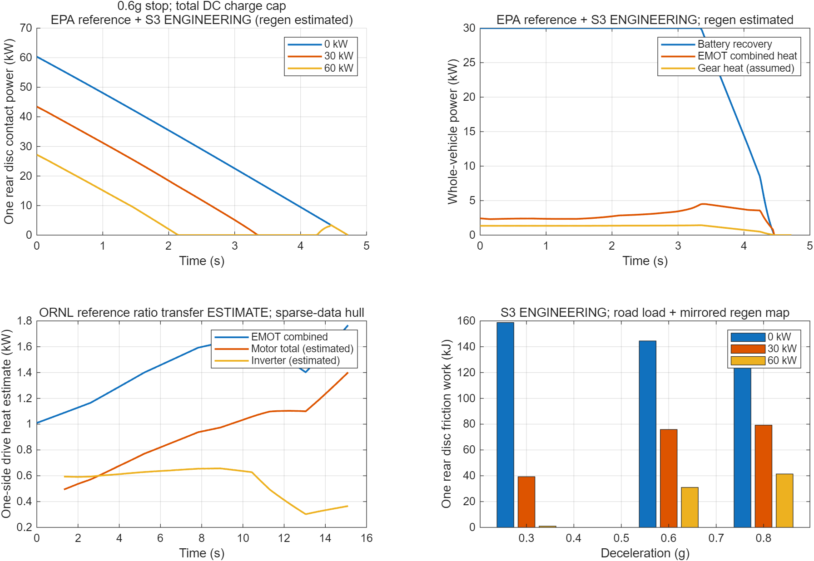
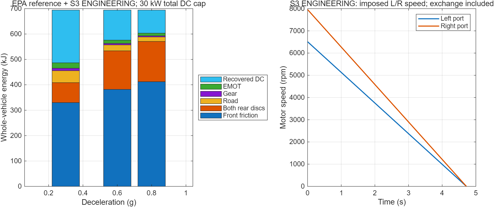
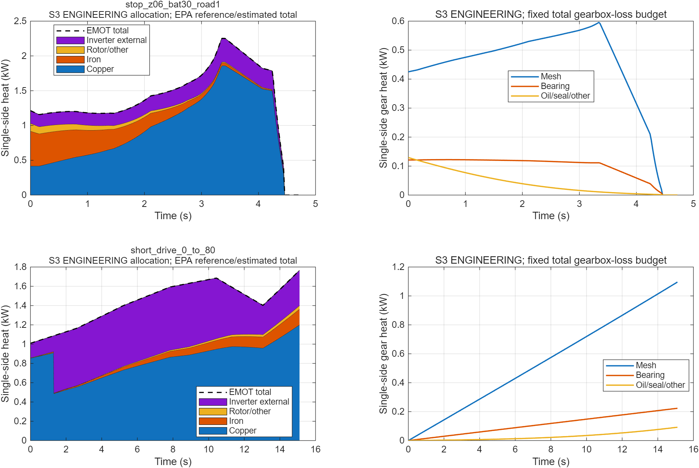
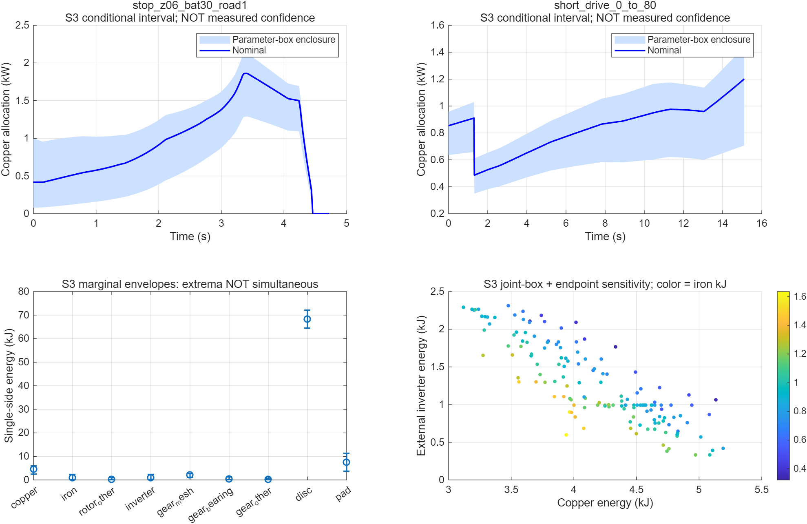
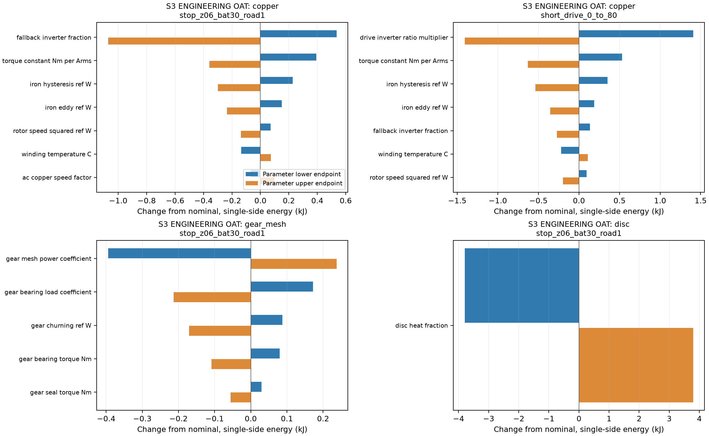

# 1. 交付结论与授权范围

本轮按用户“简单验收M0后开始M1”的授权完成M0关卡复核、PR #1合并及附注Tag归档，并从该main基线开展M1。M0正式Tag为 `M0-v1.0`，固定指向 `b13f265b1ff0add1f9e8b166d2c1bfa4ac8a8d16`；远端Tag对象为 `d50d3896b71480bc3793a82d274f862afac1f8ec`，已实际推送并核对。

M1现已实现并实际运行：整车纵向动力学、动态轴荷、前轴与两侧后轴制动力分配、独立左右轮速、电机／逆变器联合损耗图接口、方向分开的减速器损耗、盘片接触摩擦功和整车能量账本。本轮进一步完成独立工程分项接口及16参数不确定性分析：MATLAB R2025a原有18组及新增11组测试通过，23组整车轨迹、46条单侧分项接口和322次敏感性运行通过，另以Python独立读取CSV复核。

真实标定状态保持 **PARTIAL**，**概念数值热源关卡已获研究者限定验收**。数值通过不代表实际内部损耗、减速器图、盘片热分配或BMS边界已验证。原始绕组字段保持NaN，基线真实参数中的null不变；独立工程目录提供明确标记的铜/铁/转子其他/逆变器及减速器分项候选和条件上下界。没有建立温度求解、热网络、CAD、ANSYS、Fluent或优化模型，当前M1未执行M2。

M1开发分支为 `stage/M1-heat-sources`，候选版本名为 `M1-v1.0`，不是已创建的正式Tag。本轮数值代码提交为 `2b336e62485e0183f79428dd6009ec7aa32a1ab3`，MATLAB源码哈希与输入快照见 `results/m1/independent_checks.json` 及 `inputs.json`；结果证据SHA登记在 `docs/STAGE_VERSIONS.md`。继续草稿送审：[PR #2](https://github.com/alan9900/Thermal-coupling-analysis-under-drive-control-integration/pull/2)。本轮用户已批准限定验收、合并及Tag归档，并授权归档成功后启动M2；见M1_GATE_ACCEPTANCE_2026-10-19.md。

# 2. 输入、来源与模型边界

研究对象保持V0.4：1800 kg后驱概念车，后轴左右各一台参考MG2电机、一台9:1减速器和一个减速器输出端内移盘，无差速器；前轴保留摩擦制动。详细热源接口按单侧输出，整车能量同时统计前轴及左右两侧。

| 输入 | 来源或状态 | 使用方法 |
|---|---|---|
| 车型参数 | `configs/baseline_vehicle.yaml`，原M0基线 | 质量1800 kg、轴距2.765 m、有效半径0.33 m、后静载0.55、重心高0.55 m；真实参照与假设仍按M0区分 |
| 联合EMOT图 | EPA官方包，650V、0–13000rpm，14×39表 | 无外推双线性损耗插值，正负转矩包络及峰值功率限制同时生效 |
| 电机／逆变器驱动效率 | 包内ORNL稀疏工作表，137个配对驱动点 | 只在测量点凸包内估计联合热损失分配，不外推 |
| 再生效率 | EPA驱动损耗镜像估计区 | 逐点读取联合损耗，不称为MG2实测再生图 |
| 减速器效率 | 驱动0.96、反拖0.96，S3 | 两个方向分别使用；真实方向损耗图仍未知 |
| 盘片热分配 | 盘0.90、片0.10，S3演示 | 同时导出0.85–0.95盘份额的示例范围；不是测得置信区间 |
| 再生控制 | 130N·m／侧，5km/h以下禁用、5–10km/h线性恢复，S3 | 软件筛查假设，不当作硬件再生铭牌值或量产控制律 |
| 电池状态 | 整车0／30／60kW充电上限、假设SOC及温度乘数 | 约束左右合计直流回收功率，实际SOC／温度曲线仍null |
| 停用电驱损耗 | 零，显式省略项 | 未计未通电拖曳、待机和附件耗电；与已通电零转矩图上损耗区分 |

原功率模型假设在 `configs/m1_heat_sources.yaml`，新增分项参数在 `configs/m1_source_partition.yaml`，均不覆盖M0。输入快照、来源及文本SHA-256见 `results/m1/inputs.json`。曲线为参考数据与S3假设下的估算，不是本概念总成试验结果。

# 3. 动力学与单侧功率接口

令 $a$ 为带符号纵向加速度，驱动加速为正、制动减速为负，$v$ 为车体参考速度，$h$ 为重心高，$L$ 为轴距。平路动态轴荷为

$$N_r=mgf_{r0}+ma\frac{h}{L},\qquad N_f=mg-N_r.$$

故制动时 $a=-zg$，后轴比例恢复为M0的 $f_r=f_{r0}-zh/L$。坡度接口另计 $mg\sin\theta$ 的坡度力及其静态载荷转移；当前主算例仍为平路。空气阻力作用高度引起的额外俯仰未识别，负轴荷状态明确拒绝。

总轮胎纵向需求为

$$F_{\mathrm{req}}=m_{\mathrm{eq}}a+F_{\mathrm{roll}}+F_{\mathrm{air}}+mg\sin\theta.$$

当前转动惯量系数仍为1，忽略车轮、轴、齿轮及转子的额外转动动能。制动时按动态轴荷比例分配前后轴，再按设定份额分至后轴左右，各轮受自身附着上限约束。驱动仅由后轴电机提供。需求超过附着、电机或供电能力时，导出未满足的力及功率，不能仍声称轨迹可实现。主23组场景均可跟随；不满足的专门测试用于检查失败标记。

每侧减速器输出盘与自己的车轮同速，电机为自己的轮速乘9：

$$\omega_{d,j}=\omega_{w,j}=\frac{v_j}{r},\qquad \omega_{m,j}=i\omega_{w,j},\qquad j\in\{L,R\}.$$

程序不使用左右平均电机转速替代各侧速度。实际转矩同时受软件牵引限值130N·m、EPA正负限扭线、60kW峰值及数值图边界约束；207N·m硬件参照不直接替换EPA包络。

# 4. 多热源与电池功率约束

## 4.1 EMOT联合损耗及热量拆分

取 $P_{\mathrm{dc},j}>0$ 为从电池输入电驱，$P_{m,j}=T_{m,j}\omega_{m,j}$ 为电机轴向轮端输出的机械功率，则

$$Q_{\mathrm{EMOT},j}=P_{\mathrm{dc},j}-P_{m,j}\geq0.$$

模型对该非负损耗表插值，随后恢复带符号直流功率。负转矩不自动等于净充电；只有净直流回收的工作点才被本筛查控制器选用，否则回退摩擦制动。13000–13500rpm虽低于硬件最高速度声明，也不外推地图；400V、负转速或包络外工作点均明确拒绝。

在稀疏驱动效率数据覆盖范围内，以机械输出功率为基准的原电机与逆变器损耗比例为

$$\ell_m=\frac{1}{\eta_m}-1,\qquad \ell_i=\frac{1}{\eta_m}\left(\frac{1}{\eta_i}-1\right),\qquad \alpha_m=\frac{\ell_m}{\ell_m+\ell_i}.$$

对归一化转速、转矩坐标线性三角插值该比例，再将EPA联合损耗分为 $\alpha_mQ_{\mathrm{EMOT}}$ 和 $(1-\alpha_m)Q_{\mathrm{EMOT}}$。这属于“按原驱动损耗比估计的热分配”，不是新测量得到的纯电机图。它保持联合损耗总量，不把原效率图与拟合表之间差异重复加入能量账本。

原参考数据层在凸包外及再生点不拆分电机／逆变器，输出 `unallocated_emot_heat_W`；`winding_heat_W`全部为NaN，不能把EMOT热损失加到绕组。本轮独立工程拆分见第9节，不回填真实字段。

## 4.2 减速器驱动与反拖

以电机经减速器向车轮传递的带符号功率 $P_w$ 为端口，采用两个方向效率：

$$P_m=\begin{cases}P_w/\eta_d,&P_w\geq0,\\ \eta_bP_w,&P_w<0,\end{cases}\qquad Q_g=P_m-P_w\geq0.$$

因此再生时轮端力与电机负转矩满足 $F_{\mathrm{reg},j}=|T_{m,j}|i/(r\eta_b)$。测试另外使用不同的驱动／反拖效率，防止因为当前两者恰为0.96而隐藏方向错误。常数效率不能代替齿轮、轴承、密封和搅油损耗图；未传功时模型给出零齿轮热，表示未计空载拖曳和搅油，并非真实减速器无发热。

## 4.3 电池共享功率与低速退出

每侧首先求轮端需求、轮胎附着、电机负转矩包络、再生软件限扭和机械功率允许的转矩，再考虑低速衰减。随后对左右负转矩共同缩放，以损耗图计算直流回收功率，35次二分求解满足

$$0\leq-\sum_jP_{\mathrm{dc},j}\leq P_{\mathrm{bat,charge}}.$$

充电上限是整车总值。单侧失去再生时，另一侧可使用剩余电池预算，但不得超过自己的制动需求及电机限制。高SOC或温度限充示例使有效上限为零，摩擦制动承接；SOC 0.90门限及温度乘数只是显式场景假设，没有声称取得真实BMS标定。

## 4.4 制动盘片接触功与假设热分配

每侧摩擦器承担本侧后轴制动需求扣除已实现再生的余量，接触功率为

$$P_{f,j}=T_{d,j}\omega_{d,j}\geq0,\qquad Q_{d,j}=\beta P_{f,j},\qquad Q_{p,j}=(1-\beta)P_{f,j}.$$

本轮示例 $\beta=0.90$，另导出0.85–0.95份额范围。接触摩擦功、分给盘的热和实际存入盘的热是不同量。未取得几何和热边界，故不生成空间热流密度或温度场，也未计算盘到电机的辐射／导热侵入。

# 5. 整车能量守恒与左右非对称

每时刻检查带符号功率账本：

$$P_{\mathrm{dc,total}}+P_{\mathrm{unmet}}=\dot E_k+P_{\mathrm{road}}+P_{\mathrm{grade}}+P_{f,\mathrm{front}}+\sum_j(P_{f,j}+Q_{g,j}+Q_{\mathrm{EMOT},j})+P_{\mathrm{aux}}+P_{\mathrm{LR}}.$$

已实现轨迹的 $P_{\mathrm{unmet}}$ 约为数值零；不满足需求时，该诊断端口解释规定轨迹与实际力之间的差，不把未实现制动当作损耗消失。

左右轮速相同且对称时 $P_{\mathrm{LR}}=0$。强加不同左右轮速和制动力的接口测试使用

$$P_{\mathrm{LR}}=\sum_jF_{x,j}(v_j-v),$$

其中 $F_{x,j}$ 为各侧带符号轮胎力。该外部交换端口防止把不对称轮端功误算入纵向平动动能。它不是完整横摆动力学、轮胎侧偏或转向模型，不能用此测试声称车辆转弯稳定性已验证。

# 6. 实际运行结果

主矩阵为100→0km/h，0.3／0.6／0.8g，整车直流回收上限0／30／60kW，无路阻及含路阻共18组；另有单侧再生故障、高SOC、温度禁充、独立轮速接口及0→80km/h短驱动共5组。默认时间间隔不超过0.02s，低速再生在5–10km/h线性衰减。

## 6.1 含路阻的单侧后盘结果

| 减速度 | 整车充电上限 | 初始单盘转矩 | 初始单盘功率 | 单盘接触摩擦功 |
|---:|---:|---:|---:|---:|
| 0.3g | 0kW | 387.69N·m | 32.63kW | 158.73kJ |
| 0.3g | 30kW | 187.05N·m | 15.74kW | 39.30kJ |
| 0.3g | 60kW | 约0N·m | 约0kW | 0.97kJ |
| 0.6g | 0kW | 716.93N·m | 60.35kW | 144.47kJ |
| 0.6g | 30kW | 516.29N·m | 43.46kW | 75.87kJ |
| 0.6g | 60kW | 323.07N·m | 27.19kW | 30.99kJ |
| 0.8g | 0kW | 878.46N·m | 73.94kW | 132.27kJ |
| 0.8g | 30kW | 677.82N·m | 57.06kW | 79.27kJ |
| 0.8g | 60kW | 484.61N·m | 40.79kW | 41.41kJ |

例如0.6g／30kW时，假设分给单盘的热约68.28kJ，示例盘份额0.85–0.95对应64.49–72.07kJ；这不是实测盘储热。低速再生衰减后，单盘峰值转矩约737.78N·m，高于初始516.29N·m；不能按初始有再生转矩选型。

在0.3g／60kW场景，初始后轴需求可由再生承担，初始摩擦约零，但低速退出使整段摩擦功仍约0.97kJ。摩擦功率的初始值也不总是峰值。

## 6.2 无路阻回归及与M0的差异

0.6g、无路阻、零再生重新得到单盘752.839N·m、初始63.370kW及接触摩擦功149.5316kJ，与M0解析基线一致。

有再生时不应要求M1逐字复制M0固定0.90再生效率的估算。M1改为EPA负转矩联合损耗图加直流功率预算，并新增5–10km/h低速渐退。例如无路阻0.6g／30kW，单盘功由M0约79.20kJ变为M1约80.69kJ；60kW档由约30.93kJ变为约35.03kJ。这反映模型及控制假设变化，未证明真实电机优于或劣于M0假定效率。

## 6.3 故障与短驱动

| 场景 | 单侧／整车关键结果 | 解释 |
|---|---|---|
| 左侧再生不可用，0.6g／30kW | 左盘144.47kJ，右盘30.99kJ，电池回收100.50kJ | 左盘回退全摩擦，右侧使用共享预算；前轴仍计入 |
| 高SOC或温度禁充，0.6g | 两侧各144.47kJ，电池回收0 | 有效充电上限为零，不能强制保持原再生比例 |
| 强加不同左右轮速与分配 | 左盘52.26kJ，右盘104.90kJ，交换端口−5.78kJ | 仅功率接口测试，不能省略带符号交换项 |
| 0→80km/h，0.15g，15.10s | 电池净输出559.70kJ，动能增量444.44kJ | 另含路阻51.31kJ、齿轮20.66kJ、EMOT43.28kJ |

短驱动示例中约91.28%的驱动采样落在稀疏ORNL损耗比例可插值范围内，其余点的联合热量保持未拆分。15.10秒小于原报告18秒参考峰值测试时间，并不证明本新总成的连续或短时温度能力。

{width=16cm}

{width=16cm}

# 7. 原功率层测试与真实性

| 检查 | 实际结果与阈值 |
|---|---|
| MATLAB | R2025a，25.1.0.2943329，实际执行18组测试、23组轨迹 |
| 解析回归 | 零再生100→0单盘功、前轴及两侧总能量与独立解析值一致 |
| 方向及单侧标定 | 盘轮1:1、电机9:1；驱动与反拖分别核查；30kW按整车合计DC侧限制 |
| 工况可行性 | 主23组可实现；额外测试验证附着／放电能力不足时必须报告需求未实现 |
| 边界与严格模式 | 拒绝转速／转矩／电压外推、负车速；拒绝把镜像再生当实测；严格真实热源模式因缺资料明确拒绝 |
| 热源未知值 | 全部轨迹绕组源均为NaN；稀疏凸包外和再生模式不伪造部件损耗分配 |
| 功率及积分 | 点功率容差0.001W、实际最大约9.09e-11W；相对能量阈值1e-6、MATLAB最大约7.20e-16 |
| 步长细化 | 0.02→0.01s，名义单盘摩擦功相对变化约3.71e-5，即0.00371%，低于0.1%预设阈值 |
| Python独立复核 | 读取23份CSV，另行积分端口能量，最大相对残差约6.81e-15，并检查力、转速、功率约束及热量分配总和 |
| ALPHA／REVS原对象 | NOT EXECUTED；使用已经审计的数字表，不依赖未提供的专有类 |
| 实体实验、M2、ANSYS、Fluent、优化 | NOT EXECUTED；不在本轮范围 |

初次运行出现了MATLAB对行向量查询的网格格式性能提示，已改为列向量查询后恢复原形状，并重新运行测试与工况。它未改变地图或物理模型；最终日志以重新运行结果为准。

复现命令见 `scripts/m1/README.md`。主要证据：`case_summary.csv`、`traces/*.csv`、`m1_results.mat`、`tests.json`、`validation.json`、`source_readiness.json`、`independent_checks.json`和MATLAB运行日志。所有结果为参考地图及工程假设的数值计算，不是温度实验验证。

# 8. 未完成的真实输入与M1送审状态

以下缺口使M1保持PARTIAL，而不能作为已验证部件热场的完整输入：

1. 电机铜／铁／转子／机械损耗及温度依赖、真实再生下电机与逆变器损耗拆分；目前没有绕组发热图。
2. 实际电压、电池SOC／温度充电曲线、再生和牵引电流限制、原电机连续功率及控制器标定。
3. 两级减速器结构、方向损耗图、轴承／密封／搅油分项及油温依赖。
4. 实际盘片热分配、摩擦温变、几何、质量、材料与允许温度，及内移安装强度和支承。
5. 冷却流路、流量、入口温度、接触热阻、热物性和热预载；这些属于未来热模型的输入准备，未在本轮补造。

此前已完成可运行的M1功率／热源框架。上述缺口仍限制真实部件温度验证，但用户本轮允许使用可追溯的工程替代方案；后文给出参数化模型与概念数值关卡。PR只申请审查，不自行合并、打Tag或启动M2。

# 参考与文件定位

1. 原始数据及SHA：`data/raw/m0/manifest.json`，EPA包内3a生成说明、3c独立驱动效率表和7号`.m`数字定义。
2. [US EPA 官方eMotor地图目录](https://www.epa.gov/vehicle-and-fuel-emissions-testing/combining-data-complete-emotor-alpha-maps)；MG2包版本2023-04-06。
3. [ORNL/TM-2010/253，2011-03](https://info.ornl.gov/sites/publications/files/Pub26762.pdf)，原M0已保存并审计；不把原冷却及18秒能力直接移植为本车连续能力。
4. `docs/REAR_DRIVE_V04_SOURCED_BASELINE.md`、`docs/CODEX_EXECUTION.md`及`docs/GIT_VERSIONING_POLICY.md`。

# 9. 公开资料补充与参数化模型

完整资料审查见 `docs/M1_SOURCE_REVIEW.md`；下载记录、UTC时间及哈希见 `data/raw/m1/manifest.json`。本轮复用M0 ORNL原件，新增NBS铜线手册、Corley等2019齿轮箱公开论文与CrossRef DOI核对。SKF、MathWorks及Infineon官方方法页经在线核查；Infineon页面Python下载被HTTP拒绝，浏览工具可读，未伪造本地原文。本轮是针对缺口的方法检索，未穷尽所有文献，未声称其他标定绝不可能获得。

| 可追溯资料 | 实际支持内容 | 适用限制 |
|---|---|---|
| ORNL Pub26762，表2.7，印刷46页/PDF55页 | 每相0.077Ω@21°C，定义为平均相间电阻/2；已目视核对2010Prius列 | S1真实标量，但没有对应电流轨迹 |
| ORNL印刷58、62–63页及EPA工作簿 | 同一转矩有多种d/q电流；650V/5kHz测试、效率分离 | EPA两张效率表未提供电流或内部损耗测量列；不能唯一辨识铜/铁/转子损耗 |
| NBS Handbook100 | 铜的温变关系，20°C系数0.00393/K | 通用铜，不是MG2实际运行温度、AC电阻或材料认证 |
| MathWorks PMSM方法页、Infineon IGBT方法页 | 铜/铁损与电流/频率关系；导通及开关损耗计算所需输入 | 未运行高版本Simscape块；没有移植其他器件的数值 |
| Corley等2019，DOI10.1049/joe.2018.9282；SKF摩擦方法 | 齿面、轴承、搅油与密封分项，功率比例及摩擦转矩功率 | 不移植风机减速器几何/系数；不是完整ISO/TR14179实现 |
| MathWorks盘片示例 | 热逸散率分配形式 | 不将示例材料当成本项目实际盘片材料 |

## 9.1 电机：固定联合预算内的物理形状分配

令$x=n/6000$、$y=|\tau|/100$，转速单位rpm，转矩单位Nm。独立配置 `configs/m1_source_partition.yaml` 的相电流RMS代理为

$$I_* = \frac{|\tau|}{k_T}\sqrt{1+c_{fw}\left[\max\left(\frac{n}{4500}-1,0\right)\right]^2}.$$

$k_T$为S3等效系数，不是IPMSM在全工况的真实常数；4500rpm是S3弱磁形状起点。将21°C实测电阻与20°C通用铜温度系数统一：

$$R(T_*)=0.077\frac{1+0.00393(T_*-20)}{1+0.00393(21-20)}.$$

$T_*$为给定参数，未求解温度反馈。铜、定子铁心与转子/其他合并项采用非负权重

$$w_{Cu}=3R(T_*)I_*^2(1+c_{ac}x^2),$$

$$w_{Fe}=k_hx+k_ex^2,\qquad w_{Ro}=k_rx^2+k_sy^2.$$

铁损一/二次项借鉴固定极对数、假定磁密下的频率依赖；缺磁链与谐波数据，未计算真实局部铁损。转子/其他项还含杂散与未分离机械损耗，不能称为磁钢独立涡流热源。

驱动凸包内保留ORNL分离比向EPA总损耗传递的方法，并对逆变器比乘数扫描；凸包外及再生采用显式S3回退比例。逆变器热量为$Q_i=f_iQ_{EMOT}$，剩余电机预算为

$$Q_j=(1-f_i)Q_{EMOT}\frac{w_j}{w_{Cu}+w_{Fe}+w_{Ro}},\qquad j\in\{Cu,Fe,Ro\}.$$

由此$Q_{Cu}+Q_{Fe}+Q_{Ro}+Q_i=Q_{EMOT}$，没有在联合图之上追加一份损耗。原始$3RI_*^2$只是权重，归一化后铜热量不再是经真实电流验证的绝对铜耗。接口保留原始权重、代理电流及归一化因子。零预算时全部候选热量为零、归一化因子为NaN。

## 9.2 减速器及盘片

保留原方向效率损耗$Q_g$。以电机轴角速度$\omega_m$及轮端传动功率$P_w$建立

$$w_{mesh}=a_m|P_w|,\qquad w_b=\tau_b\omega_m+a_b|P_w|,$$

$$w_o=k_ox^3+\tau_s\omega_m,\qquad Q_{g,j}=Q_g\frac{w_j}{\sum_kw_k}.$$

载荷比例及摩擦转矩功率有公开方法支持；速度三次是固定阻力系数近似下的探索性形状，**不是复现Corley文中的搅油关联式**。系数全部S3，折算到电机轴。原模型零传功时$Q_g=0$，仍遗漏真实空载搅油/拖曳，不能把权重再当额外热量叠加。

盘片沿用$Q_d=\beta P_f$、$Q_p=(1-\beta)P_f$。热逸散率$e=\sqrt{k\rho c_p}$、$\beta=e_d/(e_d+e_p)$支持分配方法，但材料、运动接触与热阻未知，$\beta=0.90$和0.85–0.95扫描仍是S3。

# 10. 不确定性与实际敏感性结果

16项参数均以“下界/候选/上界”保存；**所有区间数值均为S3探索性选择，不是文献给出的MG2标定区间或概率分布**。例如转矩常数代理0.50/0.70/0.90Nm/Arms、温度40/100/140°C、回退逆变器比0.05/0.15/0.35、盘比0.85/0.90/0.95。完整值、量纲和选择依据见配置及资料审查。真实资料支持规律或电阻标量，不会使整体预测自动升级为S1。

## 10.1 条件上下界

正权重单调分式构造逐时包络，例如

$$Q_{Cu,lo}=Q_{EMOT}(1-f_{i,hi})\frac{w_{Cu,lo}}{w_{Cu,lo}+w_{Fe,hi}+w_{Ro,hi}},$$

$$Q_{Cu,hi}=Q_{EMOT}(1-f_{i,lo})\frac{w_{Cu,hi}}{w_{Cu,hi}+w_{Fe,lo}+w_{Ro,lo}}.$$

其余分项同理，零预算显式处理。这是**给定参数盒、联合与传动总损耗固定的条件包络**，不是统计置信区间。各分项极值通常对应不同参数组合，不能把全部上界拼成守恒时序；未来温度敏感性应使用同一组参数重算所有分项。本次未覆盖联合地图总损耗和0.96效率自身的真实误差。

## 10.2 名义分配与区间（单侧，kJ）

代表制动为100→0km/h、0.6g、含路阻、整车30kW限充；短驱动为0→80km/h、0.15g。括号为各分项独立包络积分，不是同时可达的总上/下界。

| 分项 | 制动名义（下–上） | 短驱动名义（下–上） |
|---|---|---|
| 铜耗候选 | 4.549（2.518–6.035） | 12.693（8.470–15.291） |
| 定子铁损候选 | 0.885（0.131–2.316） | 0.943（0.140–3.652） |
| 转子/其他合并候选 | 0.183（0.017–0.982） | 0.204（0.023–1.266） |
| 独立逆变器 | 0.991（0.330–2.313） | 7.802（6.146–9.596） |
| 齿面 | 2.079（1.164–2.600） | 8.212（4.887–9.877） |
| 轴承 | 0.468（0.098–1.274） | 1.687（0.360–4.600） |
| 油液/密封等 | 0.196（0.026–0.782） | 0.430（0.054–2.090） |
| 盘 | 68.282（64.488–72.075） | 0 |
| 片 | 7.587（3.793–11.380） | 0 |

名义电机预算归一化因子在46条时序的非零预算样本中为0.264–5.333，约0.147%样本超出预设0.25–4诊断范围。此范围只作提示，不是物理验收标准；偏差说明权重未标定，应将模型称为守恒工程分配，不能用闭合证明绝对损耗分离准确。

## 10.3 单因素与联合参数分析

每个代表工况含名义1组、16参数×2端点、固定种子20261019的联合参数盒样本128组，共161组；两工况合计322次实际运行，均通过逐时闭合与区间检查。抽样只是确定性覆盖策略，不赋予概率解释，也不声称采样覆盖全部极值。

制动铜耗分配最敏感于回退逆变器比，相对名义变化约+0.535/−1.070kJ；其次是转矩常数代理（+0.393/−0.360kJ）。短驱动以驱动逆变器比倍率最敏感（约±1.407kJ），其次为转矩常数代理（+0.530/−0.629kJ）。这支持优先补测再生损耗分离与真实电流，不是实验识别真实电机敏感度。

盘比0.85到0.95使代表制动盘输入变化7.587kJ，总盘片接触功75.868kJ不变。所有参数变化只重分配现有预算，未改变总传动效率。

# 11. 未来M2输入合同与模式

规范为 `docs/M1_HEAT_SOURCE_INTERFACE.md`，版本 `m1-source-interface-1.0`。每个工况输出左右独立CSV+JSON，共46对，位于 `results/m1/engineering/interface/`。CSV含时间、车速、自侧转速/转矩、9类候选热功率及上下界、原始绕组NaN、归一化诊断、来源代码与守恒残差。JSON记录模式/案例/单侧/场景、实际参数、原始轨迹、来源登记、输入哈希和代码SHA。

严格模式立即抛出 `m1:StrictEvidenceGap`，没有真实内部数据时不会输出工程值。工程模式要求全部参数区间完整有序；缺失/null、错误侧别、越界及不可实现轨迹均拒绝。原始真实数据不被估计覆盖。

未来网络只加载分项：联合EMOT、减速器总损耗和盘片接触功仅作核算，**不能再加载一次**。逆变器默认为外部热边界；转子/其他需合并节点或进一步拆分，不默认全部加磁钢。盘/片是单个后盘两面合计，不再乘2。前轴保留于整车账本，不进入该单侧热域。

重采样应采用分段线性功率并核对积分，不用可能产生负热源的无约束高阶插值。凸包拆分/回退切换可产生工程分配跳变，不是实测热源突变。温度反馈未执行；不能改变温度电阻后保留旧总预算却另加一份铜耗。

# 12. 本轮测试与验收判断

MATLAB R2025a（25.1.0.2943329）重新运行原有18组测试和23组整车工况，通过；新增11组检查通过。覆盖46条单侧瞬时/积分闭合、严格拒绝、真实NaN保持、独立3RI²及归一化、减速器方向分项、盘比精确斜率、低速退出、高SOC/温度禁充、单侧故障/独立轮速及缺失/null/无序/越界参数和时间轴报错。322次敏感性时序全部通过。

| 实际核验 | 结果 |
|---|---|
| 原整车积分/功率残差 | 相对能量最大7.20×10⁻¹⁶；功率最大9.09×10⁻¹¹W |
| MATLAB新增分项残差 | 最大7.28×10⁻¹²W，阈值10⁻⁷W |
| Python独立分项CSV复核 | 46条PASS；最大功率残差1.02×10⁻¹⁰W、积分残差2.01×10⁻¹¹J |
| Python敏感性复核 | 322次PASS，参数在范围内，三组预算积分不变 |
| 严格模式/参数缺失 | 按预期报错，未伪造标定输出 |
| 原始绕组与M0 | NaN/null保持，受保护配置/数据/结果/报告对固定Tag无改动 |
| 温度、实体实验、ANSYS、Fluent、优化 | NOT EXECUTED |

复现命令见 `scripts/m1/README.md`。接口、能量汇总、完整参数矩阵、敏感性结果、MAT文件、PNG/SVG、实际日志及独立检查均保存。验收表为 `reports/M1_ACCEPTANCE_CHECKLIST.md`。

**概念数值热源模型已具备提交验收的条件**：模型守恒、无重复计热、单侧接口明确、严格与工程路径分离、参数与不确定性可追溯，实际运行证据齐备。真实标定仍为PARTIAL，不能宣称物理验证完成。研究者已按概念数值模型范围验收，授权详见本轮关卡记录。

**M2可在用户批准后开展概念瞬态热网络**，前提是参数化未知热容、热阻、冷却与合并项节点，并在守恒场景下比较敏感性；还需考察总损耗、方向效率和遗漏空载拖曳的影响。不能据此承诺真实温度精度、热安全或连续能力。M1计算未包含M2；研究者已授权归档成功后启动M2，实际合并及Tag目标另行登记。

# 13. 补充引用

1. ORNL. *Evaluation of the 2010 Toyota Prius Hybrid Synergy Drive System*. 2011-03。[原始PDF](https://info.ornl.gov/sites/publications/files/Pub26762.pdf)，本地只读复用M0原件。
2. NBS. *Copper wire tables*. Handbook100。[官方PDF](https://nvlpubs.nist.gov/nistpubs/Legacy/hb/nbshandbook100.pdf)。
3. Corley B., Carroll J., McDonald A. *Thermal modelling of a small wind turbine gearbox for condition monitoring*. The Journal of Engineering, 2019(18):5335–5339。[DOI](https://doi.org/10.1049/joe.2018.9282)，CC BY3.0，本地保存机构原文及CrossRef元数据；仅借鉴损耗方法。
4. SKF. [Using a friction model as an engineering tool](https://evolution.skf.com/using-a-friction-model-as-an-engineering-tool-3/). 2006-06-08。
5. MathWorks. [PMSM方法](https://www.mathworks.com/help/simscape-electrical/ref/femparameterizedpmsm.html)及[盘片示例](https://www.mathworks.com/help/pde/ug/thermal-and-structural-analysis-of-disc-brake.html)。
6. Infineon. [IGBT损耗方法](https://community.infineon.com/t5/Knowledge-Base-Articles/Calculate-IGBT-losses-for-a-SPWM-voltage-source-converter/ta-p/381757)，下载限制已登记。
