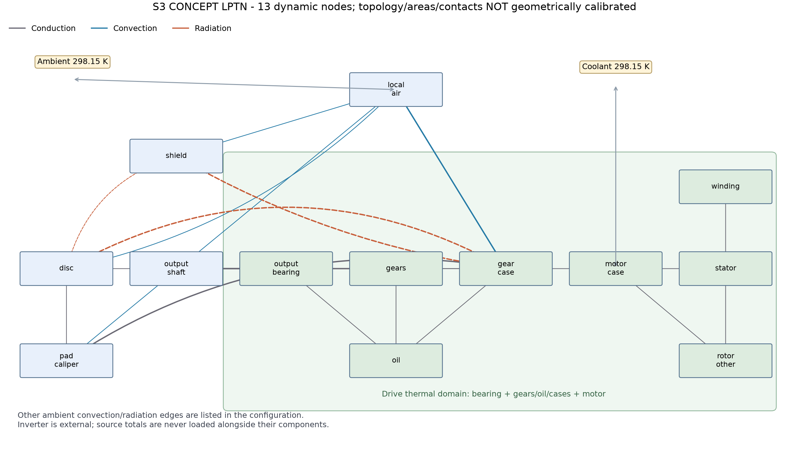
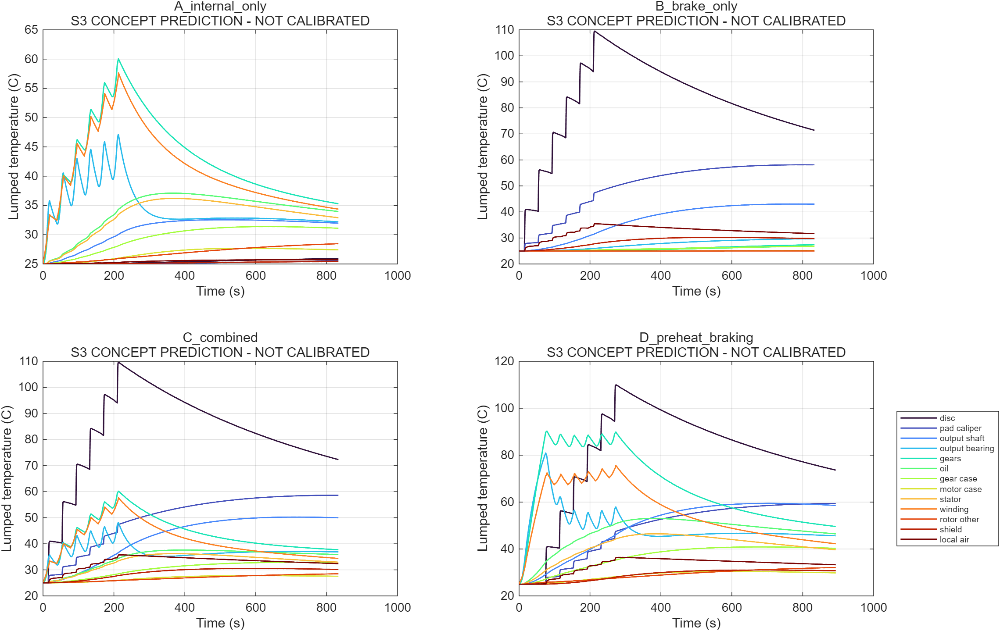
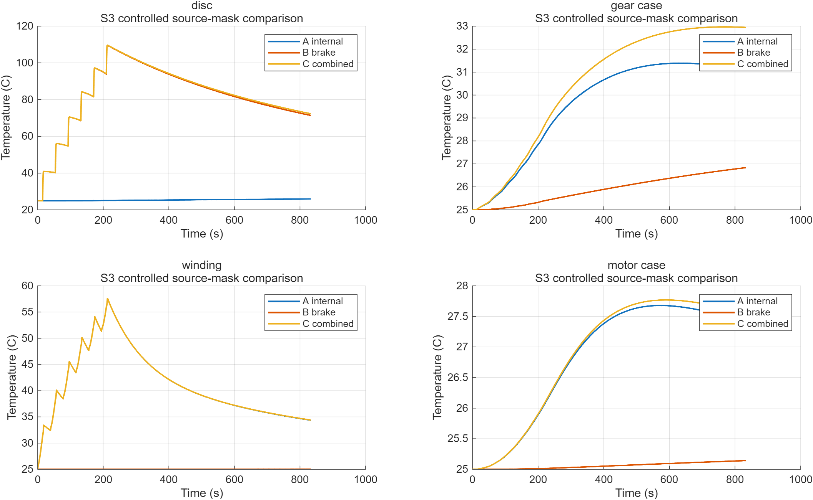
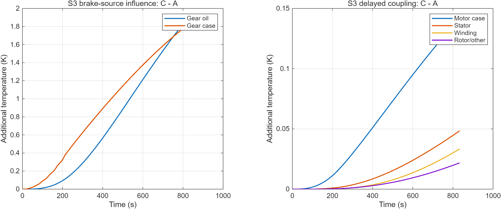
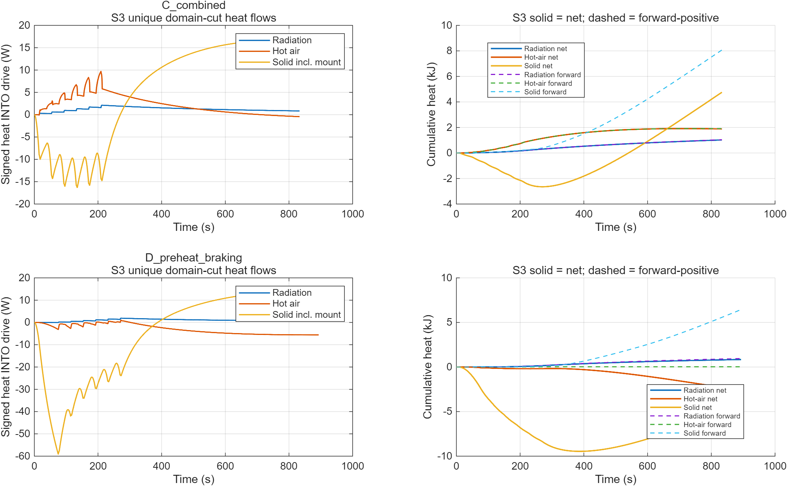
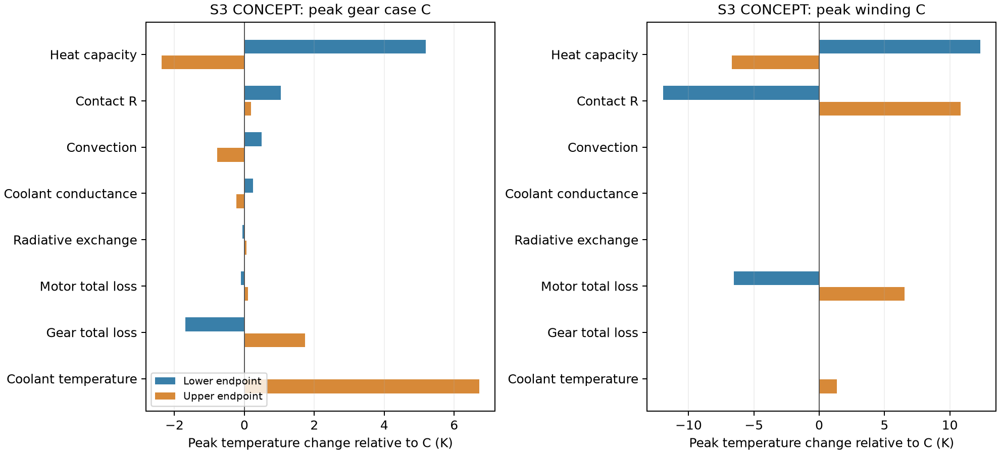

# 1. 阶段结论、基线与授权

M1已按研究者指定的“具有明确来源、参数化假设和不确定性分析的概念数值热源模型”范围验收，真实损耗标定仍为PARTIAL。PR #2已合并；附注Tag `M1-v1.0` 的远端对象为 `9b3c7f97c63b56b50eb7c0477a72ad03060cae39`，剥离目标为实际main合并提交 `9d545ab39a3efcce857573af74f7e325b74a2b15`，已实际推送和核验。`M0-v1.0`仍指向 `b13f265b1ff0add1f9e8b166d2c1bfa4ac8a8d16`，未修改或覆盖。

M2分支 `stage/M2-thermal-network` 从上述最新main创建，数值计算代码提交为 `ff818ccb35daf8d70d0cbafbf28fc6690ab457a8`，后续图稿布局修改与结果SHA在独立检查及阶段登记中记录。当前[草稿PR #3](https://github.com/alan9900/Thermal-coupling-analysis-under-drive-control-integration/pull/3)待研究者验收，未合并、未创建M2-v1.0、未进入M3。

已实际完成MATLAB R2025a的13节点单侧LPTN，4基础场景、3路径移除及18敏感性场景；11组数值测试通过。全网络与电驱子域分别核算输入、储热、环境及冷却净带走热量；Python独立检查及自适应SciPy积分比较通过。**所有温度均为S3概念预测，不是样机标定结果，不证明连续功率、温度限值或法规符合性。**

候选参数下，C共同热源场景盘/减速器壳/绕组峰值约109.63/32.96/57.61°C，D预热后循环约110.01/40.89/75.63°C。制动热对壳体和轴承的影响明显大于对绕组的短期影响；传热存在方向反转与延迟，不能只看瞬时峰值或把正向热侵入与净热量混为一谈。

# 2. 对象、节点与来源边界

保持V0.4：1800kg后驱概念车，后轴左右独立电机，每侧60kW参考峰值及9:1减速器，输出端内移盘，无差速器。只算左侧详细热网络；M1整车账本仍包含前轴与双后侧，不能用本单侧热量直接与整车初始动能相比。

网络包含12个部件等效节点及1个局部热空气控制体；环境和冷却液为固定温度热库。片/钳合并避免在缺乏接触与结构资料时虚构独立精度；输出轴、轴承、齿轮、油、两壳体、定子、绕组、转子其他及护罩保留各自热容。合并节点只给平均等效温度，不给片面热点、制动液或磁钢热点。

| 节点 | 候选质量kg | cp J/(kg·K) | C J/K及主要依据 |
|---|---:|---:|---|
| 制动盘 | 4.50 | 500 | 2250，S3铸铁类候选 |
| 摩擦片/卡钳 | 2.00 | 700 | 1400，S3复合等效 |
| 输出轴 | 1.20 | 460 | 552，S3钢类候选 |
| 输出轴轴承 | 0.35 | 460 | 161，S3合计等效 |
| 两级齿轮 | 2.50 | 460 | 1150，S3合计 |
| 油/齿轮箱其他 | 0.80 | 2000 | 1600，S3等效，并非均匀实测油池 |
| 减速器壳体 | 4.00 | 900 | 3600，S3铝类候选 |
| 电机壳体 | 5.00 | 900 | 4500，S3铝类候选 |
| 定子铁心 | 10.36 | 460 | 4765.6，ORNL质量参照×S3等效cp |
| 绕组 | 4.93 | 385 | 1898.05，ORNL铜质量×通用铜cp参照 |
| 转子/其他 | 6.70 | 460 | 3082，ORNL转子含电机轴的质量参照 |
| 隔热罩 | 0.40 | 500 | 200，S3无CAD候选 |
| 局部热空气 | 0.05 | 1005 | 50.25，S3通风混合控制体 |

完整ρ、k、ε与来源表为 `results/m2/parameter_source_table.csv`；原未知参数独立保留null，不写回M0/M1配置。ρ、k是材料准备候选，**没有用它们反推出已验证几何或接触R**。参考电机转子质量已含其电机轴；本网络输出轴是减速器输出轴，未重复计算同一根轴。

## 2.1 公开资料核对

ORNL表2.7支持上述三项质量参照。NIST固相Shomate式在298.15K给纯铜/铝/铁cp约385.08/897.14/449.41 J/(kg·K)，仅支持量级；浸漆绕组、叠片和复合转子仍需等效。Hydro6082线索、Fluke表面/波段发射率、COMSOL换热方法、Xiao与Griffo2020电机LPTN辨识及Corley2019齿轮箱网络用于方法审查。

Hydro直接PDF、NASA初始路线和Wiley直接下载失败；NIST及COMSOL HTTP可用，Xiao论文与Fluke官方页可通过浏览读取。失败与哈希保留，不伪造本地原文。Fluke的谱发射率不直接当本模型总半球灰体值。详见 `docs/M2_SOURCE_REVIEW.md`、`data/raw/m2/manifest.json`及 `material_reference_values.json`。未做穷尽文献综述。

# 3. 瞬态热平衡与传热模型

各节点的常数热容$C_i=m_ic_{p,i}>0$，全部内部温度采用K：

$$C_i\frac{dT_i}{dt}=Q_i+\sum_j Q_{j\to i}-Q_{amb,i}-Q_{cool,i}.$$

每条内部边只计算一遍，有符号热流在两端等量反号。正方向由配置的from→to给出，真实流向可反转。

## 3.1 固体传导与接触

$$q_{a\to b}=\frac{T_a-T_b}{R_{ab}}.$$

15条等效R包含盘—片、盘—轴、轴—轴承/齿轮、轴承/齿轮/油—壳体、壳体法兰、定子/绕组/转子等。候选R为0.08–8K/W，全部S3。其中9组涉及接触/安装的等效R统一扫描0.3–3倍；它们仍包含部分几何与材料效应，不称为独立识别的真实接触热阻。钳支架→壳体的导热旁路显式保留，不能默认为只有轴承一条固体路径。

## 3.2 局部热空气及外部对流

$$q_{a\to b}=h(v)A(T_a-T_b),\qquad h(v)=h_0+h_v\sqrt v.$$

$v$单位m/s。盘、片和护罩与局部空气交换，局部空气再与减速器壳体交换，并通过等效通风导热能力连到环境。局部空气有有限热容，不能把“盘产生的所有对流散热”立即当成“壳体吸热”。外露壳体另有环境散热边界。

$h_0,h_v,A$全部S3；此形式不是已验证内移盘关联式。空气—环境的虚拟面积1m²仅用于表示总通风G，不是已设计通风口。未做CFD，不能用车速替代真实底盘气流标定。

## 3.3 辐射与护罩

采用能量对称的两灰体有效交换近似：

$$q_{a\to b}=\sigma A_{eff}F_{ab}\epsilon_{eff}(T_a^4-T_b^4),$$

$$\epsilon_{eff}=\left(\frac{1}{\epsilon_a}+\frac{1}{\epsilon_b}-1\right)^{-1},\qquad \sigma=5.670374419\times10^{-8}\ \mathrm{W/(m^2 K^4)}.$$

包括盘→减速器壳直接交换、盘→护罩和护罩→壳体。盘ε0.8、壳体0.7、护罩0.2，以及有效面积/视角因子是S3，不是CAD视角因子求解；没有声称完整封闭辐射网络或表面互易关系已几何验证。各边热量严格反对称，满足计算能量守恒。环境辐射另作边界；盘温低于电驱温度时允许反向辐射。

## 3.4 液冷边界

$$Q_{cool}=G_{cool}(T_{motor\ case}-T_{coolant}).$$

基准$G_{cool}=25$W/K、环境与入口冷却液均298.15K，以隔离源项耦合。这里没有实测流量或泵模型，液冷只作用于电机壳体。冷却液温度扫描到333.15K时，可出现$Q_{cool}<0$，表示热库向总成加热，不能截成零或当作损耗源。

# 4. M1输入接口、工况与数值方法

原M1读取路径与原始NaN/null保持不变；M2只在自己的目录保存新时序。绕组铜耗、定子铁耗、转子/其他分别加载相应节点；齿面、轴承、其他齿轮箱损耗分别加载齿轮、轴承、油等效节点；盘片热量分别加载盘和片/钳节点。**逆变器独立排除，联合总损耗和各分项不重复加载，转子/其他不全当作永磁体发热。**

## 4.1 四类基础工况

相同基础运动序列为六次“0→80km/h、0.15g驱动；80→0、0.6g制动；停歇20s”，之后冷却600s。整车直流限充30kW仍按M1两台合计，单侧热源不乘2。总时长833.263s。停歇显式停用电驱，未计拖曳及空载热。

| 场景 | 加载热源 | 解释 |
|---|---|---|
| A | 仅电机与减速器内部损耗 | 同运动序列的受控热源消融 |
| B | 仅盘片摩擦热 | 同序列另一消融，不是现实中零驱动损耗的整车循环 |
| C | 全部上述热源 | 参考时序的共同热作用 |
| D | 预热后共同热源循环 | 第一次驱动后插入60s、80km/h、0.18rad坡道预热，总893.263s |

D的单侧轴端机械功率约41.18kW，M1瞬时转矩/速度/功率包络通过；**60s持续能力未验证**，它是工程热应力场景，不能用60kW参考峰值或18s测试去证明该连续工况真实可用。

## 4.2 保守源项重采样及积分

每个M1原分段以线性功率的解析原函数重采样，目标区间加载精确平均功率：

$$\overline Q_k=\frac{1}{t_{k+1}-t_k}\int_{t_k}^{t_{k+1}}Q_{M1}(t)\,dt.$$

不同物理分段不跨界插值。名义最大步长0.25s，温度与边界/路径累计热量使用同一显式RK4求积。输入热量重采样残差约$1.16\times10^{-10}$J。瞬时CSV热流为右侧状态诊断值，不能用其粗步长梯形积分替代原RK4累计账本后要求同样舍入残差。

# 5. 温度结果与多热源影响

| 场景 | 盘峰值°C | 减速器壳峰值°C | 油等效峰值°C | 绕组峰值°C |
|---|---:|---:|---:|---:|
| A 内部损耗 | 25.93 | 31.38 | 37.10 | 57.61 |
| B 摩擦热 | 109.52 | 26.84 | 26.92 | 25.03 |
| C 共同热源 | 109.63 | 32.96 | 37.61 | 57.61 |
| D 预热后循环 | 110.01 | 40.89 | 53.01 | 75.63 |

A没有摩擦热，盘仍可被较热的电驱/轴系加热约0.93K，体现传热可逆。D较高的电机温度主要与牵引预热有关，不能全部归因于制动盘热侵入。

在相同基础时间轴上，定义摩擦热额外影响$\Delta T_i(t)=T_{C,i}(t)-T_{A,i}(t)$。其最大值：减速器壳约1.835K、油1.920K、输出轴轴承4.720K、电机壳0.142K、定子0.048K、绕组0.0333K、转子/其他0.0218K。**绕组峰值之差仅约0.000274K，而最大逐时温差为0.0333K**，两者不能混用；延迟侵入更多出现在源项停止后的冷却阶段。

这表明在当前候选热阻、热容与冷却下，制动热先影响轴/轴承和减速器，传到绕组较弱且滞后。它不证明其他实际布置也可忽略制动热，尤其接触、空气路径和冷却尚未标定。

# 6. 三条路径：瞬时、正向累计与净热量

为避免重复计数，电驱**计账子域**选为输出轴轴承、齿轮/油/壳体和电机节点，输出轴本身在该子域外单列储热；这是一种积分边界选择，不是机械零件归属。跨域边只有：辐射2条、局部空气→壳体1条、固体3条（轴→轴承、轴→齿轮、片/钳支架→壳体）。盘→轴与轴承→壳体仍逐边输出，但不再重复加进热侵入总量。

每条跨域边正向定义为指入该子域：

$$q_p(t)=\sum_{e\in p}q_e(t),\qquad E_{p,net}=\sum_{e\in p}\int q_e(t)\,dt,$$

$$E_{p,+}=\sum_{e\in p}\int\max(q_e(t),0)\,dt.$$

正向累计是每条跨界边的穿越累计量，不是唯一一次制动热粒子的追踪；不能把相反方向同时流动先相消后再算正部。净量则保留全部反向热流。路径通量本身没有热源起源标签；制动源的额外影响用A/B/C对比判断。

| 场景与路径 | 净入热kJ | 正向累计kJ | 解释 |
|---|---:|---:|---|
| C 辐射 | 1.021 | 1.040 | 有少量反向交换 |
| C 热空气 | 1.883 | 1.912 | 随车速/冷却阶段改变方向 |
| C 固体（含支架旁路） | 4.757 | 8.072 | 早期电驱向外散热，后期盘轴向内传热 |
| D 辐射 | 0.841 | 0.946 | 预热阶段也有反向交换 |
| D 热空气 | −2.622 | 0.027 | 全程净向外，不等于从未发生正向侵入 |
| D 固体（含支架旁路） | −4.160 | 6.442 | 预热后的反向散热大于后来正向侵入 |

C中固体路径正向累计最大，但这些不是可直接相加的温升贡献率。三个C路径移除工况已分别求解；移除路径同时改变原有散热与储热。某些节点峰值反而上升，例如关掉固体跨界路径会使绕组峰值略升，不能将其解释成“固体导热不会带来热侵入”。

# 7. 总能量验证、数值测试与独立复核

全网络检查

$$E_{in}-E_{amb,net}-E_{cool,net}=\sum_i C_i[T_i(t)-T_i(0)].$$

子域另检查

$$E_{drive,source}+\sum_pE_{p,net}-E_{drive,boundary}=\sum_{i\in drive}C_i[T_i(t)-T_i(0)].$$

所有内部边对全网络严格抵消。C的单侧实际加载热427.148kJ、环境净带走78.683kJ、冷却净带走39.329kJ、期末储热309.136kJ，闭合；833s结束时仍有明显储热，不把600s冷却误称完全冷却。逆变器约51.751kJ不在该热域内，没有误计入绕组或上述热量。

11组MATLAB测试覆盖被动拓扑/唯一截面、辐射绝对K及正反方向、独立单热容指数冷却、封闭非均温网络守恒、无源趋近等温热库、热冷却液倒流、M1接口与重采样、源项消融、正向/净量区分、步长收敛及参数缺失/严格模式报错。

| 检查 | 实际结果 |
|---|---|
| 软件 | MATLAB25.1.0.2943329/R2025a，实际运行 |
| 主计算 | 4主场景+3路径干预+18敏感性，全部通过内部能量断言 |
| 全网络能量 | 7主/干预场景最大相对残差5.28×10⁻¹⁴ |
| 电驱子域能量 | 最大绝对残差约1.50×10⁻⁸J |
| C步长0.5/0.25/0.125s | 粗/细峰值最大差0.03864K；名义/细0.001203K，限0.05K |
| D名义/细 | 峰值最大差约0.0016K，小于0.05K |
| 无源、初温高30K | 24,000s后最大残余温差0.000657K，小于0.1K |
| Python独立检查 | 7场景源项、储热、环境/冷却及跨域账本通过；最大相对残差1.45×10⁻¹³ |
| 自适应SciPy RK45复核C | 相同区间平均源项，温度最大差0.002916K，小于事先0.01K判据 |
| 实体实验、M3/CAD、ANSYS、Fluent | NOT EXECUTED |

初次无源测试观察窗12,000s结束时仍约0.17K，未达到0.1K判据。保留失败和诊断日志；诊断最慢线性化时间常数约两千秒，延长至24,000s，未放宽判据。该失败是有限观察窗不足，不假装初次通过。

MATLAB导出高密度矢量图时提示耗时/文件较大；这是绘图性能提示，未当作数值失败或隐去。最终日志与另存的布局刷新日志分开。Python用独立实现的储热/边界/瞬时边通量及自适应积分复核，未以分项守恒代替热网络能量验证。

# 8. 热参数及热源总量不确定性

8个参数分别取下/上端点，共16次；再加两组M1分项的联合端点，共18次。所有区间为S3探索范围，不是温度置信区间，不保证真实总成落在其中。

| 参数 | 探索范围 | 结果说明 |
|---|---|---|
| 所有热容尺度 | 0.6–1.4 | 绕组峰值约69.95–50.94°C，幅度远大于本次摩擦热延迟影响 |
| 9组接触/安装等效R尺度 | 0.3–3 | 绕组约45.65–68.43°C；同时改变内部散热和外部侵入 |
| 对流尺度 | 0.5–2 | 改变盘冷却、局部空气温度及壳体交换，不能单独由车速认证 |
| 液冷G尺度 | 0.5–2 | 未标定总冷却能力；固定入口热库不等于真实泵/水套 |
| 内部辐射交换尺度 | 0.5–1.5 | 包含有效面积/灰体系数误差的有限探索，不穷尽几何遮挡 |
| 电机联合损耗尺度 | 0.8–1.2 | 铜/铁/转子其他与外置逆变器相关分项共同缩放 |
| 减速器总损耗尺度 | 0.7–1.3 | 三类齿轮箱分项共同缩放；减速器壳峰值约31.28–34.69°C |
| 冷却液温度 | 298.15–333.15K | 热冷却液可向网络加热，不能称为负损耗或截断 |

两组M1联合分配场景使绕组峰值约60.99°C和51.15°C，保存实际参数向量，不是把每个热源独立上界同时加载。改变逆变器分配时，热域内/外热量相应改变，但M1联合预算仍守恒。

电机和减速器总损耗误差分析是固定运动/控制时序下的热源扰动，未重算电池限充及再生控制，也不冒称新的整车能量账本闭合。空载拖曳、搅油和停用电驱损耗仍未建立；乘法尺度不能补出基准为零的遗漏热量。绕组电阻、油黏度、材料cp/k和冷却的温度反馈未闭环，没有在M1预算之外再叠加3RI²。

# 9. 交付、验收状态及关键缺口

代码与复现命令见 `scripts/m2/README.md`；独立配置为 `configs/m2_thermal_network.yaml`。`results/m2/cases/`保存7场景完整温度、逐边瞬时/累计热流、源项区间及JSON；MAT保存全部主场景与18敏感性场景的温度/路径累计结果、参数及汇总，避免重复存储CSV已有的全部矩阵；所有详细逐边数据仍在CSV。另存拓扑、温度、路径、差值、敏感性PNG/SVG、测试、实际日志、源/输出哈希及编译网络。

复核表为 `reports/M2_ACCEPTANCE_CHECKLIST.md`。本阶段可以送审“守恒、可追溯、有参数化不确定性的概念瞬态热网络”，但**尚未取得真实温度标定**，M1真实损耗仍PARTIAL；所有重要物理未知量保留null/NaN。

优先补充：实际盘/钳/轴/轴承/齿轮/油/壳体质量与尺寸、热接触及法兰结构、真实辐射视角与表面状态、内移盘气流和通风、冷却液温度/流量/水套换热、材料温变、原始电流/损耗与实测温度、空载拖曳及搅油图、实际高负载连续能力。平均LPTN温度不能替代热点、结构强度、密封/轴承温限、安装可行性或制动法规验证。

M2当前为待验收概念预测；PR #3保持草稿，M2-v1.0未创建。未经研究者批准，不合并、不启动M3 CAD、ANSYS或Fluent。

# 10. 主要引用

1. ORNL. *Evaluation of the 2010 Toyota Prius Hybrid Synergy Drive System*. 2011-03，表2.7。[官方PDF](https://info.ornl.gov/sites/publications/files/Pub26762.pdf)，只读复用M0原件。
2. NIST Chemistry WebBook SRD69，Chase1998固相Shomate资料：[Cu](https://webbook.nist.gov/cgi/cbook.cgi?ID=C7440508&Mask=2)、[Al](https://webbook.nist.gov/cgi/cbook.cgi?ID=C7429905&Mask=2)、[Fe](https://webbook.nist.gov/cgi/cbook.cgi?ID=C7439896&Mask=2)。
3. Xiao S., Griffo A. *Online thermal parameter identification for permanent magnet synchronous machines*. IET Electric Power Applications, 2020,14(12):2340–2347。[DOI](https://doi.org/10.1049/iet-epa.2020.0119)。仅借鉴方法，不转用机器参数。
4. Corley B., Carroll J., McDonald A. *Thermal modelling of a small wind turbine gearbox for condition monitoring*. The Journal of Engineering, 2019(18):5335–5339。[DOI](https://doi.org/10.1049/joe.2018.9282)，M1已有CC BY3.0公开PDF。
5. Fluke Process Instruments. [Emissivity—Metals](https://www.flukeprocessinstruments.com/en-us/service-and-support/knowledge-center/infrared-technology/emissivity-metals)。方法及表面/波段依赖参照，非本总成灰体标定。
6. COMSOL. [Modeling Natural and Forced Convection](https://www.comsol.com/blogs/modeling-natural-and-forced-convection-in-comsol-multiphysics/)。换热边界方法参考，本轮未运行COMSOL或CFD。
