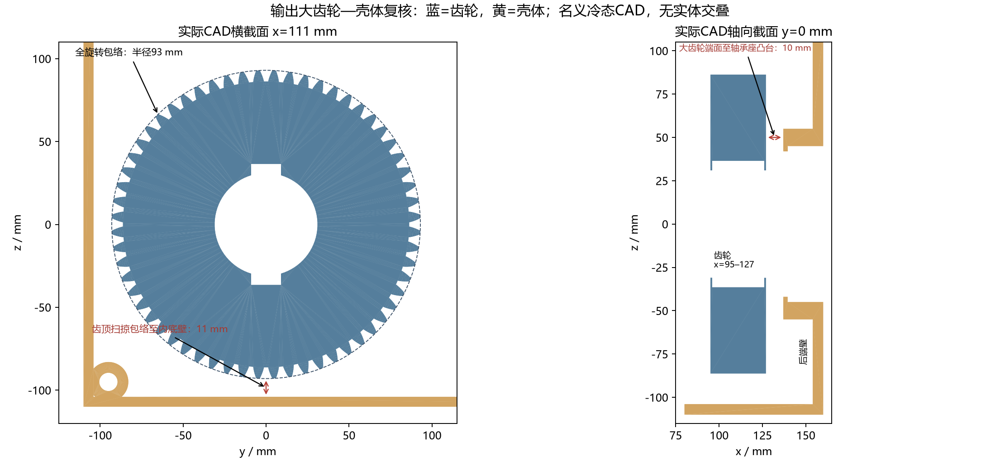

# M3 输出大齿轮—减速箱壳体复核

日期：2026-10-20。用户观察当前SolidWorks透视图疑似干涉后，针对原位置原尺寸重新检查；未修改几何、移动零件或扩大壳体。

当前`stage/M3-geometry`，沿用PR #4。检查对象为已导出的`Case0_d50_full.step`及其公共基础零件；原M3、M2固定成果未覆盖。本记录不改变M3的PARTIAL/BLOCKED机械验收状态。

## 实际结果

| 方法/对象 | 实际结果 |
|---|---|
| CadQuery2.8/OpenCascade：大齿轮 vs 前半壳体 | 相交体积0mm³；最短距离18.646322mm |
| 同上：大齿轮 vs 后半壳体 | 相交体积0mm³；最短距离10mm |
| 完整360°齿顶扫掠圆柱 vs 前/后半壳体 | 两者相交体积均0；最短距离18.601075/10mm |
| 一齿距内13姿态×前后壳体 | 26对实际旋转布尔检查，均无相交 |
| SolidWorks Premium2023 SP0.1导入装配 | 129个叶零件；干涉检测返回0；未忽略隐藏体，不将整个子装配当作单个零件，包含多实体零件内检查，重合面不作为体积干涉 |
| 导入位置核对 | SolidWorks大齿轮/前后箱体边界框与原STEP的mm→m换算一致 |

大齿轮分度圆直径180mm，最大齿顶半径93mm，齿宽范围x=95–127mm。箱体内底壁z=-104mm，完整旋转包络到内底壁最小径向间隙为104-93=11mm；后轴承座凸台前端x=137mm，至齿轮右端面间隙137-127=10mm。最短10mm是轴向凸台间隙，不能误标成齿顶径向间隙。

SolidWorks右视图中齿轮与壳体后端壁仍会在二维投影上叠加；此前透明等轴测图也难以区分前后距离。精确交集和真实截面不支持存在冷态实体穿透。为方便观察，完成全装配检测**之后**才临时隐藏周围零件，切到只显示齿轮及壳体的视图；隐藏操作没有用于规避干涉检查，也没有保存覆盖原STEP。

## 限制及复现

以上为名义冷态几何；不能替代轴挠度、轴承游隙、齿轮/壳体制造公差、热膨胀差与实际润滑搅油检查。原连接套、预紧、绝缘、冷却、罩支点热膨胀等BLOCKED项继续有效，没有据此宣布整机机械安全或M3正式通过。

- STEP源文件SHA256、4项布尔/距离、26个旋转配对及真实截面：`results/m3_review/output_gear_clearance/`。
- OCCT复现：`tmp/m3_cad/Scripts/python.exe scripts/m3_review/check_output_gear_clearance.py`。
- 原装配已在SolidWorks打开后，运行：`py scripts/m3_review/check_solidworks_gear_clearance.py`。脚本拒绝检查其他活动文档，保留启动时无文档/临时文档的拒绝日志；最终检查JSON是实际成功运行记录。
- SolidWorks本次确已实际执行导入/几何检查；先前M3交付报告中NOT EXECUTED是当时历史状态。ANSYS/Fluent仍NOT EXECUTED，未进入M4。
