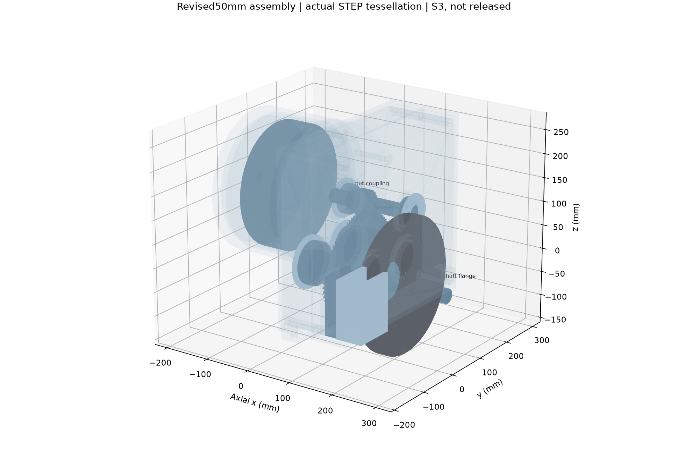
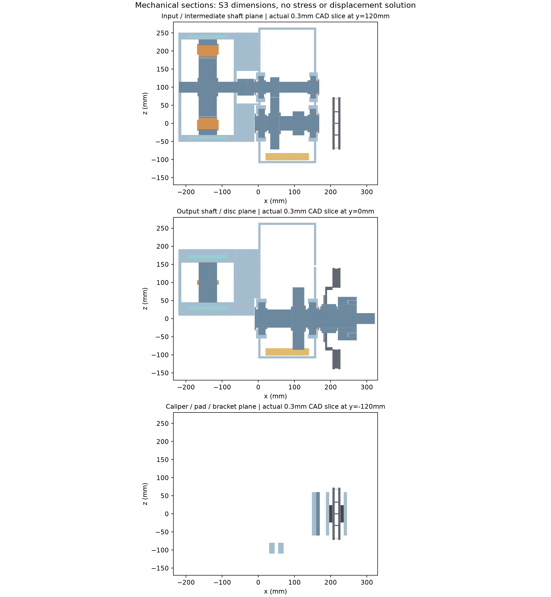
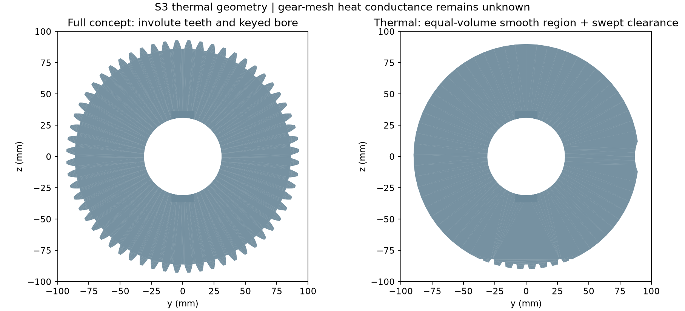
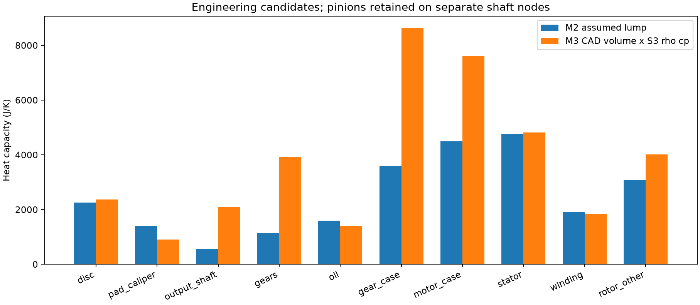
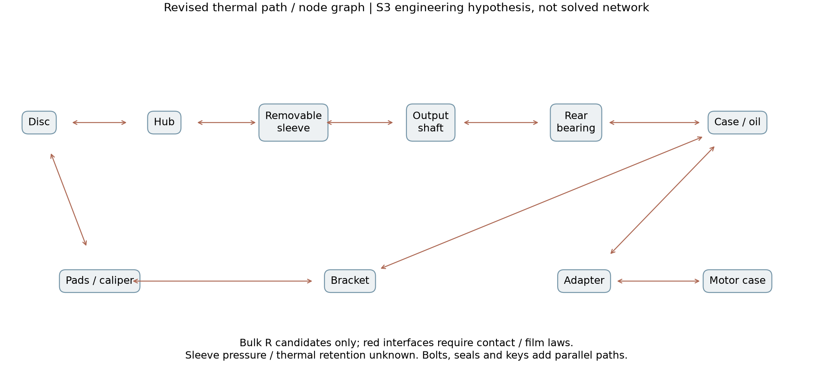
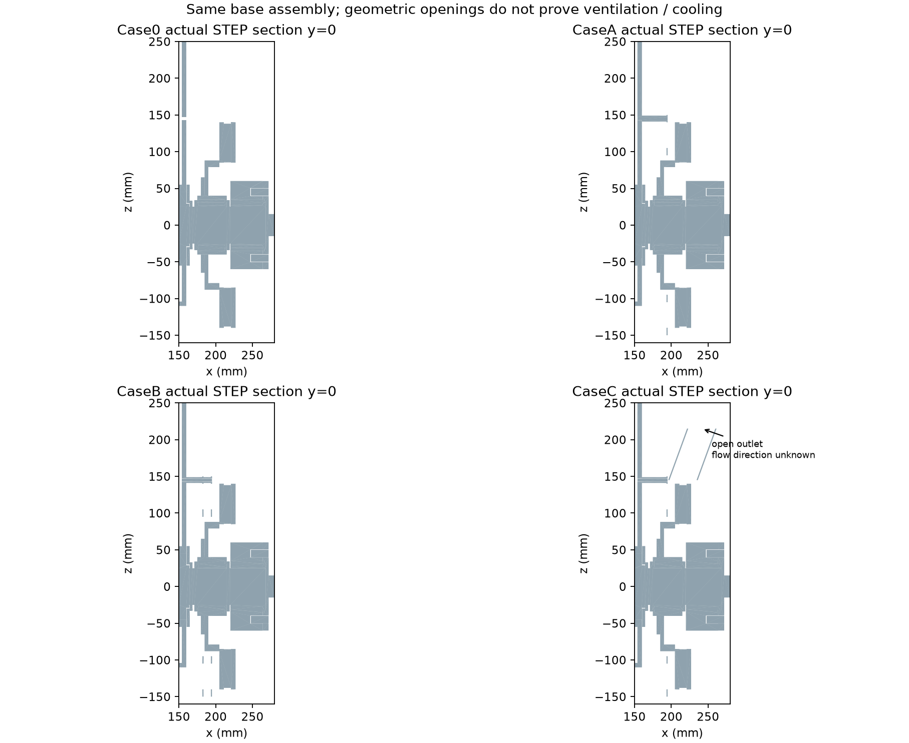
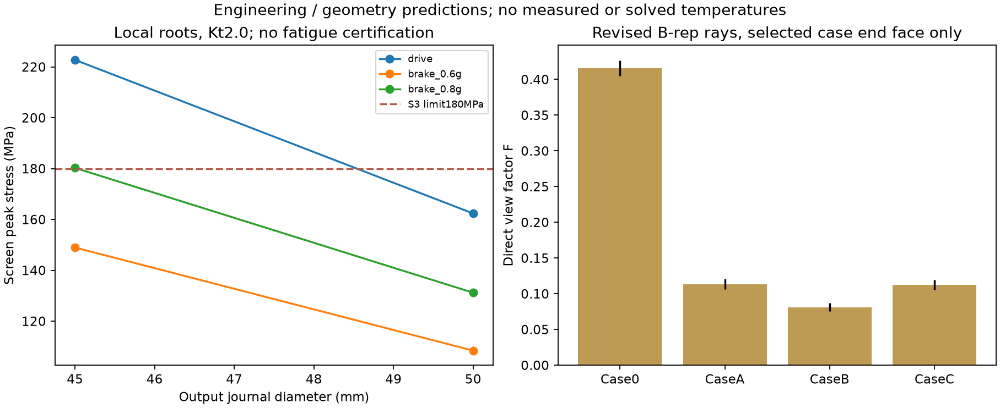

# 1. 结论与适用边界

本补充审查状态为 **PARTIAL：几何导入候选已准备，机械冻结与定量热预测仍有 BLOCKED 项**。保留原 M3 概念CAD、代码、结果及三格式报告；新增文件位于 `cad/m3_review/`、`scripts/m3_review/`、`results/m3_review/`。M0/M1/M2固定版本均未覆盖。当前仅在 `stage/M3-geometry` 开发，更新[PR #4](https://github.com/alan9900/Thermal-coupling-analysis-under-drive-control-integration/pull/4)，不合并、不创建M3-v1.0、不开展M4。

已补齐电机独立联轴接口、分体箱体、三轴支承/定位/密封座、盘毂连接、卡钳M12候选安装及车轮半轴接口。轴系审查发现一体加粗外端座会阻挡后轴承装入，修订为可拆连接套；其摩擦传扭、环向应力及热态接触尚须验证，不能把“能装入”当作“能安全传扭”。45mm仅保留失败对照，50mm作为本轮几何候选。

实际运行CadQuery2.8.0/OpenCascade7.9.3.1及Python3.13；完整与热简化STEP均经OCCT回读。这不等于已经运行ANSYS导入、网格、结构或温度求解。SolidWorks、ANSYS、Fluent、疲劳及样机实验均 **NOT EXECUTED**。报告所有应力/热参数/射线结果均为工程筛查或几何预测，没有温度曲线或降温认证。

CAD最终几何修订启动源提交：`700edf045c03ea63ed27e197e2020048ceb98995`。之后提交补充断言、资料与审查脚本，未重新命名旧模型为实测数据。精确提交登记由后续STAGE_VERSIONS条目记录，避免报告自引用。

# 2. 真实来源、假设及坐标

对象保持1800kg后驱双独立参考60kW电机、每侧两级3×3减速、输出端内移盘、无差速器；只详细建左侧。输出盘与轮速相同。输入/中间/输出轴中心(y,z)分别为(120,100)/(120,0)/(0,0)mm。

| 项目 | 本轮数值/处理 | 等级与边界 |
|---|---|---|
| 参考电机壳体 | 外径302、长度161mm，原尺寸不缩放 | ORNL表2.7；原始资料沿用docs/M3_SOURCE_REVIEW.md |
| 电机安装位置 | x=-221至-60，新增60mm适配环 | S3新设计；非Toyota原接口 |
| 两级齿轮 | m2.5与m3、20/60齿；轴向33–58/95–127mm | S3，齿廓仍为概念渐开线 |
| 输入轴承 | 6206，30×62×16mm | 原SKF外形参照；寿命/极限转速未选型 |
| 中间轴 | 35→40mm，6208：40×80×18mm | 轴径S3；轴承边界SKF官方；同步修改轴、齿轮孔、轴承和壳体 |
| 输出45mm对照 | 6209：45×85×19mm | SKF外形；不能因目录存在就认定可用 |
| 输出50mm候选 | 6210：50×90×20mm | SKF外形；官方开式质量0.442kg，仅可作参考有效质量候选 |
| 制动盘 | 280×22、总高42mm保留；定位孔68→80mm | 前三项Brembo外形参照；80mm为自设计盘帽，已偏离目录件 |
| 盘毂与输出连接 | 62mm候选套外径(50mm版本)，80mm定位外径，双键+可拆套 | S3；并非已验证花键/胀紧套产品 |
| 卡钳支架 | 2×M12、间距80mm、耳高120mm，同步箱体凸台及孔 | S3；强度限值、预紧及摩擦未知 |

新增厂家来源：[SKF6208](https://www.emarketplace.in.skf.com/deep-groove-ball-bearing/6208)、[SKF6209](https://www.emarketplace.in.skf.com/deep-groove-ball-bearing/6209)、[SKF6210](https://www.emarketplace.in.skf.com/deep-groove-ball-bearing/6210)。三份HTML快照及SHA256在 `data/raw/m3_review/manifest.json`。6210开式0.442kg与6210-2Z的其他质量不可混用。CAD轴承仍为空间包络；本轮installed_mass/C保持空值，不直接按实心钢环加载热容。

[Schaeffler Technical principles](https://www.schaeffler.com/remotemedien/media/_shared_media/08_media_library/01_publications/schaeffler_2/catalogue_1/downloads_6/mh1_technical_principles_de_en.pdf) PDF第6–7页支持定位/浮动支承方法：深沟球轴承作为浮动端需要一个可滑动套圈配合。本轮采用后外圈两侧各0.5mm名义自由空间；实际配合公差和滑移能力仍null。该PDF已通过web读取核对，本地下载被站点/TLS阻塞，**未伪称已归档PDF**，失败日志保留。

其余尺寸、材料ρ/cp/k、摩擦、许用应力及接触压力均为S3工程候选。配置 `configs/m3_geometry_review.yaml` 的 actual字段保持null；该布局只支持明确校核的45/50mm离散版本，其他直径必须同步修订，不是任意缩放的优化器。

# 3. 运动、传力、支承与装配顺序

驱动路径：电机转子轴→两端独立键连接的联轴套→输入轴一体一级小齿轮→中间大齿轮双键→中间轴一体二级小齿轮→输出大齿轮双键→输出轴→可拆半轴连接套→双键法兰→8只M10及4只候选配合销→车轮半轴接口。两级相反转向相乘后，输出与输入同向；转速比9。没有差速器。

制动路径：轮胎/半轴→输出法兰/轴→盘毂连接套→双键盘毂→5只M10连接与80mm止口→盘帽/摩擦环→摩擦片/卡钳→M12支架→箱体凸台→车架安装耳。卡钳支架绕过输出轴形成另一条固体热路；不能把全部制动热沿轴传入电机。

三轴前端内圈由轴肩与挡圈定位；前外圈由壳体肩与带M5候选螺钉的压盖定位。后端内圈由轴肩与等效夹紧环定位，后外圈留浮动间隙。唇封有独立区域和实际径向密封座。夹紧环的分体紧固细节/夹紧力、挡圈标准槽与承载、压盖螺钉预紧和密封唇摩擦均未完成，应标BLOCKED，不把等效环称已选型标准件。

Case0固体装配总包络约543×493×375mm（含电机、支架与半轴接口，不含外空气域）。新增适配环和连接接口使轴向包络增加；实际后舱、车架和半轴摆角包络未知，装车可行性BLOCKED，不据此缩放电机或隐藏空间冲突。

装配操作候选：先将双键大齿轮装到阶梯座并安装定位环；三根轴装入x=80分体壳的前半部；从右侧安装后轴承并合后箱、压盖和密封；最后装可拆连接套、盘毂、盘/卡钳与半轴法兰。后轴承未装时外端连接套必须拆下。模型检查了轴承通过包络，未做完整工具可达性、公差蒙特卡洛或实物装配试验。电机内部轴承与原厂轴端未知，参考电机到本适配器仍不能视为量产兼容。

# 4. 轴系、制动器与连接筛查

后轴载荷转移和每侧零再生制动转矩按同一V0.4配置计算，前轴继续承担其余制动：

$$f_r=f_{r0}-\frac{a}{g}\frac{h}{L},\qquad T_d=\frac{m a f_r r_w}{2}.$$

矩形片面积平均有效摩擦半径0.1143532m，摩擦系数候选0.35：

$$F_t=T_d/r_e,\qquad N_{\mathrm{each\ pad}}=F_t/(2\mu).$$

| 减速度 | 单盘转矩 N·m | 切向力 N | 每片法向力 N |
|---|---|---|---|
| 0.6g | 752.839 | 6583.5 | 9404.9 |
| 0.8g | 911.057 | 7967.0 | 11381.5 |

0.8g仅为初步载荷场景；附着候选μ=0.8时已在理想全车附着边缘，未验证ABS/EBD、路面、前后轴法规或实际制动容量。输出驱动另按130×9×0.96=1123.2N·m校核，不把0.8g制动与峰值驱动叠加成同一工况。

分段简支梁考虑齿轮/盘载荷位置及不同传扭区间，根部内切圆为保守截面：

$$\sigma_{\mathrm{eq}}=K_t\sqrt{\left(\frac{32M}{\pi d^3}\right)^2+3\left(\frac{16T}{\pi d^3}\right)^2}.$$

| 轴径 mm | 载荷 | Kt | 最大筛查 MPa | 结论 |
|---|---|---|---|---|
| 45 | drive | 2.0 | 222.74 | BLOCKED |
| 45 | brake_0.6g | 2.0 | 148.95 | PASS_SCREEN_ONLY |
| 45 | brake_0.8g | 2.0 | 180.25 | BLOCKED |
| 50 | drive | 2.0 | 162.34 | PASS_SCREEN_ONLY |
| 50 | brake_0.6g | 2.0 | 108.40 | PASS_SCREEN_ONLY |
| 50 | brake_0.8g | 2.0 | 131.18 | PASS_SCREEN_ONLY |

180MPa为S3筛查阈值，不是材料证书许用应力。输入联轴键高由7→5mm、根径23→25mm；输出大齿轮改为双键，半轴键长15→42mm。最初失败表保存在initial_key_failures.csv及initial_shaft_screening.csv。中间轴40mm、输入30mm也进行了弯扭/键根筛查；完整结果见shaft_screening.csv、key_screening.csv。不含齿根接触应力、轴挠度/临界转速、外部CV径向与轴向力、疲劳及轴承L10寿命。

M12在0.8g下名义螺栓组根面积剪应力约71.70MPa，低于120MPa候选阈值；**局部铝凸台、螺纹连接、支架3D应力、螺栓拉剪与接缝张开仍BLOCKED**。预紧10/20/30kN、μ=0.08/0.15/0.25的扫描显示部分组合滑移；不能只看销杆剪切就判安装安全。半轴法兰摩擦容量不足的组合亦明确BLOCKED；配合销约110MPa名义剪应力仍需实测配合/孔壁承压/疲劳验证。

可拆套的传扭能力与孤立厚环近似为：

$$T_{\mathrm{fit}}=\mu p\pi d^2 l/2,\qquad \sigma_\theta(r_i)=p\frac{r_o^2+r_i^2}{r_o^2-r_i^2}.$$

50mm版本共36个连接套压力/摩擦/接口组合，其中2个满足两项候选阈值，其余34个标记BLOCKED；这些条件通过点仍未验证真实连接。完整矩阵见removable_sleeve_scan.csv。

压力10–150MPa及摩擦范围只是探索；较大压力会提高传扭并增加环向应力。此厚环式忽略外部盘毂的约束、键槽削弱及非均匀压力，不能把条件通过的组合等同已设计成功。实际过盈、表面状态、热膨胀松脱与寿命均null；连接套属于**冻结前BLOCKED重点**，需合格胀紧/端面正连接方案或后续独立结构复核，不能在热优化中默认为稳定粘结。

膨胀检查保存200/400/600K盘温升假设；400K时径向增0.616mm、单面厚向增0.0484mm，0.1mm跳动及0.1mm片公差下0.5mm片隙剩0.2516mm。1mm跳动组合明确BLOCKED。盘锥变形、钳/支架位移、液压行程及热态摩擦接触仍未知；不能以均匀膨胀预算替代运行间隙验证。后轴承0.5mm浮动预算亦有超限温差组合，见bearing_axial_expansion.csv。

# 5. 独立热分析几何与接触

完整装配为Case0/A/B/C的50mm版本和Case0的45mm对照；热版另存同名thermal STEP，不覆盖原概念或完整模型。保留盘/帽、毂、输出轴、可拆套、轴承包络、支架、齿轮热区、油库存、分体箱体、适配器、电机铁心/绕组/转子其他及水套区域。

热版将两个大齿轮替换为平滑等体积区域，保留键槽，并为啮合小齿轮扫掠包络留0.2mm间隙；油库存占据区域亦从等效齿轮排除。一体小齿轮暂保留原齿形，避免虚构断开的导热件或丢失轴热容；绕组分段合并为连通等效体。螺纹和细槽本来未建，宏观螺栓保留其导热旁路。本轮不是最小零件数网格模型，后续网格前可继续分区/粗化，不能盲目一键合并全部材料。

每个部件的体积/质量/C由CAD统计；full/thermal单体最大体积相对差 1.69e-10。平滑区改变表面积和啮合热路，齿面接触、油膜和搅油不能从这个版本直接求得。

contact_pairs.csv记录各版本主接触对，supplemental_contact_pairs.csv补充连接套、密封座和端绕组。接触面积通过B-rep面与相邻体相交统计，只是名义共形面积；总表面积含内表面，不能全部指定外部对流。盘毂到轴现在须经可拆套，不能跨越间隙直接粘结；密封载体已补充，不能以圆边接触冒充承载面。

**绕组槽内约0.2mm间隙保留，但端环与铁心端面名义相接**。最初“全绕组已有隔离间隙”的断言失败并保留日志；修订测试明确区分槽内与端环，未修改CAD掩盖接触。端部绝缘/浸漆/接触R未知，自动粘结会高估散热，该项BLOCKED。制动片0.5mm运行隙亦不是热接触，应采用时间相关闭合或指定摩擦功率分配，不自动缝合。

# 6. CAD热参数与M2对照

$$m_i=\rho_i V_i,\qquad C_i=m_i c_{p,i},\qquad R_{\mathrm{bulk}}=\sum_k\frac{l_k}{k_k A_k}.$$

| M2节点 | M2 C J/K | M3几何候选 C J/K |
|---|---|---|
| disc | 2250.0 | 2367.0 |
| pad_caliper | 1400.0 | 901.9 |
| output_shaft | 552.0 | 2107.1 |
| output_bearing | 161.0 | null/需独立定义 |
| gears | 1150.0 | 3914.8 |
| oil | 1600.0 | 1398.5 |
| gear_case | 3600.0 | 8640.4 |
| motor_case | 4500.0 | 7611.2 |
| stator | 4765.6 | 4819.2 |
| winding | 1898.0 | 1832.3 |
| rotor_other | 3082.0 | 4021.1 |
| shield | 200.0 | null/需独立定义 |
| local_air | 50.2 | null/需独立定义 |

几何体积变化来自加粗轴/定位件、加大支架、箱体凸台和新接口。材料仍为S3等效量；转子区域含新电机侧轴，不能与原M2的组合质量直接等同。齿轮表仅含两个独立大齿轮，一体小齿轮留在输入/中间轴节点，必须增加节点后比较，禁止把差异全部解释为质量误差。轴承包络实心质量只在专门几何列保留，installed_mass/C为空；若采用SKF目录质量与S3 cp应作为另一个显式场景。

| 路径 | 体热阻 K/W | M2等效 K/W |
|---|---|---|
| hub_to_rear_bearing_d45 | 0.6288 | 1.5 |
| hub_to_rear_bearing_d50 | 0.5093 | 1.5 |
| hat_radial_40_to_88 | 0.5577 | 2 |
| bracket_axial_envelope | 0.1667 | 8 |

盘帽径向式为 $R=\ln(r_o/r_i)/(2\pi k t)$；轴段体热阻、支架均匀体下界不能替代M2接触+扩散+油膜总热阻。接触扫描按 $R_c=1/(h_c A_c)$，h候选100/1000/10000W/(m²K)，实际值null。轴承滚动接触、压配合、分型面、端部绝缘、油膜及联轴连接都不能只用l/kA确定。

# 7. 隔热导流与空气连通

四方案基础部件一致；Case0没有新增罩、支柱或导流。A为1.5mm单层罩、盘距10mm；B为两层/10mm间隙；C为单罩加高70mm、内口37×67mm的倾斜开放通道。入口z=145mm、出口z=215mm，出口中心x约241.48mm。新增轴承压盖与原30°支柱发生干涉，已将该支点移到60°，同步开孔、加安装杆；90°/330°支点保留。

CaseC实际空气布尔结果为一个连通外域，中心线从入口前、入口、通道内、出口到出口外8个探针均在同一外域内。局部外域x=168–350、y=-220–330、z=-200–290mm；盲孔气穴单独记录。该外域仅为后续导入候选，尚未证明远场尺度无关、没有设置实际流速或求解流向。

隔热罩热膨胀安装仍有BLOCKED项：4.4mm孔与4mm杆仅0.2mm径向自由量；以不锈钢候选α=17×10⁻⁶/K、罩温升300K/铝箱温升100K估计，145mm支点处差动自由膨胀约0.406mm，超出名义余量。当前三圆孔不能视为已验证的滑移安装；需要一定位点配径向长孔/柔性支点，并重新评估热桥。本轮不掩盖该约束，也不把自由膨胀式当成约束应力求解。完整扫描见shield_mount_expansion.csv。

外边界候选为该六个外域面，旋转位置为三轴及盘/帽/毂/输出法兰；未来需区分车辆来流与盘转动，增设旋转子域并排除封闭库存水/油。入口/出口均通外域，不可同时无依据指定强制单向流。通道低端靠盘上缘；逆向来流、盘泵吸和罩后回流可能把热空气经窗口/卡钳缺口/下部空隙冲向壳体，必须保留双向工况。出口向+x倾斜只是一种几何，不构成通风有效证据。

采用均匀环面采样与余弦半球射线，直接与修订STEP实体求交：发射面盘后露出环88–140mm，接收面仅箱体x=160指定外端面；支持帽、毂、套、轴承盖、支柱、卡钳、罩和通道实际遮挡。

| 方案 | 指定端面F | 采样标准误 | AF m² |
|---|---|---|---|
| Case0 | 0.4154 | 0.0054 | 0.01547 |
| CaseA | 0.1135 | 0.0035 | 0.00423 |
| CaseB | 0.0812 | 0.0030 | 0.00302 |
| CaseC | 0.1123 | 0.0035 | 0.00418 |

每方案8192射线，2048粗样本对照；误差条为2倍采样标准误。等同轴圆盘解析对照通过。该F不能外推为整个壳体总视角，不含侧面受照、多次反射及罩再辐射。CaseA和C细小差异不作排序证据，不宣称任何降温百分比。

# 8. M3-to-M4接口及准备清单

新接口 `configs/M3_to_M4_mapping.json` 不覆盖M2。热源总量仍来自M1单侧时序，各源在指定子区按体积归一，积分严格返回原W：

$$q'''_s(t)=\frac{Q_s(t)}{\sum_{i\in s}V_i},\qquad \sum_i q'''_s V_i=Q_s.$$

一体小齿轮热区需沿x=33/58及95/127mm分区，source_regions.csv保存实际截取体积，不把其损耗涂到整根输入/中间轴。分区只提供几何计划，ANSYS操作NOT EXECUTED。逆变器独立外部记录；motor/reducer总损耗仅校验，不与分项重复加载；rotor_other不等于全部永磁体热源。不同不确定上界不作为同一物理时序简单相加。

| 求解前项目 | 当前状态与下一步 |
|---|---|
| 几何读取、单位、命名区域 | OCCT实测通过；ANSYS实际导入NOT EXECUTED，须复核mm→m及每个体 |
| 固体材料与质量 | CAD候选齐备；材料证书/轴承有效密度及温变参数BLOCKED |
| 装配/传扭 | 50mm弯扭候选通过；可拆套热态保持、预紧和疲劳BLOCKED |
| 接触与间隙 | 名义对/面积已给；实际h、端部绝缘、压配合/轴承/油膜BLOCKED |
| 摩擦热 | 单盘/片分项；片隙闭合及热分配时序需明确，禁止全热加载绕组 |
| 内部热源 | 分项W→分区W/m³合同已给；空间分配仍S3，必须做敏感性 |
| 对流与液冷 | 外露面与水套有几何；封闭水套无进出口/流量，实际h及温度边界BLOCKED |
| 辐射 | K温标、可逆方向、指定端面直接F已审查；完整面间辐射仍待定义 |
| 空气域 | 连通几何候选；远场/旋转域/来流/网格/CFD均未开展 |
| 数值验证 | 后续须检查全域储能+环境+冷却能量闭合、网格/步长；本轮不冒称已验证 |

可直接交给ANSYS做**导入和区域识别尝试**的是四份50mm thermal STEP；完整STEP用于装配核对。45mm为拒绝方向对照，不作为冻结方案。概念参数化热敏感性可在另获阶段批准、显式赋值后准备；目前不能直接进行可信的样机温度或热管理最优方案判定。

# 9. 实际验证、阻塞与成果位置

共10份装配、5份连通局部空气域及修订零件，144份STEP，总量152.5MB（有限归档，单文件<100MB）。全对AABB后3686对精确布尔，无>0.001mm³正体积交叠；回读最大相对体积误差2.28e-13。16组审查测试、18齿轮相位及24盘/卡钳旋转配对检查完成。测试PASS表示审查逻辑和证据通过，不将BLOCKED机械条件改判通过。

本轮纠错保留：初次联轴/适配器干涉、热简化区侵入油库存、支柱碰轴承压盖、原短键失败、端绕组间隙断言失败、资料TLS/下载失败。失败记录不是最终设计通过项；未采用跳过相关零件的方式消除装配干涉。

影响后续热管理优化的首要缺口：连接套热态夹紧/压力同时影响传扭和接触R；轴承有效质量/滚动热阻及油路；支架/凸台挠度和片接触；端部绝缘和冷却边界；空气流向和完整辐射交换。若把它们默认为粘结、无限冷却或单向排热，会改变方案排序，导致表面上“优化”而缺少物理依据。

目录：CAD与说明cad/m3_review；配置configs/m3_geometry_review.yaml及M3_to_M4_mapping.json；原始CSV/JSON/日志/图results/m3_review；脚本scripts/m3_review；本报告Markdown/Word/PDF位于reports。补充验收表M3_GEOMETRY_REVIEW_CHECKLIST.md。本轮只完成M3复核交付，未声称机械冻结或M3正式通过。
