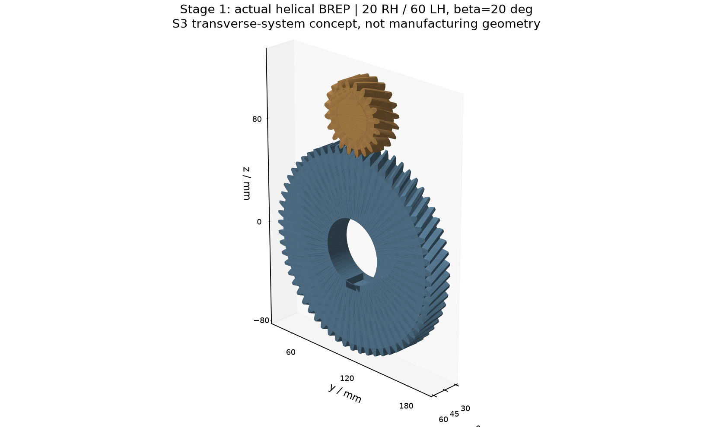
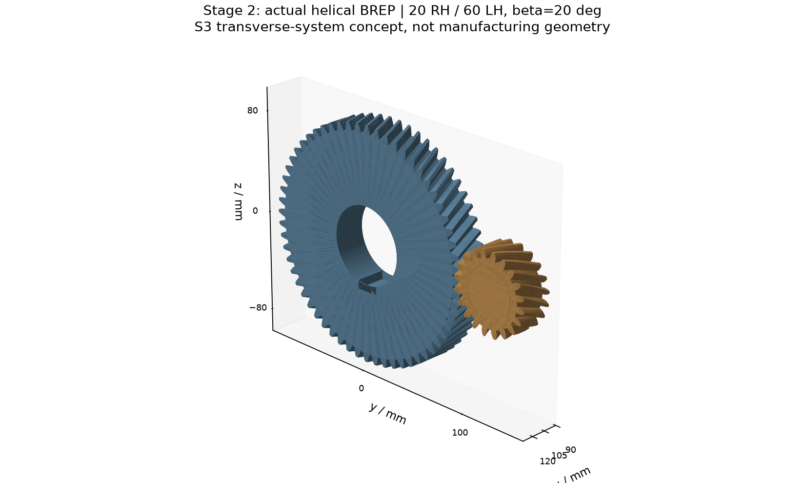
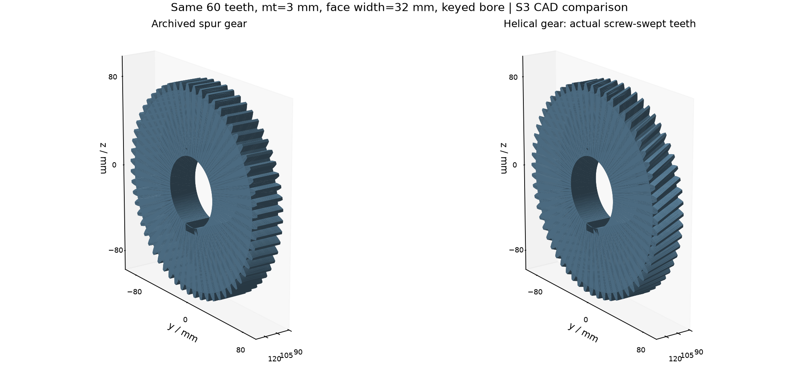
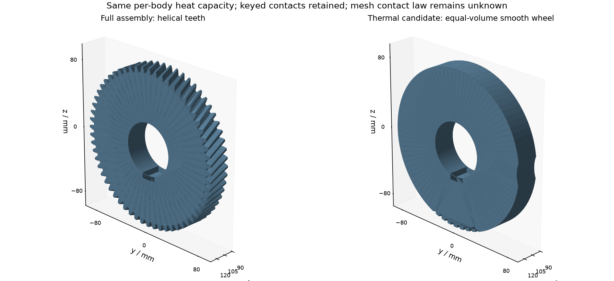

# 1. 结论与修改边界

本轮已实际生成两级斜齿完整CAD和独立热分析候选CAD，固定原三轴空间坐标、100/120mm中心距、20/60齿、总速比9.0和50mm输出轴。Case0/A/B/C、轴承、壳体、电机、内移制动盘、卡钳及隔热导流结构保留。原直齿模型和既有M0/M1/M2归档均未覆盖。

状态为 **PASS_CONCEPT_GEOMETRY / M3整体PARTIAL**：几何构建与本轮数值审查通过，不代表制造定型、轴承轴向承载通过或实际效率/温度标定。继续在stage/M3-geometry和PR #4送审，不合并、不创建M3正式Tag、不进入M4。ANSYS与Fluent均NOT EXECUTED。

原参考电机来源仍是Toyota/ORNL MG2；本两级减速器是S3概念设计，不能称为Prius量产传动机构。KHK公开技术资料支持端面/法向模数体系的区分及平行轴外啮合采用相反旋向，不是本总成的产品尺寸来源。[KHK技术参考](https://khkgears.net/pdf/helical-tech.pdf)，本地原始PDF及SHA256见data/raw/m3_helical。未直接套用KHK目录承载能力或效率结论。

# 2. 固定中心距的参数推导

将原模数解释为端面模数，固定端面节圆与原端面20°压力角：

$$m_n=m_t\cos\beta,\qquad a=\frac{m_n(z_1+z_2)}{2\cos\beta}=\frac{m_t(z_1+z_2)}{2}.$$

$$\alpha_n=\arctan(\tan\alpha_t\cos\beta).$$

| 项目 | 一级 | 二级 |
|---|---|---|
| 齿数 / 单级速比 | 20/60 / 3.0 | 20/60 / 3.0 |
| 端面模数 mm | 2.5 | 3.0 |
| 法向模数 mm | 2.34923155 | 2.81907786 |
| 中心距 mm | 100 | 120 |
| 螺旋角 / 旋向 | 20° / 小RH、大LH | 20° / 小RH、大LH |
| 轴向范围 / 齿宽 mm | 33–58 / 25 | 95–127 / 32 |
| 端面 / 法向压力角 | 20° / 18.881721° | 20° / 18.881721° |
| 小齿轮实际扭转角 | 20.853958° | 22.244222° |
| 大齿轮实际扭转角 | -6.951319° | -7.414741° |
| 轴向重合度候选 | 1.1586 | 1.2358 |

两级法向模数均为非标准候选值。沿用原端面全齿高：齿顶高=mt、齿根高=1.25mt；因此法向齿高系数相应为1/cosβ和1.25/cosβ，而不是声称采用标准法向全齿高刀具。无变位，无根部圆角与修形设计；这些选择只定义概念几何。若今后要求标准法向模数，需要重新协商齿数、中心距或变位，不属于本轮。

一级节圆直径50/150mm，齿顶直径55/155mm；二级节圆60/180mm，齿顶66/186mm，均保留。0.15mm为原代码的单齿端面齿厚减薄参数，不是实测总啮合侧隙。

固定坐标（所有轴沿+x，单位mm）：输入(y,z)=(120,100)，中间=(120,0)，输出=(0,0)。中间轴一级大齿轮33–58mm、二级一体小齿轮95–127mm，端面间37mm；有效重叠齿宽分别25/32mm，未移动轴肩、轴承或挡圈。

# 3. 螺旋实体及啮合实现

以齿宽中面保持原齿轮相位，避免直接扭转前端导致原相位失配：

$$\theta(x)=\theta_{mid}+h\frac{\tan\beta}{r_p}(x-x_{mid}),\qquad h=+1\ (RH),\ -1\ (LH).$$

同一齿轮副中两轮的齿数加权扭转量互相抵消，保持沿齿宽的啮合定位；旋转检查使用大齿轮角位移=-小齿轮角位移/3。两级小齿轮均RH、大齿轮均LH，明确相对于同一+x轴定义。

复用原端面渐开线轮廓，每侧6段近似，使用OpenCascade螺旋扫掠构造真正螺旋侧面，再切出圆柱轴孔及原键槽。小齿轮仍与输入/中间轴一体融合。不是直齿实体改名；也不是精确解析渐开线齿面、根部滚切包络或制造级CAD。

从生成后的真实B-rep长边采样101点，展开角度独立反算法向轴线的节圆螺旋角，四轮均为±20°；端面齿顶顶点计数分别40/120，对应20/60齿。实际小齿轮跨宽扭转为20.853958°/22.244222°，大齿轮为−6.951319°/−7.414741°。此扭转角与螺旋角不是同一量。

# 4. 体积、质量、热容与热分析接口

材料沿用原S3钢候选密度7800kg/m³、比热460J/(kg·K)，没有新增材料标定：

$$M=\rho V,\qquad C=\rho c_p V.$$

| 齿轮热区 | 原质量 kg | 斜齿质量 kg | 原/新热容 J/K |
|---|---|---|---|
| 一级小齿轮（含轴芯） | 0.370059 | 0.370059 | 170.226940 / 170.226938 |
| 二级小齿轮（含轴芯） | 0.683087 | 0.683087 | 314.220184 / 314.220177 |
| 一级大齿轮 | 3.010859 | 3.010857 | 1384.995221 / 1384.994276 |
| 二级大齿轮 | 5.499475 | 5.499470 | 2529.758570 / 2529.756313 |

完整零件及体积明细见volume_mass_capacity.csv，齿轮热区明细见gear_region_mass_capacity.csv。小齿轮行包含对应轴向片段的轴芯；整根轴的热容单独记录，不能再把小齿轮片段热容叠加到整轴。

理想同截面螺旋扫掠保体积。本轮齿轮质量差异很小，主要来自扫掠B-spline/布尔积分数值误差；不是凭齿轮类型宣称质量降低。油库存随齿形重新裁剪，体积约变化−0.00551%，是必要占位修订，不表示已解出真实油面或动态搅油。

热分析版保持与完整CAD相同基础结构：两只大齿轮用等体积平滑实体，保留键槽、孔、油库存避让及小齿轮扫掠间隙；一体斜齿小齿轮仍保留，以保持轴的导热连续性和热容。没有模拟螺旋齿面局部接触温度，也没有给齿面与平滑轮间虚构实接触面积。轴孔/键等安装接触保持，动态啮合导热系数仍null；后续应以等效接触或显式热源分配研究。

所有方案逐体完整/热版热容相对误差最大1.8e-10。轴承仍是包络区，表中几何质量不是安装轴承真实质量；原installed_mass/C未知限制保留。

独立映射configs/M3_helical_to_M4_mapping.json继承原热源合同，仅更新斜齿热区体积与归一化分配；不覆盖M2或原M3映射。M1减速器总损耗沿用原参数化模型，斜齿实际效率、空载/搅油/轴向承载增加的损耗未重新标定。总损耗仅作校验，不能与分项重复加载；逆变器不进入绕组，转子其他损耗不等于全部永磁体损耗。未重新运行M1/M2温度场。

# 5. 轴向力量级及原有阻塞项

只作斜齿新增载荷数量级检查：

$$F_t=\frac{T}{r_p},\qquad |F_a|=F_t\tan\beta.$$

取软件输入限扭130N·m，二级理想输入390N·m（此载荷上限估计不计传动损失）：一级切向5200N、轴向1892.645N；二级切向13000N、轴向4731.613N。+x施加输入转矩时，按实际螺旋几何的力正交关系，输入轴网格力+x、中间轴两处均−x、输出轴+x；中间轴合计约6624.258N，转矩反向则符号反转。两级采用上述旋向不保证中间轴推力抵消。

**轴承轴向能力、浮动端/定位端和挡圈承载仍BLOCKED**，不能因几何无干涉判为通过。本轮按授权不开展轴承寿命、复杂定位、预紧、制造或热膨胀优化。此前连接套热态保持、罩支点膨胀、支架/壳体变形、接触热阻、绝缘与冷却边界等限制继续存在。

# 6. 实际执行检查及验收清单

实际生成8份装配STEP及10份修订部件STEP，共18份/145.6MB；3006对精确布尔检查均无>0.001mm³正体积干涉。8份装配回读有效且实体数量一致，最大相对体积误差6.25e-13。

| 验收项目 | 结果及证据 |
|---|---|
| 20/60齿、每级3、总9 | PASS；gear_parameters及actual_helix_checks.csv |
| 固定模数/中心距/原轴心 | PASS；法向模数转换及unchanged_component_positions.csv |
| 真实±20°齿向、相反旋向 | PASS；独立B-rep边采样，不仅检查配置字段 |
| 轴向位置及齿宽 | PASS；33–58、95–127mm；中间37mm |
| 完整/热版、四方案相同基础 | PASS；8装配及所有共用体体积断言 |
| STEP回读有效、数量/体积一致 | PASS；checks.json及step_manifest.json |
| 名义冷态零件干涉 | PASS；全对AABB后精确布尔，不忽略齿轮或壳体 |
| 旋转啮合检查 | PASS；每级7相位，共14对，未出现正体积穿透 |
| 修改前后质量/热容 | PASS；两份CSV，不把几何候选称为实测 |
| 热分析等效体热容 | PASS；逐体、逐方案检查 |
| 源项归一与原始null | PASS；独立映射，未知实参保持null |
| 原直齿及归档版本 | 未覆盖；Git diff检查通过 |
| 轴向承载/制造与真实效率 | BLOCKED / 未标定，不在本轮扩展 |
| ANSYS / Fluent | NOT EXECUTED，未进入M4 |

干涉检查只覆盖名义装配静态全对和所列离散运动相位；不是公差、满周连续接触、挠度或高温认证。二级齿顶全扫掠半径仍93mm，旧圆柱包络对壳体的11mm底壁净距及10mm轴向凸台间隔仍适用。齿面接触质量、寿命及传动效率未验证，不声称改善了效率或散热。

初次并行验证在CAD尚未全部完成时触发“8装配齐备”断言，记录保留为initial_parallel_finalization_failure.txt；14对啮合及真实边检查已执行并保存，CAD完成后读取该结果重新汇总通过。没有将失败日志删除或伪称第一次整体通过。现脚本入口先检查完整CAD已就绪。

# 7. 复现与交付

源码scripts/m3_helical与configs/m3_helical.yaml；CadQuery2.8.0/OpenCascade7.9.3.1/Python3.13.12实际执行。CAD启动提交225c1a217c1983fa3b654bf26c6d1365906382e7，后续增加独立测试、接口检查和报告；最终源码与STEP字节哈希以delivery_manifest.json为准。分支PR：https://github.com/alan9900/Thermal-coupling-analysis-under-drive-control-integration/pull/4 。

按README顺序运行run_helical.py、update_interface.py、verify_helical.py、plot_helical.py、write_report.py。Word由Markdown通过Pandoc生成，实际Word导出PDF并检查OMML与版面。完整STEP及热版路径在cad/m3_helical/README.md，CSV/图/日志位于results/m3_helical；不删除旧模型。
