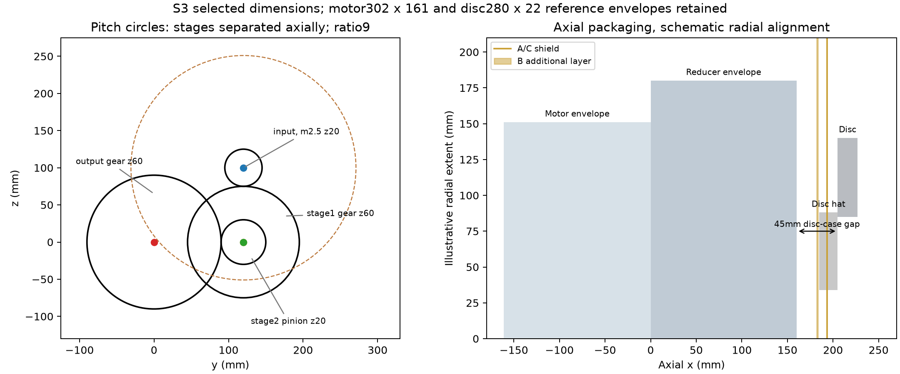
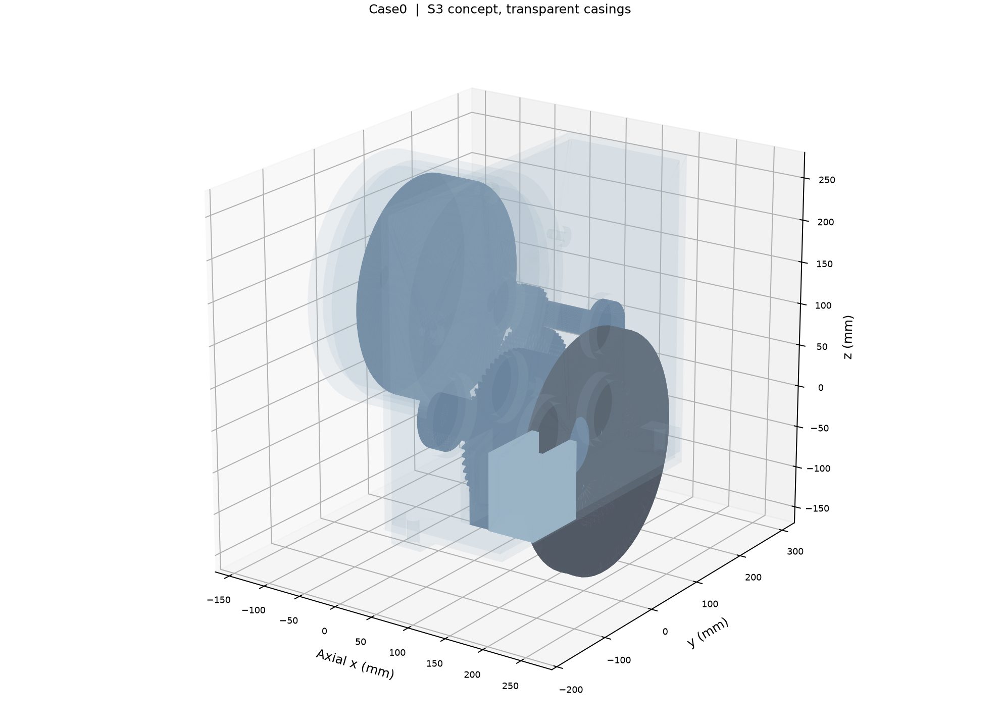
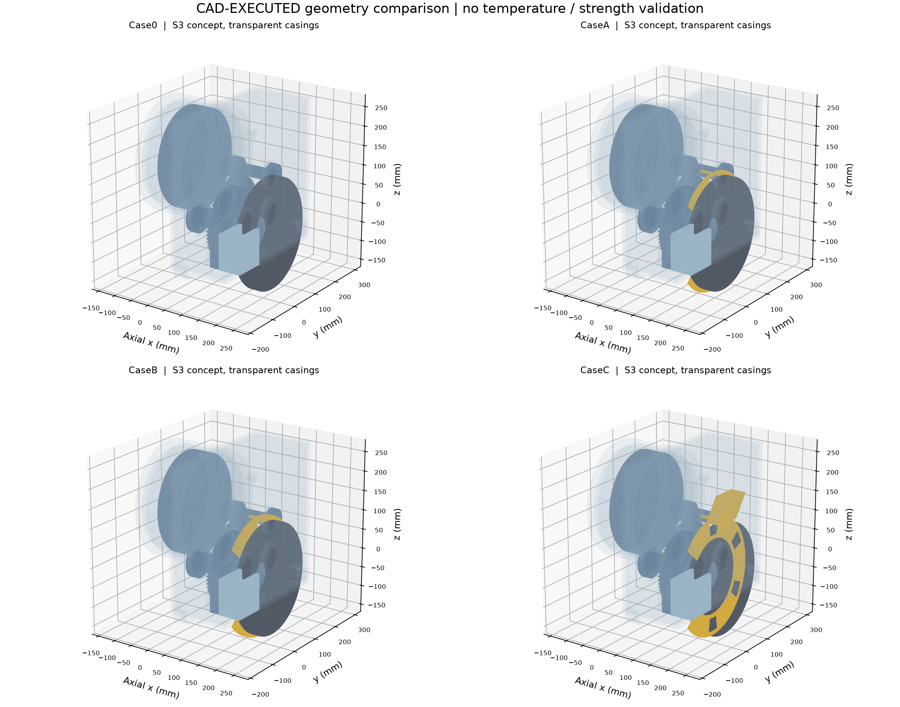
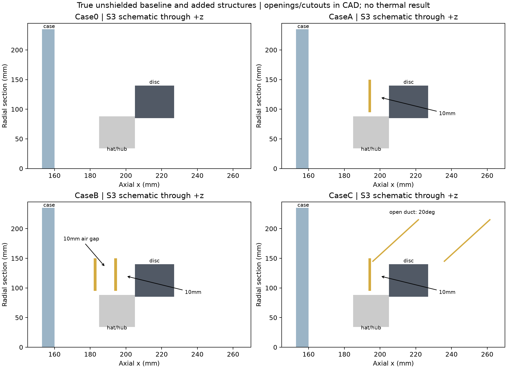
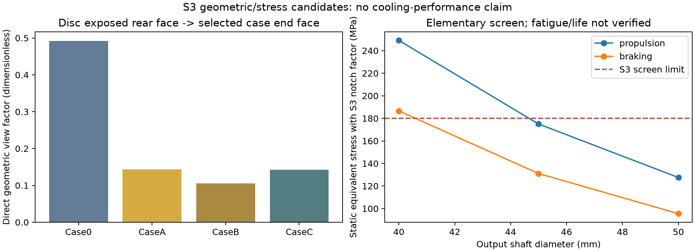

# 1. 交付结论与版本边界

M2已由研究者按“具有明确工程假设、通过能量守恒及数值验证的概念瞬态热网络模型”范围批准。PR #3已合并；附注Tag `M2-v1.0` 远端对象为 `4ad89c4a220174de741b4ba48706279d3b7cb2d1`，剥离目标与实际main合并提交 `1d51c22d94577ff8f52be785300b5f6b4aadee37`一致。M0/M1固定Tag未变。M2真实几何、热阻、换热和温度标定仍未完成，限定验收没有消除这些限制。

远端归档成功后，从该最新main建立 `stage/M3-geometry`，[草稿PR #4](https://github.com/alan9900/Thermal-coupling-analysis-under-drive-control-integration/pull/4)独立送审。实际CAD生成源提交 `3ea9c6bd2af2cde56d17c1ce5f56ba446813477b`；后续报告/图稿和完整成果提交在阶段登记追加，不将证据SHA冒充正式验收版本。

本轮已实际执行 **CadQuery2.8.0 / OpenCascade7.9.3.1 / Python3.13.12**，生成共同零件、四种装配与四个外部空气域，导出56个有限STEP；参数化源为YAML与Python。4名义Case无超过0.001mm³的正体积干涉，STEP回读体积相对误差约10⁻¹³。8组测试、18个齿轮相位、2187组解析范围筛查完成；729组不满足几何约束并被拒绝。

**M3交付为S3概念几何和候选热参数，不是原厂总成CAD、可制造发布、实物安装验证、样机标定或降温结果。** 当前输出轴强度余量、轴向定位/花键、轴承寿命/配合、分体壳体、密封及整车安装仍需完成。SolidWorks、ANSYS、Fluent与M4均NOT EXECUTED/NOT STARTED。未经研究者批准不合并M3、不创建M3-v1.0、不进入M4。

# 2. 对象、来源与参数等级

保持1800kg后驱概念车、后轴左右独立电机、每侧参考60kW及9:1，无差速器；详细几何仅左侧。前轴制动与整车双侧动力学继续只读复用M1。这里将参考电机外形用于自设计总成，不能称Toyota量产后驱电驱桥。

| 几何数据 | 值 | 来源及适用范围 |
|---|---|---|
| 电机壳体外径、轴向长度 | 302、161mm | ORNL表2.7，印刷46/PDF55页，S1参考，不缩放 |
| 定子外径/内径/叠长 | 264/161.9/50.8mm | 同表；槽口、端绕组和浸漆未重建 |
| 转子外径/叠片孔/叠长 | 160.4/51/50.165mm | 同表；51mm不是外伸轴端直径 |
| 电机外伸轴端 | 30mm | S3阶梯轴；轴端、花键及电机轴承未知 |
| 后盘外径/厚度/总高/定位孔 | 280/22/42/68mm | Brembo09.9908.21外形参照；内部筋、帽形、孔距为S3 |
| 输出轴承 | 6209，45×85×19mm | SKF目录边界；每只0.404kg参考质量，不等于完成寿命选型 |
| 中间/输入轴承 | 6207，35×72×17；6206，30×62×16mm | SKF目录边界；CAD只作支承包络 |
| 壳体、卡钳、支架、盘毂、孔距、安装距离 | 独立配置及Python基本体 | S3自设计，不冒充真实量产参数 |

ORNL原件和Brembo/SKF厂家页面已经核对，HTTP获取状态与哈希见 `data/raw/m3/manifest.json`，方法和限制见 `docs/M3_SOURCE_REVIEW.md`。KHK仅支持标准齿轮几何计算方法；模块、齿数和布局由本项目选择。材料ρ、cp、k及热膨胀系数为S3等效候选，M2的NIST量级参照不使新几何成为实测参数。

参考电机壳体质量14.1kg还包括原总成附属件，不能用它证明本等效壳体8.46kg正确；不通过强行调密度使不同对象质量相等。原始实际安装和热接触等未知量保持null。

# 3. 单侧三维模型与装配坐标

统一CAD单位mm，轴向为$x$，三根旋转轴平行$x$。输出轴中心$(y,z)=(0,0)$，中间轴$(120,0)$，电机/输入轴$(120,100)$。齿轮一级轴向区间33–58mm，二级95–127mm，不因端视图圆重叠而认定不同轴向级发生碰撞。

$$d=mz,\qquad a=\frac{m(z_1+z_2)}{2},\qquad i=\frac{60}{20}\frac{60}{20}=9.$$

一级模数2.5、20/60齿、中心距100mm、宽25mm；二级模数3、20/60齿、中心距120mm、宽32mm。齿廓采用20°标准全齿高渐开线的分段近似，侧隙候选0.15mm；无齿根圆角、接触疲劳或NVH验证。齿数与模数来自配置，壳长当前支持160mm固定布局，改变壳长需显式修改端支承布局，不会静默忽略输入。

电机壳体位于$x=-161\ldots0$，减速器$x=0\ldots160$，制动盘近/远面$x=205/227$。盘帽背面$x=185$，总高42mm；近摩擦面到壳体端面45mm。壳体基本外包络160×395×375mm，另有两侧车架接口耳；单侧装配轴向总包络约421mm、横向约493mm、高约405mm，整车包络仍未知，不能由两套镜像相加就声称可装车。

共同32个命名部件包括电机壳/定子/分段绕组/转子其他/阶梯输入轴、环形水套、中间与输出轴、4齿轮、6轴承包络、齿轮箱壳体、油库存、盘帽、毂、卡钳、两片、反力支架和安装螺栓。输出轴径45mm、长度260mm；参考电机转子孔保留51mm，但轴伸采用30mm新假设，不能把二者混用。

绕组50个接触/等效体未重建导线；定子48个简化槽及端绕组仅供等效热建模。壳体有电机错位安装孔和两个14mm车架接口孔，卡钳由两只M10概念螺栓和钢支架承力。其预紧、螺纹、摩擦防滑、壳体局部强度、轴肩/挡圈/花键、分体壳体及密封尚未完成，STEP不是可制造装配说明。

# 4. 真正的Case0与三种新增结构

M2网络中已有护罩节点，因此**不能把已归档M2原网络叫作无罩基准**。M3 Case0实际没有新增护罩、支柱或导流通道；如果后续采用此基准重新计算网络，必须另建配置移除M2护罩节点/辐射边，本轮未改M2。

| M3几何方案 | 新增结构 | 候选参数 | 新增罩及支撑质量 |
|---|---|---|---:|
| Case0 | 无 | 盘到箱端面45mm | 0kg |
| CaseA | 单层不锈钢候选罩+3支柱 | 厚1.5mm，盘距10mm | 0.354kg |
| CaseB | 双层罩+两级支柱 | 两层各1.5mm，层间10mm，近盘距10mm | 0.680kg |
| CaseC | 罩与开口斜通道一体、连接耳 | 同A，通道高70mm、出口方向20° | 0.531kg |

罩内/外半径95/150mm，卡钳避让80°。四个通风窗口保留内外连续桥带，面积比为扣除卡钳缺口后可用环带的15%，不是把整片径向割成无支承扇区。通风口候选面积约0.004939m²；C的通道内入口37×67mm，面积0.002479m²，出口倾斜通过斜向中心线形成，未假定风机或强制流量。

设计变量按配置扫描：盘到箱25–65mm、罩距5–15mm、厚1–2mm、双层间隙5–15mm、开口面积比0.10–0.30、出口方向0–35°。解析检查2187组，729组拒绝；25mm盘距下支架延伸空间不足，部分双层参数还会侵入壳体或不能保留3mm装配间隙。未对所有范围点输出CAD或声称均可制造；25mm布局另做实际B-rep并成功触发拒绝。

# 5. 安装、热膨胀及静力筛查

## 5.1 干涉与中性格式

四名义Case分别有32/36/40/36个命名部件；全对检查先用轴对齐包围盒剔除无交集对，再对283对候选做B-rep布尔交集。共同边界接触允许，正体积阈值0.001mm³；最终无超过阈值的交叠。18个啮合转角点同样无正体积齿干涉，但不能证明连续运动公差、磨损或接触应力。

四装配STEP均回读为有效B-rep，体积相对误差约1.0–1.2×10⁻¹³；mm尺寸量级检查通过。56个STEP合计约78MB，最大装配约14MB；采用共同零件存一次、4装配、4空气域及新增罩件的有限归档方案，未存放CAD内核/虚拟环境或大规模DOE模型。

失败证据完整保留：初始输出轴后伸5mm与电机端盖交叠约2703mm³；将轴端收回箱体端面，未缩放电机。四正交安装螺栓中一只碰中间轴承约61.7mm³，改为20/100/180/300°错位孔。初始通风筋与内圆精确相切导致STEP回读失效，筋根偏离切点0.5mm并与盘片作0.02mm布尔融合重叠，消除退化，外形参考值未变。

初次外部空气连通检查还发现两处各约689mm³的封闭螺栓间隙气穴；最终外流域取最大连通体，气穴另记体积，未伪造通风孔。所有初次失败日志与修复后结果分开，不把第一次运行写成通过。

## 5.2 盘热膨胀与间隙

以候选铸铁线膨胀系数$\alpha=11\times10^{-6}\ \mathrm{K}^{-1}$、均匀温升400K作几何压力筛查。400K并非M2盘温预测，也不代表允许温升。

$$\Delta r=\alpha\Delta T r=0.616\ \mathrm{mm},\qquad \Delta x_{half}=\alpha\Delta T\frac{22}{2}=0.0484\ \mathrm{mm}.$$

盘外圆到钳桥候选冷间隙5mm，减去1mm装配预算及径向膨胀后仍3.384mm。单侧片运行间隙0.5mm，减去0.1mm轴向跳动预算、0.1mm片轴向公差及半厚增长后为0.2516mm；若跳动达1mm则为负并拒绝。真实跳动、热锥变形、摩擦片磨耗、支架挠曲和制动液沸腾未验证，不能把均匀膨胀当作完整制动器热安全。

## 5.3 输出轴与制动反力

由CAD矩形片接触区域求平均力臂约0.11435m；整环均匀压力公式约0.11474m，仅作对照：

$$r_{eff,annulus}=\frac{2}{3}\frac{r_o^3-r_i^3}{r_o^2-r_i^2},\qquad F_t=\frac{T_b}{r_{eff}}.$$

对单侧后盘0再生0.6g参考转矩752.84Nm，切向合力约6583N；候选摩擦系数0.35时每片法向力约9405N。反力路径为片/卡钳→两只安装螺栓→钢支架→齿轮箱安装凸台/壳体→车架接口耳，车辆侧支承边界尚未定义。按螺栓组中心至作用线偏心45.65mm，局部力矩约300.5Nm；两螺栓间距60mm，单栓合成剪力约5993N，以假设有效截面58mm²得到103.3MPa。120MPa只是S3静力筛查值，预紧、防滑、螺栓弯曲、热衰减与疲劳未知。

输出轴另分别计算驱动与制动两工况，未将牵引和制动最大值硬加。软件牵引130Nm，经9×0.96得输出1123.2Nm；并按二级齿轮力及两支承静力求弯矩。

$$\sigma_b=\frac{32M}{\pi d^3},\qquad \tau=\frac{16T}{\pi d^3},\qquad \sigma_{eq}=K_t\sqrt{\sigma_b^2+3\tau^2}.$$

| 轴径 | 驱动等效应力 | 制动等效应力 | 180MPa假设限值下结论 |
|---:|---:|---:|---|
| 40mm | 249.1MPa | 186.6MPa | 拒绝 |
| 45mm | 175.0MPa | 131.1MPa | 仅静力筛查通过，驱动余量约3%，不能冻结 |
| 50mm | 127.5MPa | 95.5MPa | 值得优先复核，需重配轴承/毂/花键/密封 |

$K_t=1.5$与180MPa均未由具体材料、缺口或温度实验证实；若实际缺口系数升至2，45mm驱动筛查将不通过。轴承反力约数kN至10kN，制动时内侧反力为负，说明过悬布置需要可靠双向支承与轴向定位；未完成轴承寿命和热配合。

# 6. 固体传热与辐射几何候选

## 6.1 体导热不等于接触热阻

$$R_{axial}=\frac{L}{kA},\qquad R_{radial}=\frac{\ln(r_o/r_i)}{2\pi kt}.$$

径向环带以$L=r_o-r_i$及对数等效面积$A_{eq}=2\pi t(r_o-r_i)/\ln(r_o/r_i)$记录，使表中L、A、k保持SI。接触项均null，不以几何计算自动补出真实接触压力或油膜。

| 路径 | M3候选体热阻K/W | M2等效值K/W | 使用限制 |
|---|---:|---:|---|
| 毂侧到近输出轴承的轴向轴段 | 0.482 | 盘/轴+轴/轴承串联3.5 | 仅34.5mm轴段，仍缺帽/毂/轴连接接触 |
| 盘帽5mm径向环板 | 0.673 | 盘到轴2 | 仅34–88mm径向实体项；不能与前行等同原单边 |
| 轴承环连续体径向下界 | 0.118 | 轴/轴承+轴承/壳2 | 真实滚动体/接触不连续，不能用实心环直接替代 |
| 支架轴向27mm钢桥 | 0.222 | 片/钳到壳8 | 安装和螺栓/接触未知；低体阻可能形成热桥 |
| 电机安装法兰全脸体阻下界 | 0.00116 | 两壳体0.3 | 全接触面积为上界，真实夹紧接触范围未知 |

M2等效边包含几何之外的界面与混合路径，两列不是同一已标定参数的“新旧真值”。不能因体阻低就宣称总热阻低；可优先辨识轴承、毂连接和支架热桥。接触面积比例0.1–1作为额外候选尺度，真实接触导热率仍null；无有限接触数据时不输出经过标定的总R。

## 6.2 直接几何视角与遮挡

对盘朝箱侧露出的88–140mm环面发射均匀面积、余弦加权射线，估计到选定箱体端面$x=160$的直接视角。该发射面面积0.037247m²，接收端面有效几何面积约0.14102m²；没有把壳体包含内腔的全部B-rep表面积直接加载成外部换热面积。

$$\widehat F_{disc\to face}=\frac{N_{first\ hit\ face}}{N},\qquad (AF)_{direct}=A_{emit}\widehat F.$$

射线显式检查帽/毂/轴、卡钳/支架、罩缺口/孔和通道壁。平板厚度按前/中/后三平面近似，未精确处理所有掠射侧壁；支柱小面积和罩连接耳、壳侧面、漫反射多次交换等未完整纳入，因此**结果是指定端面和限定遮挡模型的候选直接F，不是完整壳体总视角或辐射热量**。实际遮挡面积和发射率仍应在M4几何中复核。

| 方案 | N=32768的直接F | 直接AF m² | 加密至131072的F |
|---|---:|---:|---:|
| Case0 | 0.4924 | 0.01834 | 0.4938 |
| CaseA | 0.1435 | 0.005345 | 0.1433 |
| CaseB | 0.1054 | 0.003927 | 0.1060 |
| CaseC | 0.1421 | 0.005292 | 0.1421 |

各方案的射线分类总和为1；加密差小于事先0.01判据。另对等半径同轴圆盘作独立解析对照，理论F=0.609612，抽样0.609573，误差0.0000384。抽样标准误只描述固定候选几何下的数值误差，不是实际结构不确定性的置信区间。

M2盘—壳边采用0.04×0.12=0.0048m²的假设AF，但M2已经有护罩和其他辐射边，不能将它当作M3 Case0并直接比总热量。罩吸热后再辐射、支柱导热、空气绕流和液冷仍存在；CaseC与A的直接F接近，不说明二者总传热或温度优劣。

# 7. 与M2连接、热容和流体边界

$$m_i=\rho_iV_i,\qquad C_i=m_ic_{p,i}.$$

M3新候选写入 `M2_revision_candidates.csv` 和 `M2_geometry_interface.json`，没有覆盖M2配置或重算温度。重点节点如下：

| 节点 | M2热容J/K | M3候选J/K | 解释 |
|---|---:|---:|---|
| 盘/帽 | 2250 | 2392 | 4.784kg，Brep体积×候选铸铁 |
| 输出轴 | 552 | 1484 | 3.225kg，比M2假设明显增大 |
| 输出轴承合计 | 161 | 372 | 2×0.404kg参考，CAD实心环体积不可冒充真轴承质量 |
| 齿轮合计 | 1150 | 4513 | 实心轮体9.812kg，尚无轻量轮辐/强度设计 |
| 齿轮箱壳体 | 3600 | 7966 | 8.851kg，含候选耳与凸台 |
| 油库存 | 1600 | 1509 | 0.754kg候选，不等于整个箱内空腔填油 |
| 电机壳 | 4500 | 7611 | 8.457kg，不匹配ORNL原附属总成质量 |
| 定子/绕组 | 4766/1898 | 4819/1832 | 参考叠片尺寸+简化槽/端绕组，未标定 |

转子其他候选包括电机侧轴段，齿轮箱侧输入轴另列，避免轴质量重复计算；总成仍需增加独立毂、支架、输入/中间轴和两个轴承节点。转子其他不等同磁体，逆变器外置，M1总损耗与分项不可同时加载，不能把独立上界简单合成热工况。

本几何齿轮和壳体偏重，可能改变M2瞬态惯性与后盘热侵入；也提示未来应做有强度依据的轮辐与壳体设计。不能按新热容大小直接宣布温度更低，因为热源、热阻、流动和接触仍需共同复核。

电机环形水套内湿面约0.09038m²、水等效库存0.460kg，仅初步夹层几何，无入口出口/流量标定。M2总G=25W/K不因存在水套即得到验证。外部局部空气域四方案均为一个连通体，体积约0.0313m³；体积范围和入口、出口、旋转区、湍流、风量及环境边界均须后续重新核实。当前没有Fluent网格或流固耦合求解。

# 8. 验证记录与交付接口

| 检查 | 真实执行结果 |
|---|---|
| CAD内核 | CadQuery2.8.0/OpenCascade7.9.3.1，Python3.13.12，已实际运行 |
| 四Case | 32/36/40/36命名部件；基础32体一致，罩为连通实体 |
| 布尔干涉 | AABB剔除后283对均未超过0.001mm³；紧凑坏方案正确报干涉 |
| STEP回读 | 四装配有效；相对体积误差约10⁻¹³，mm量级通过 |
| 齿轮相位 | 2对×9角，共18次，通过限定正体积检查 |
| 单元/回归 | 8组PASS，含真Case0、公共体一致、坏参数拒绝和M2保护 |
| 范围筛查 | 2187解析组合，729拒绝；不是2187次CAD求解 |
| 辐射数值 | 射线分类守恒、32768/131072收敛、圆盘独立解析例通过 |
| 制造/装车/耐久/实物温度 | NOT EXECUTED |
| SolidWorks/ANSYS/Fluent | NOT EXECUTED；M4 NOT STARTED |

模型及STEP在 `cad/m3/`；配置为 `configs/m3_geometry.yaml`；生成/分析/测试/图稿脚本在 `scripts/m3/`；完整CSV、JSON、失败及成功日志、环境版本、STEP哈希和PNG/SVG/PDF图在 `results/m3/`。当前源提交和配置哈希与最终证据SHA通过独立交付检查及阶段登记追溯。

进入未来ANSYS前，必须确认mm→SI、共享拓扑/接触、绕组50体、轴承等效材料、金属/油/水/空气的区域分类、发射率和实际冷却。当前外部空气、库存油和水套不是可直接互换的流场域；实心轴承环不等于滚动接触热阻。几何闭合、体积回读和无穿透不能代替这些设置。

# 9. 验收建议与未解决问题

可送审范围为“参考尺寸可追溯、参数化源可重建、Case0/A/B/C齐备、完成限定几何/静力/热参数候选检查的概念CAD”。尚不能声称完成制造、装车或结构热安全验证；如研究者要求生产级轴系与完整卡钳选型，应继续M3修订。

优先未决问题：45mm轴在假设工况下余量很小，需复核50mm及实际材料/缺口/温度；轴肩挡圈、花键、轴承寿命与密封；壳体分型与装配顺序/局部强度、支架螺栓预紧与防滑；电机实际轴端/安装、水套端口、热接触/局部通风；实际车体/悬架/半轴/轮毂连接包络。当前不设差速器，也未强行缩放参考电机掩盖空间问题。

报告、STEP与验收表随PR #4待研究者检查。M3-v1.0未创建，M3未合并，M4未开展。

# 10. 主要资料

1. ORNL, *Evaluation of the 2010 Toyota Prius Hybrid Synergy Drive System*, 表2.7。[原始PDF](https://info.ornl.gov/sites/publications/files/Pub26762.pdf)。M0原件只读复用。
2. Brembo, [09.9908.21原厂尺寸页](https://www.bremboparts.com/europe/en/view-document/catalogue/disc/09-9908-21)。仅参考外形，不转移原产品认证。
3. SKF, [6209](https://www.emarketplace.in.skf.com/deep-groove-ball-bearing/6209)、[6207](https://www.emarketplace.in.skf.com/deep-groove-ball-bearing/6207)、[6206](https://www.emarketplace.in.skf.com/deep-groove-ball-bearing/6206)。目录边界与明确质量记录。
4. KHK, [Calculation of Gear Dimensions](https://khkgears.net/gear-knowledge/gear-technical-reference/calculation-gear-dimensions/)。几何方法，不提供本项目传动额定能力。
5. CadQuery, [Importing and Exporting Files](https://cadquery.readthedocs.io/en/latest/importexport.html)。参数源为Python，STEP为中性几何。
