# 阅读说明

本册收录29幅已完成ANSYS原生温度云图：1幅整体同步温度场、28幅部件云图。图像直接由ANSYS 2024 R1的已有RTH结果导出，保留软件标识、时刻和色标；未合成温度、未重新求解。目的是便于研究者保存截图、逐件阅读和复核。

所有图片来自Case0无新增隔热罩的D场景：首次驱动、高负载保持60 s、80 km/h开始以0.6g制动及随后30 s冷却。整车再生功率上限30 kW；详细热场只计算单侧。初始、环境及冷却液候选温度均为25°C。D的预热是给定热负荷，不代表普通平路恒速行驶。

结果为S3工程假设下的概念预测，M4继续为PARTIAL。真实材料、损耗分配、接触热阻及冷却条件未完成实物标定。时间步与完整接触及冷却敏感性尚未闭合，本册不新增研究或宣布阶段验收通过。

**先看时间，再看色标。** 整体图固定在76.7535 s；每张部件图选择该部件在已保存时刻中的局部最高温度时刻。各图通常采用独立自动色标，红色只表示该图较高温度，不能跨图直接比较颜色。云图最大值不是体积平均温度，也不是安全允许温度。

SMN和SMX分别表示图示节点的最低和最高温度，TIME为求解时间，TEMP为温度。部件页另列热容加权均温，来源是同一时刻的有限元积分；它不是按节点数量简单平均。

**整体图大部分呈蓝色的原因。** 整体色标约25～393°C，上限由摩擦片控制，轴承、壳体等25～69°C区域被压缩到低色阶；不能把蓝色理解成全体均为25°C或不存在传热。整体外观还会遮挡内部件，需结合部件图读取。

**本册峰值的适用范围。** 它们只对应当前首周期及预热窗口、离散输出时刻；不代表连续耐久全局峰值。约400°C片温依赖固定90/10盘片热量分配和无移动摩擦接触等假设，不能作为测量或安全认证。窗口终点达到最大值的部件尚不能声称已达到长期最高温度。

证据基线提交：`6244726c4c7666bf1a3527235b63fa223fc9da93`。原始记录：`results/m4/studies/D_normal12_rd95_dt1/`；完整来源与截图哈希见本册配套清单 `results/m4/contour_captures/capture_manifest.json`。草稿PR #5保持未合并。

# 图01 整体同步温度场

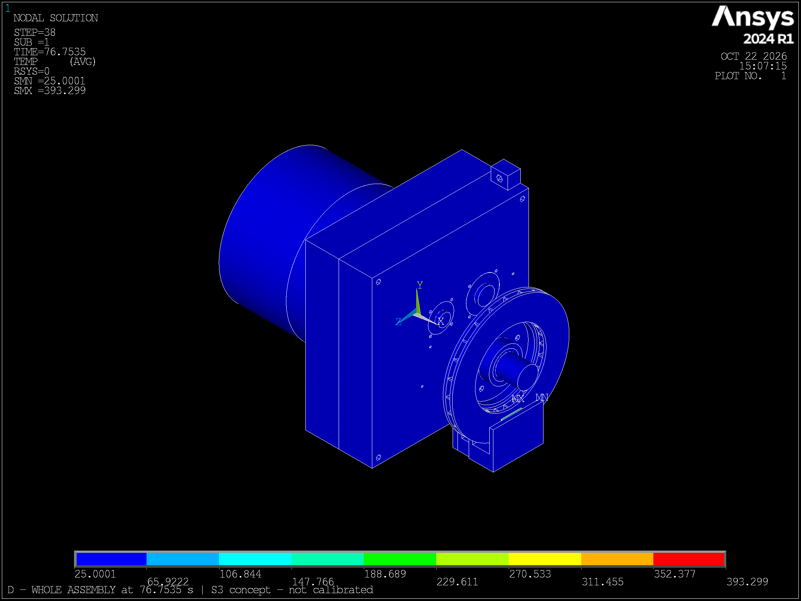{width=15.8cm}

时刻 76.7535 s；整体节点范围 25.000～393.299°C。这是同一时刻的空间范围，并非各部件独立峰值拼接。

整体图把28个有限元热区置于同一时刻，适合核对总成空间关系及同时温度水平。色标上限由当时的摩擦片温度决定，因此较低温的外壳和制动盘大多落在蓝色端；内部高温还可能被外壳遮挡。应结合下列独立部件图判读，不按外观颜色宣布总成没有热耦合。

区域标识：`WHOLE_ASSEMBLY`。软件图中的TIME与本页所列时刻一致；数值保留三位小数仅用于追溯，不代表实物预测精度。

# 图02 输出轴后轴承

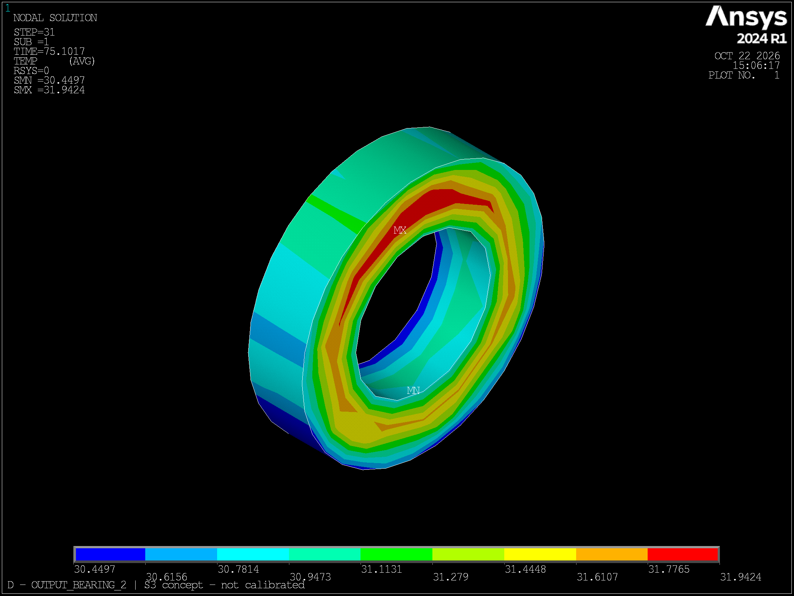{width=15.8cm}

窗口内记录峰值时刻 75.1017 s；节点范围 30.450～31.942°C；该时刻热容加权均温 31.271°C。

该轴承是输出轴向壳体传热链上的等效区域，同时加载候选轴承损耗。图中温差说明区域并非等温；不能单凭本图把升温全部归于制动盘。轴承内部接触及油膜尚未标定，不据此判断润滑或寿命。

区域标识：`M4_OUTPUT_BEARING_2`。软件图中的TIME与本页所列时刻一致；数值保留三位小数仅用于追溯，不代表实物预测精度。

# 图03 减速器后壳体

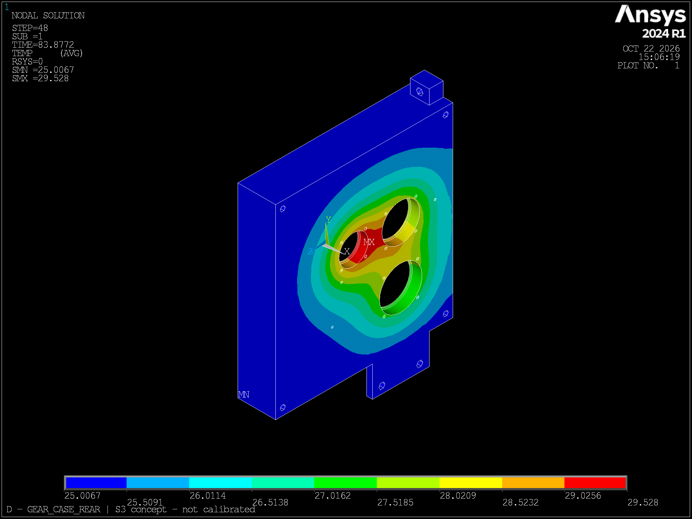{width=15.8cm}

窗口内记录峰值时刻 83.8772 s；节点范围 25.007～29.528°C；该时刻热容加权均温 25.794°C。

这是靠近输出端制动器的壳体区域。壳体同时接收内部损耗经连接传来的热量，并与环境发生对流和辐射交换。其峰值滞后于制动盘峰值；具体制动附加影响应使用相同网格的C减A差值，不能由D工况单图拆分。

区域标识：`M4_GEAR_CASE_REAR`。软件图中的TIME与本页所列时刻一致；数值保留三位小数仅用于追溯，不代表实物预测精度。

# 图04 减速器润滑油等效区

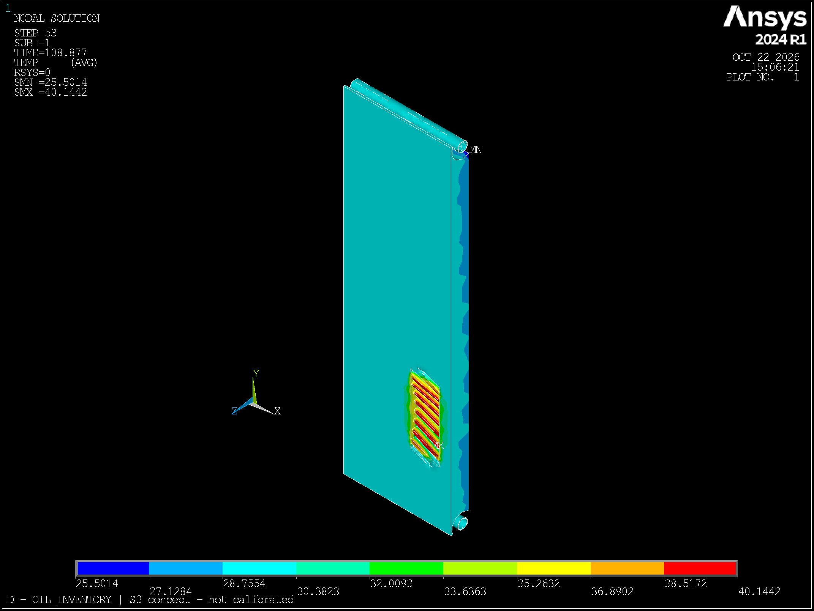{width=15.8cm}

窗口内记录峰值时刻 108.8772 s；节点范围 25.501～40.144°C；该时刻热容加权均温 29.245°C。

油液以静止导热实体及有限等效界面表示，另接收M1其他传动损耗候选热源。图中分布不代表真实流动、搅拌或喷油温度场。峰值发生在窗口终点，表示本次记录内仍在累积或重分布热量，不能称已获得长期最高油温。 本图最大值位于记录窗口终点，后续演化未在此窗口中覆盖。

区域标识：`M4_OIL_INVENTORY`。软件图中的TIME与本页所列时刻一致；数值保留三位小数仅用于追溯，不代表实物预测精度。

# 图05 电机绕组等效区

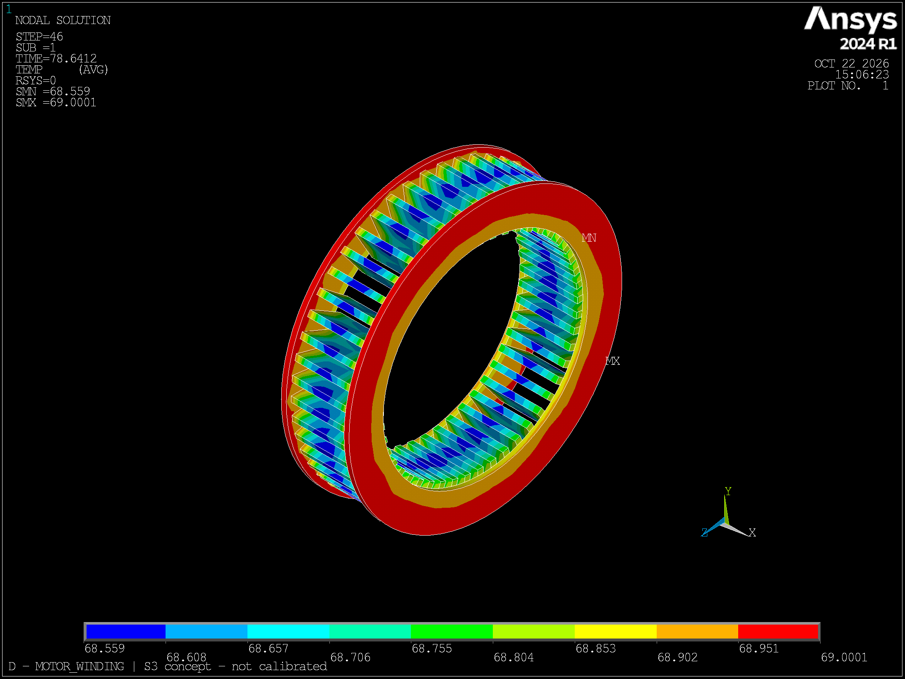{width=15.8cm}

窗口内记录峰值时刻 78.6412 s；节点范围 68.559～69.000°C；该时刻热容加权均温 68.797°C。

绕组加载工程分配的铜耗，逆变器热量没有加载于此。图示高温主要反映本场景给定的高负载内部发热与有限散热边界。铜块等效导热、绝缘及浸渍接触未标定，69°C不能视为实际绕组或绝缘热点精度。

区域标识：`M4_MOTOR_WINDING`。软件图中的TIME与本页所列时刻一致；数值保留三位小数仅用于追溯，不代表实物预测精度。

# 图06 减速器输出轴

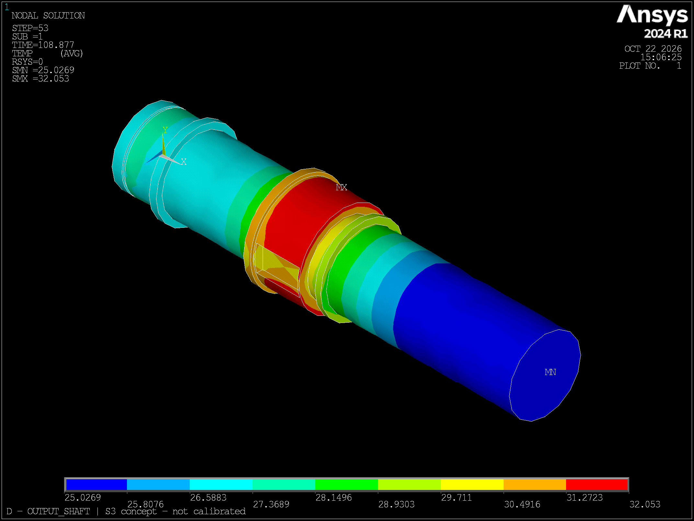{width=15.8cm}

窗口内记录峰值时刻 108.8772 s；节点范围 25.027～32.053°C；该时刻热容加权均温 27.393°C。

输出轴连接盘毂、支承与减速器内部，是固体导热路径中的一个储热区域。峰值出现在窗口终点，短时盘温回落不意味着轴已达到热平衡。温度云图只反映热场，不构成50mm候选轴的强度或传扭校核。 本图最大值位于记录窗口终点，后续演化未在此窗口中覆盖。

区域标识：`M4_OUTPUT_SHAFT`。软件图中的TIME与本页所列时刻一致；数值保留三位小数仅用于追溯，不代表实物预测精度。

# 图07 制动盘与盘帽

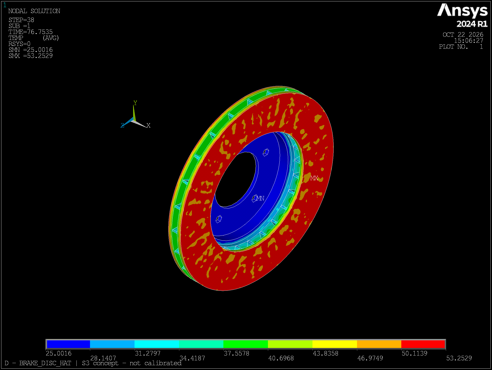{width=15.8cm}

窗口内记录峰值时刻 76.7535 s；节点范围 25.002～53.253°C；该时刻热容加权均温 38.377°C。

制动摩擦热加载于两侧摩擦环，盘帽通过实体导热受热，未直接均匀加载摩擦功率。图中摩擦环与盘帽的温差具有明确加载依据。该峰值对应单次制动及当前预热窗口，不是零再生、连续耐久或所有工况最高温度。

区域标识：`M4_BRAKE_DISC_HAT`。软件图中的TIME与本页所列时刻一致；数值保留三位小数仅用于追溯，不代表实物预测精度。

# 图08 近侧摩擦片

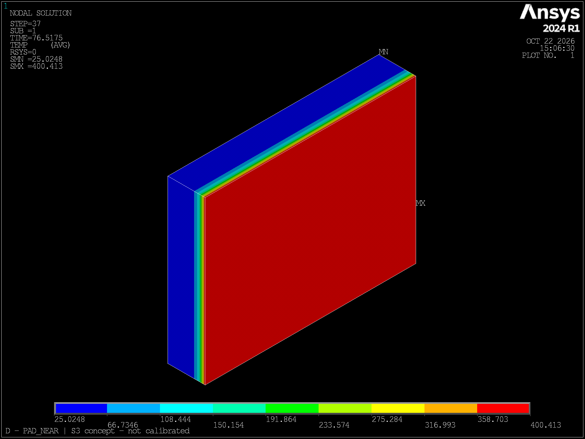{width=15.8cm}

窗口内记录峰值时刻 76.5175 s；节点范围 25.025～400.413°C；该时刻热容加权均温 78.717°C。

该摩擦片接收候选10%片侧热量中的一半，并通过有限接触导热。局部峰值约400°C，反映固定热分配和有限片厚下的表面陡温升。无移动摩擦接触、闪温或温变材料标定，不能据此认定真实摩擦片温度或制动安全。

区域标识：`M4_PAD_NEAR`。软件图中的TIME与本页所列时刻一致；数值保留三位小数仅用于追溯，不代表实物预测精度。

# 图09 制动卡钳等效体

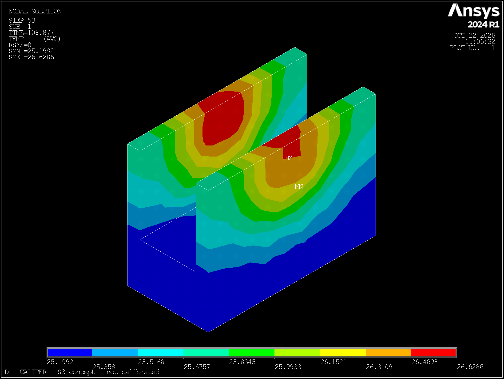{width=15.8cm}

窗口内记录峰值时刻 108.8772 s；节点范围 25.199～26.629°C；该时刻热容加权均温 25.480°C。

卡钳通过片背及安装链间接受热，没有把摩擦总热直接加载到卡钳。短窗口中卡钳温升远小于片表面温升，与热容和有限传热时间相容；不能据此认定长时卡钳、制动液或密封温度安全。 本图最大值位于记录窗口终点，后续演化未在此窗口中覆盖。

区域标识：`M4_CALIPER`。软件图中的TIME与本页所列时刻一致；数值保留三位小数仅用于追溯，不代表实物预测精度。

# 图10 卡钳反力支架

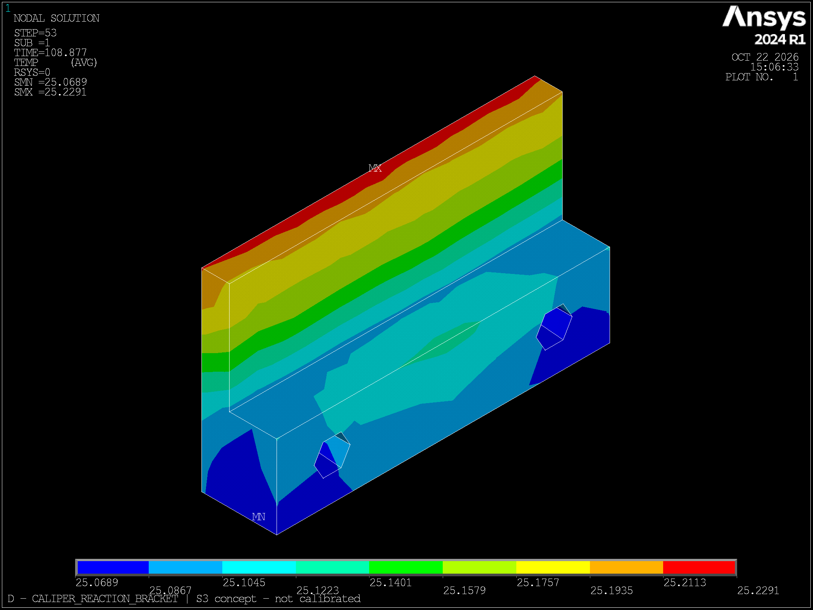{width=15.8cm}

窗口内记录峰值时刻 108.8772 s；节点范围 25.069～25.229°C；该时刻热容加权均温 25.117°C。

支架连接卡钳与壳体，构成盘片安装链通往电驱系统的一条固体传热支路。当前较小温升属于给定接触参数与短时窗口的预测；不能作为支架隔热效果、螺栓预紧或制动反力承载的验证。 本图最大值位于记录窗口终点，后续演化未在此窗口中覆盖。

区域标识：`M4_CALIPER_REACTION_BRACKET`。软件图中的TIME与本页所列时刻一致；数值保留三位小数仅用于追溯，不代表实物预测精度。

# 图11 制动盘盘毂

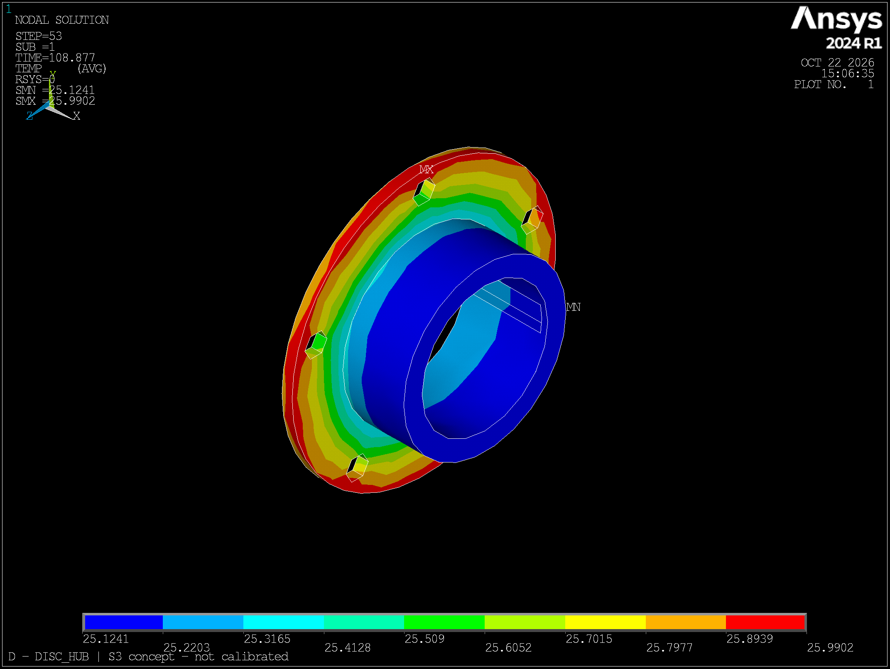{width=15.8cm}

窗口内记录峰值时刻 108.8772 s；节点范围 25.124～25.990°C；该时刻热容加权均温 25.364°C。

盘毂位于制动盘向输出轴传热的串联链中。盘毂温度明显低于摩擦环，可用于观察当前结构与边界下的温度梯度；热流仍须从对应界面结果读取，不能把各串联截面的热量重复相加。 本图最大值位于记录窗口终点，后续演化未在此窗口中覆盖。

区域标识：`M4_DISC_HUB`。软件图中的TIME与本页所列时刻一致；数值保留三位小数仅用于追溯，不代表实物预测精度。

# 图12 减速器前壳体

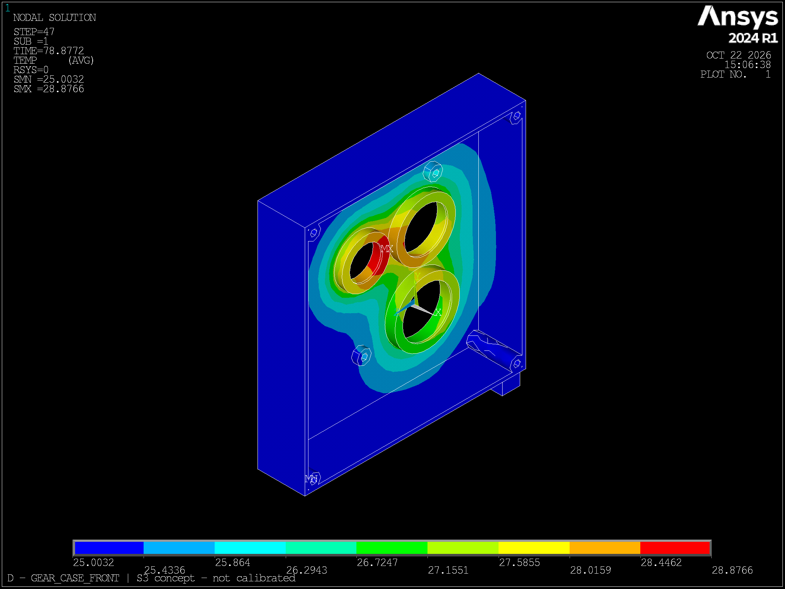{width=15.8cm}

窗口内记录峰值时刻 78.8772 s；节点范围 25.003～28.877°C；该时刻热容加权均温 25.577°C。

前壳体通过内部件、壳体连接及电机转接区域受热，同时向环境散热。与后壳体比较时应注意二者独立峰值时刻不同。当前图不证明壳体实际接触热阻、对流系数或安装散热条件已经标定。

区域标识：`M4_GEAR_CASE_FRONT`。软件图中的TIME与本页所列时刻一致；数值保留三位小数仅用于追溯，不代表实物预测精度。

# 图13 盘毂可拆连接套

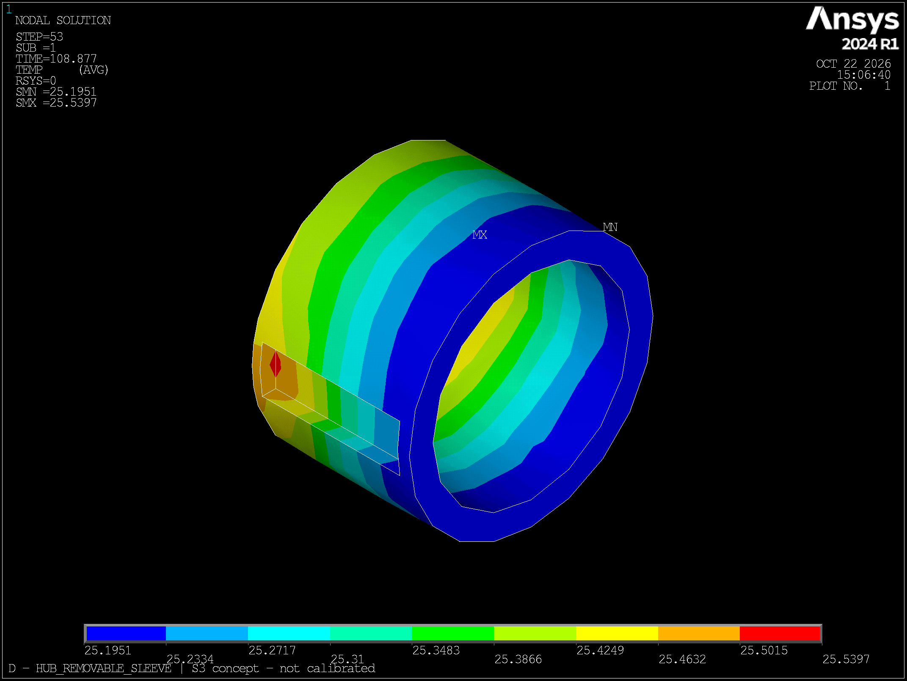{width=15.8cm}

窗口内记录峰值时刻 108.8772 s；节点范围 25.195～25.540°C；该时刻热容加权均温 25.320°C。

该连接套位于盘毂与输出轴之间，是需要保留有限接触导度的安装接口。短时较低温升不等于传热被完全阻断。其传扭能力、接触压力及接触热阻仍属研究限制，本图不提供机械连接认证。 本图最大值位于记录窗口终点，后续演化未在此窗口中覆盖。

区域标识：`M4_HUB_REMOVABLE_SLEEVE`。软件图中的TIME与本页所列时刻一致；数值保留三位小数仅用于追溯，不代表实物预测精度。

# 图14 输入轴轴承一

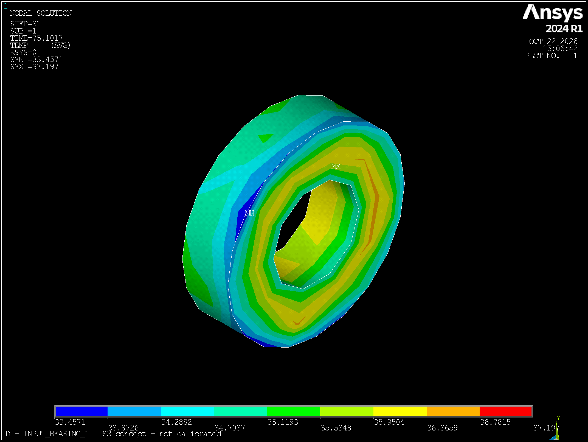{width=15.8cm}

窗口内记录峰值时刻 75.1017 s；节点范围 33.457～37.197°C；该时刻热容加权均温 35.908°C。

该区域以轴承等效材料和候选质量建立，加载候选轴承损耗，并通过轴及壳体连接散热。峰值与高负载结束附近的热源变化相关，但各来源贡献须通过热量收支分离。等效温度不是滚动体或内圈接触热点。

区域标识：`M4_INPUT_BEARING_1`。软件图中的TIME与本页所列时刻一致；数值保留三位小数仅用于追溯，不代表实物预测精度。

# 图15 输入轴轴承二

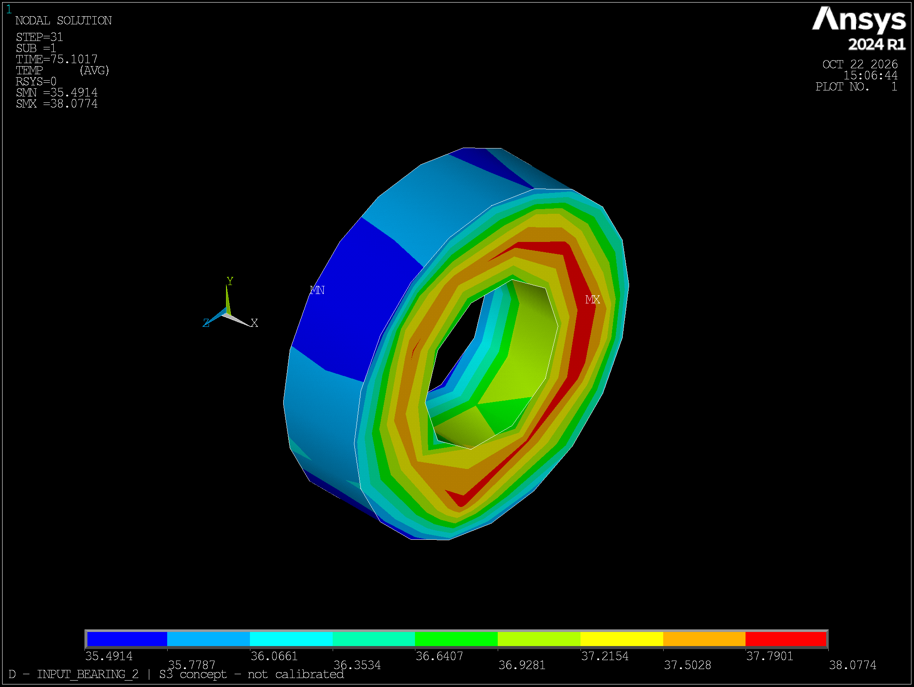{width=15.8cm}

窗口内记录峰值时刻 75.1017 s；节点范围 35.491～38.077°C；该时刻热容加权均温 36.936°C。

与输入轴轴承一属于同一输入轴支承链。两者峰值差异反映当前几何、局部连接和热边界下的模型响应，不足以推定真实轴承载荷不平衡。内部油膜与滚动接触温度未解析。

区域标识：`M4_INPUT_BEARING_2`。软件图中的TIME与本页所列时刻一致；数值保留三位小数仅用于追溯，不代表实物预测精度。

# 图16 减速器输入轴

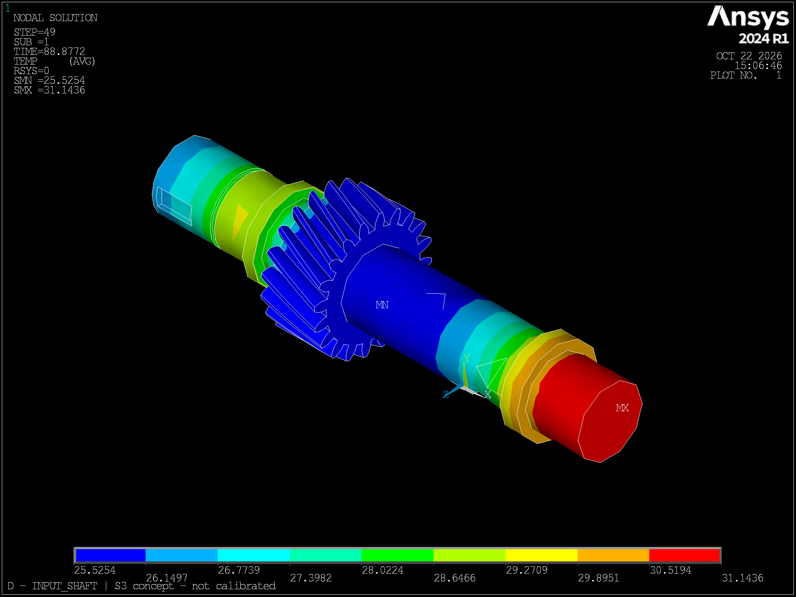{width=15.8cm}

窗口内记录峰值时刻 88.8772 s；节点范围 25.522～31.144°C；该时刻热容加权均温 27.309°C。

输入轴通过电机连接套、轴承和一级齿轮区域参与传热。峰值晚于部分轴承峰值，表明当前窗口内存在热量扩散与储存过程。未对轴材料温变或实际接触进行温度标定。

区域标识：`M4_INPUT_SHAFT`。软件图中的TIME与本页所列时刻一致；数值保留三位小数仅用于追溯，不代表实物预测精度。

# 图17 中间轴轴承一

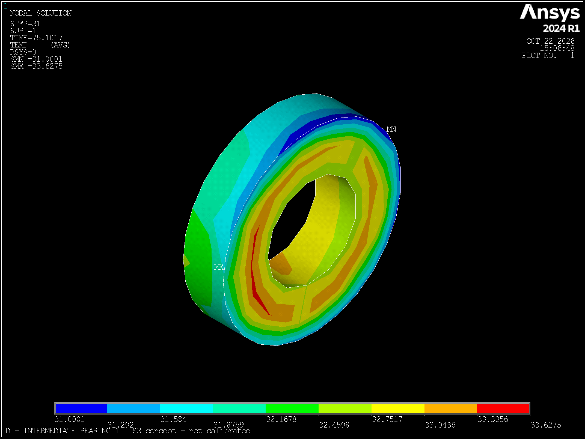{width=15.8cm}

窗口内记录峰值时刻 75.1017 s；节点范围 31.000～33.627°C；该时刻热容加权均温 32.780°C。

中间轴支承区加载候选轴承损耗并连接中间轴与壳体。图中有限空间温差应作为等效热区结果理解，不能替代滚道局部温度、润滑状态或轴向力验证。

区域标识：`M4_INTERMEDIATE_BEARING_1`。软件图中的TIME与本页所列时刻一致；数值保留三位小数仅用于追溯，不代表实物预测精度。

# 图18 中间轴轴承二

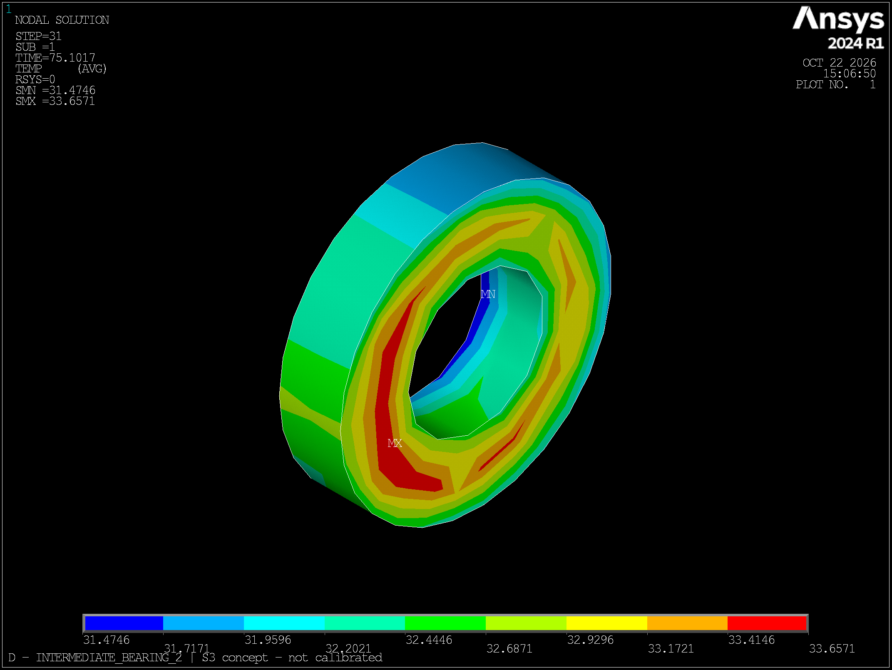{width=15.8cm}

窗口内记录峰值时刻 75.1017 s；节点范围 31.475～33.657°C；该时刻热容加权均温 32.791°C。

该轴承与中间轴另一支承形成并联的散热与储热连接。两支承峰值接近是当前候选配置的计算结果，不代表实际载荷或接触热阻相同。相应轴向力和寿命不在本次热场整理范围。

区域标识：`M4_INTERMEDIATE_BEARING_2`。软件图中的TIME与本页所列时刻一致；数值保留三位小数仅用于追溯，不代表实物预测精度。

# 图19 减速器中间轴

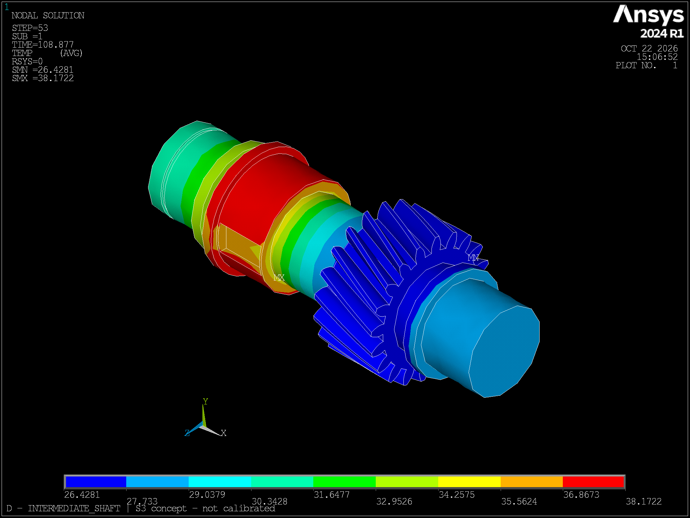{width=15.8cm}

窗口内记录峰值时刻 108.8772 s；节点范围 26.428～38.172°C；该时刻热容加权均温 30.148°C。

中间轴连接两级传动的热区及两个支承，参与内部损耗的再分配。窗口终点达到本次记录最大值，尚不能据此推断连续运行温度平台。该图使用热简化实体，不解析齿面局部接触温度。 本图最大值位于记录窗口终点，后续演化未在此窗口中覆盖。

区域标识：`M4_INTERMEDIATE_SHAFT`。软件图中的TIME与本页所列时刻一致；数值保留三位小数仅用于追溯，不代表实物预测精度。

# 图20 电机壳体

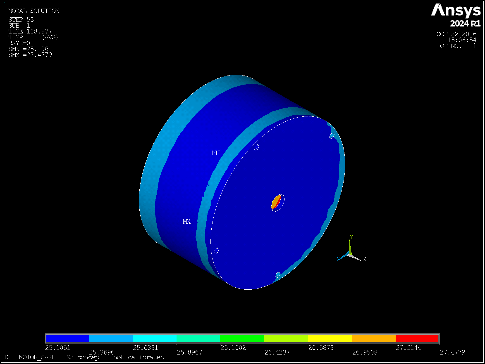{width=15.8cm}

窗口内记录峰值时刻 108.8772 s；节点范围 25.106～27.478°C；该时刻热容加权均温 25.504°C。

电机壳体通过定子及连接区域受热，并施加有限液冷边界。较低外壳温度可以与较高绕组温度同时出现，二者之间存在有限热阻。冷却系数与25°C体温为候选条件，不代表实际冷却回路能力。 本图最大值位于记录窗口终点，后续演化未在此窗口中覆盖。

区域标识：`M4_MOTOR_CASE`。软件图中的TIME与本页所列时刻一致；数值保留三位小数仅用于追溯，不代表实物预测精度。

# 图21 电机减速器转接件

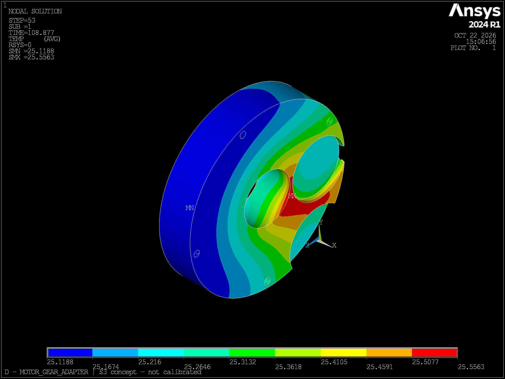{width=15.8cm}

窗口内记录峰值时刻 108.8772 s；节点范围 25.119～25.556°C；该时刻热容加权均温 25.213°C。

转接件构成电机与减速器壳体之间的固体连接热区。当前温升小，不能把它解读为真实总成中的零耦合。温差与净热流须分别记录，尤其不能由单张温度图确定热流方向始终不变。 本图最大值位于记录窗口终点，后续演化未在此窗口中覆盖。

区域标识：`M4_MOTOR_GEAR_ADAPTER`。软件图中的TIME与本页所列时刻一致；数值保留三位小数仅用于追溯，不代表实物预测精度。

# 图22 电机输入传扭连接套

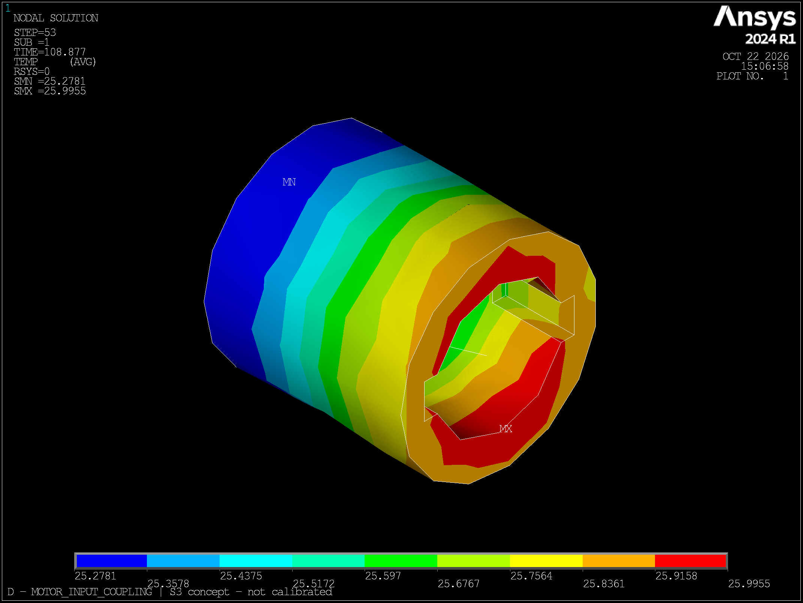{width=15.8cm}

窗口内记录峰值时刻 108.8772 s；节点范围 25.278～25.996°C；该时刻热容加权均温 25.566°C。

该连接套用于保留电机转子轴与减速器输入端之间的候选机械及热连接。云图反映等效实体和有限接口的热响应，不验证连接套传扭、接触压力或装配公差。 本图最大值位于记录窗口终点，后续演化未在此窗口中覆盖。

区域标识：`M4_MOTOR_INPUT_COUPLING`。软件图中的TIME与本页所列时刻一致；数值保留三位小数仅用于追溯，不代表实物预测精度。

# 图23 电机转子及其他损耗等效区

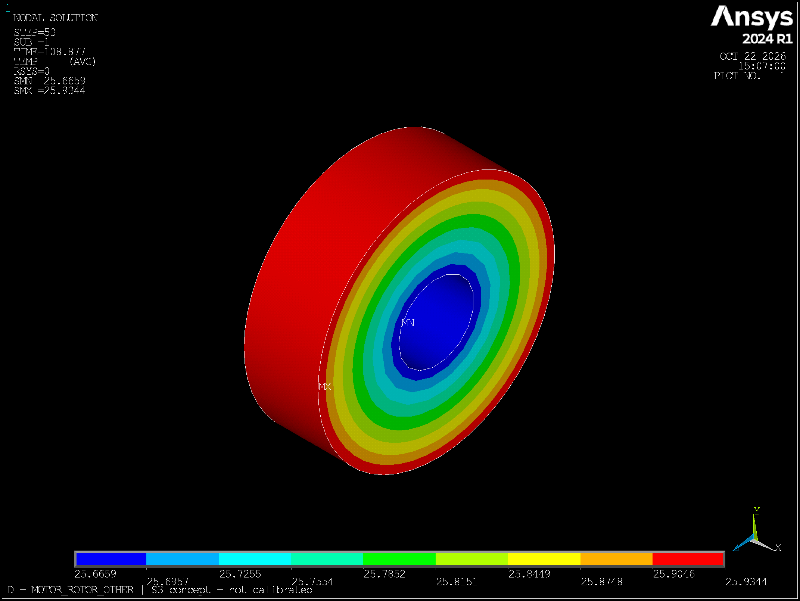{width=15.8cm}

窗口内记录峰值时刻 108.8772 s；节点范围 25.666～25.934°C；该时刻热容加权均温 25.819°C。

该区域接收M1工程场景分配的转子及其他损耗，未把这部分全部解释为永磁体发热。较低等效温升不能用于宣布磁体无退磁风险；磁体几何、损耗和内部换热尚未独立标定。 本图最大值位于记录窗口终点，后续演化未在此窗口中覆盖。

区域标识：`M4_MOTOR_ROTOR_OTHER`。软件图中的TIME与本页所列时刻一致；数值保留三位小数仅用于追溯，不代表实物预测精度。

# 图24 电机转子轴

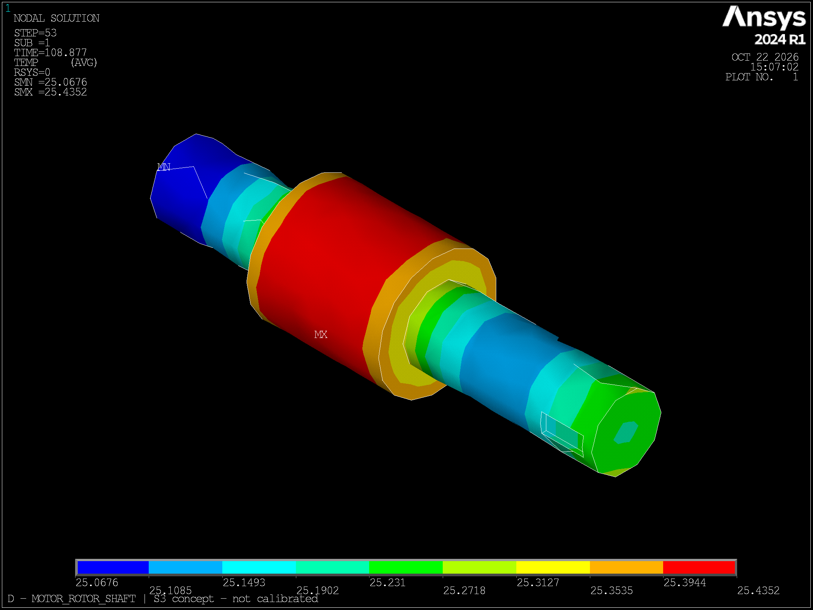{width=15.8cm}

窗口内记录峰值时刻 108.8772 s；节点范围 25.068～25.435°C；该时刻热容加权均温 25.286°C。

转子轴通过内部连接及传扭接口参与热量传递。图中低温升是当前工程热源分配、有限窗口和等效热阻共同作用的结果；不是实际高速转子轴的标定温度。 本图最大值位于记录窗口终点，后续演化未在此窗口中覆盖。

区域标识：`M4_MOTOR_ROTOR_SHAFT`。软件图中的TIME与本页所列时刻一致；数值保留三位小数仅用于追溯，不代表实物预测精度。

# 图25 电机定子铁心等效区

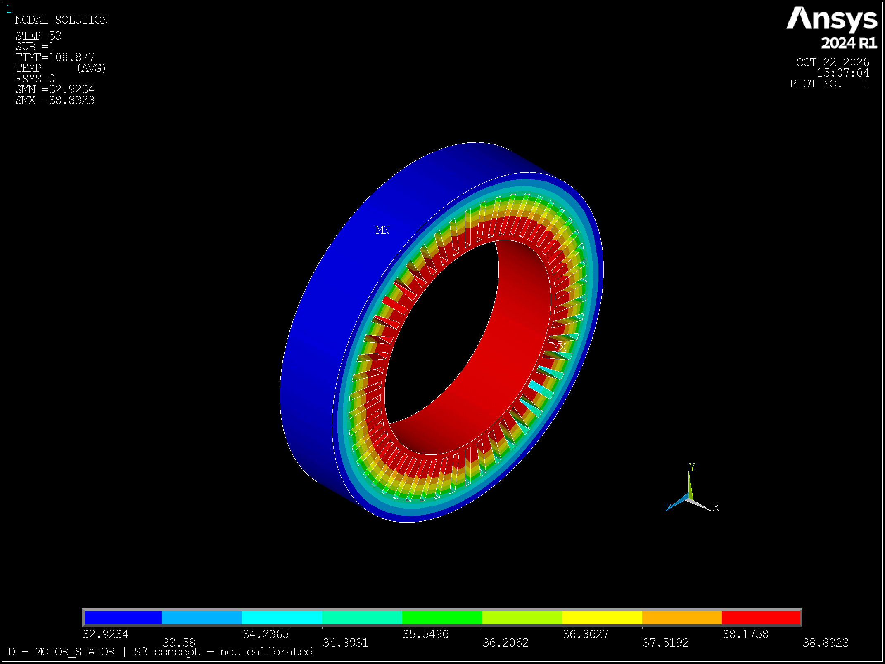{width=15.8cm}

窗口内记录峰值时刻 108.8772 s；节点范围 32.923～38.832°C；该时刻热容加权均温 35.696°C。

该区域加载工程分配的铁耗，并与绕组、壳体进行有限导热。绕组与定子的峰值不同步，不能将独立峰值相减当作同一时刻温差。叠片铁心各向异性及绕组接触热阻仍未知。 本图最大值位于记录窗口终点，后续演化未在此窗口中覆盖。

区域标识：`M4_MOTOR_STATOR`。软件图中的TIME与本页所列时刻一致；数值保留三位小数仅用于追溯，不代表实物预测精度。

# 图26 输出轴前轴承

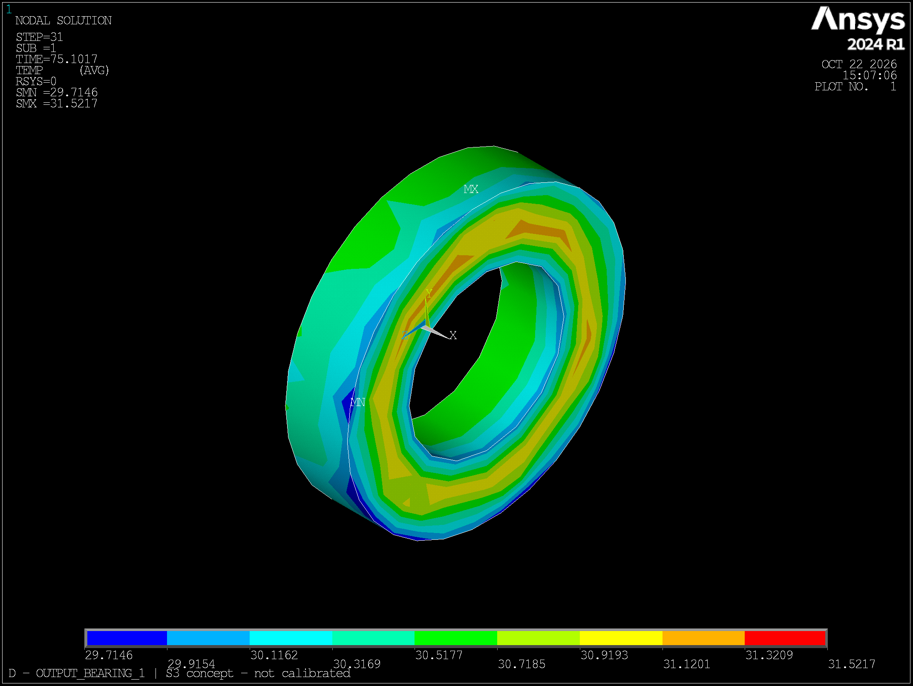{width=15.8cm}

窗口内记录峰值时刻 75.1017 s；节点范围 29.715～31.522°C；该时刻热容加权均温 30.853°C。

该区域与输出轴后轴承共同连接输出轴与壳体，加载候选轴承损耗。比较两者峰值可描述当前模型的支承热分布，但不能区分实际滚道局部摩擦热或验证真实润滑条件。

区域标识：`M4_OUTPUT_BEARING_1`。软件图中的TIME与本页所列时刻一致；数值保留三位小数仅用于追溯，不代表实物预测精度。

# 图27 远侧摩擦片

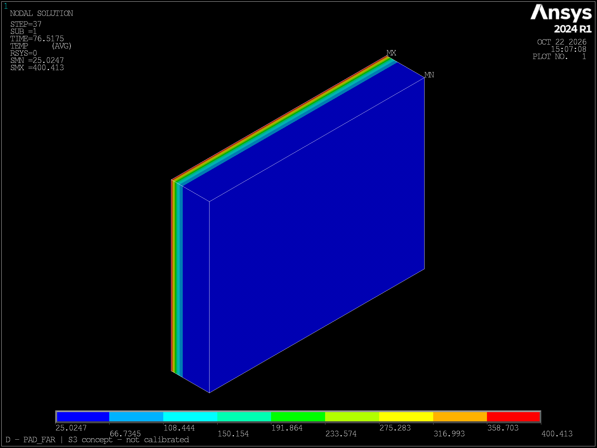{width=15.8cm}

窗口内记录峰值时刻 76.5175 s；节点范围 25.025～400.413°C；该时刻热容加权均温 78.717°C。

远侧片与近侧片采用对称候选热量分配，因此峰值非常接近；这是模型设定与响应，不是实测对称性证据。约400°C预测仍受固定90/10盘片分配、静止面热流及常热物性限制。

区域标识：`M4_PAD_FAR`。软件图中的TIME与本页所列时刻一致；数值保留三位小数仅用于追溯，不代表实物预测精度。

# 图28 一级齿轮等效热区

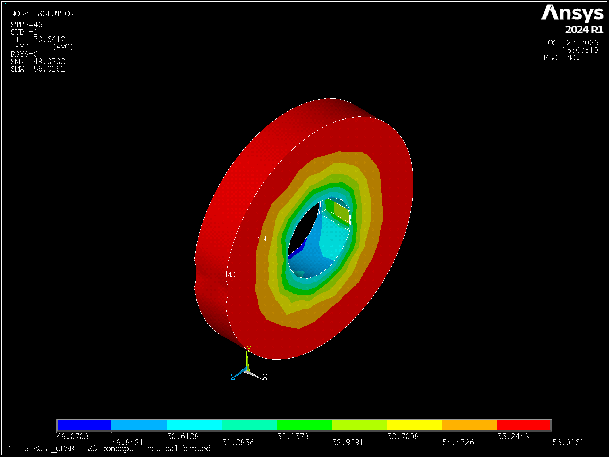{width=15.8cm}

窗口内记录峰值时刻 78.6412 s；节点范围 49.070～56.016°C；该时刻热容加权均温 54.864°C。

M1齿轮损耗候选中的一半施加到一级从动齿轮等效热区。该图反映简化实体的温度扩散，不解析斜齿局部啮合或瞬时接触闪温。斜齿传动实际损耗未重新标定，不能据此声称效率提高。

区域标识：`M4_STAGE1_GEAR`。软件图中的TIME与本页所列时刻一致；数值保留三位小数仅用于追溯，不代表实物预测精度。

# 图29 二级齿轮等效热区

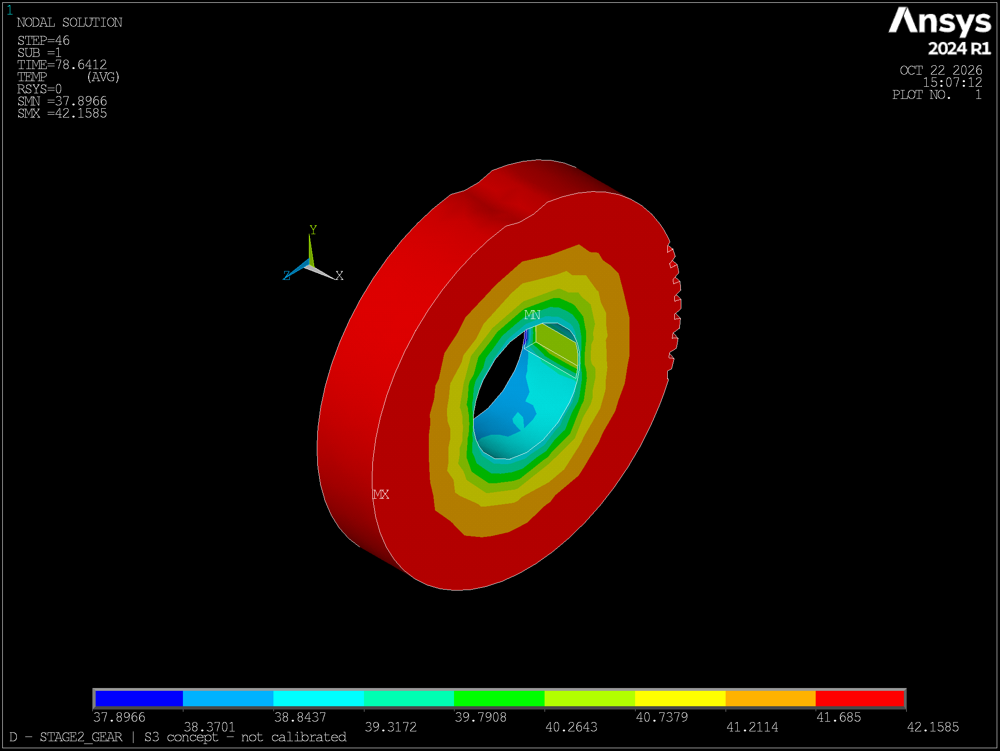{width=15.8cm}

窗口内记录峰值时刻 78.6412 s；节点范围 37.897～42.159°C；该时刻热容加权均温 41.513°C。

二级从动齿轮接收另一半齿轮损耗候选热源。与一级热区峰值不同可以来自体积、热容及连接边界差异，不能据温度高低反推两级损耗大小，更不能当作齿面接触温度试验。

区域标识：`M4_STAGE2_GEAR`。软件图中的TIME与本页所列时刻一致；数值保留三位小数仅用于追溯，不代表实物预测精度。
