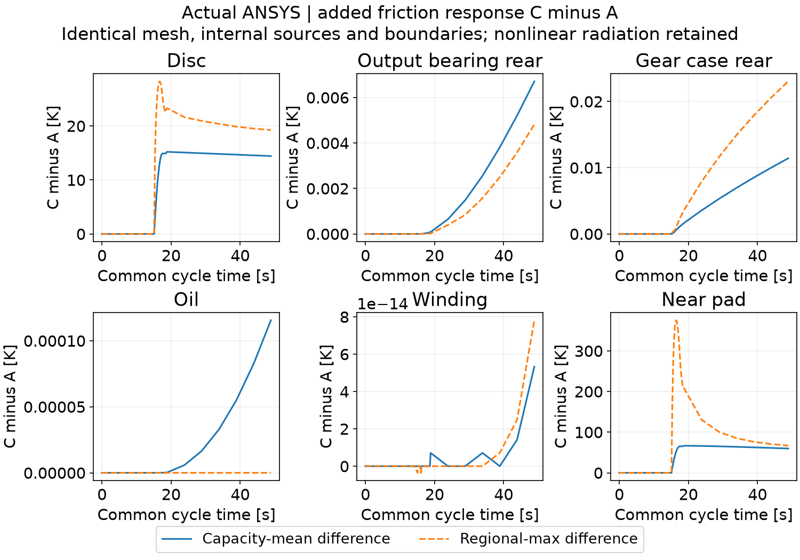
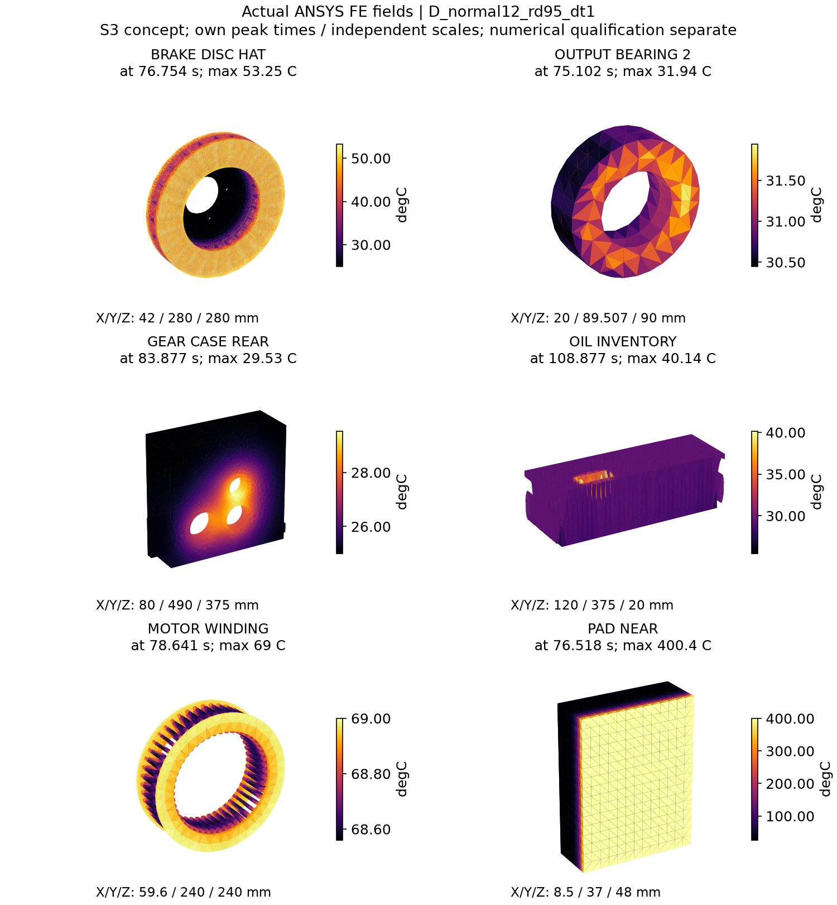
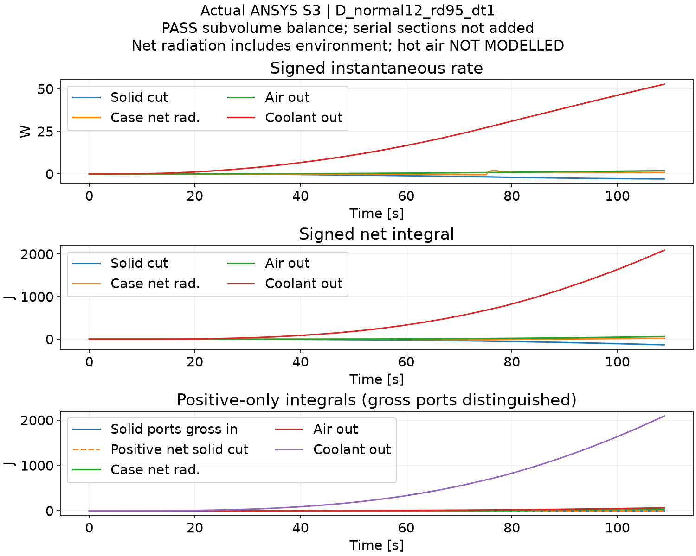
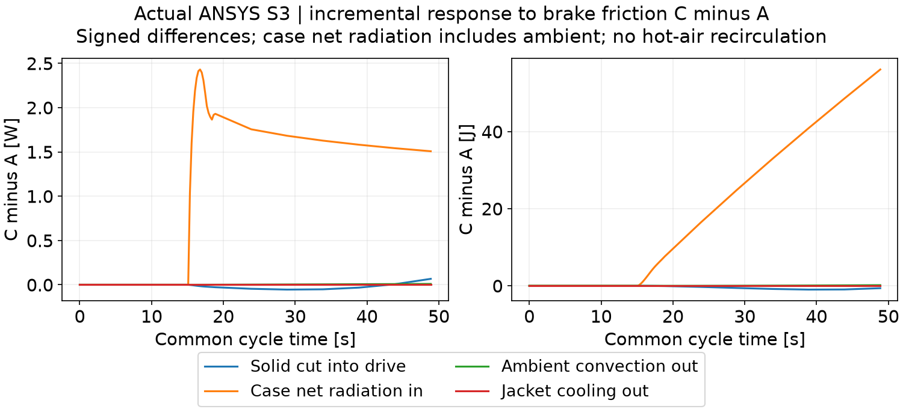

# 1. 当前状态与研究范围

**阶段状态：PARTIAL；按研究者2026-10-22要求暂停进一步研究，仅整理已有成果。** 本报告记录实际 ANSYS 2024 R1 计算及尚未通过的项目，不能作为 M4 验收完成声明。开发分支为 `stage/M4-ansys`，草稿 [PR #5](https://github.com/alan9900/Thermal-coupling-analysis-under-drive-control-integration/pull/5)。最终数据表、测试状态和可复算输入随本阶段提交更新。模型结果均为 **S3 工程假设下的概念预测**，不是实际样机温度标定。

M3 已按研究者批准的概念几何范围归档。附注标签 `M3-v1.0` 已推送，远程解引用提交为 `7a6b9b1512495283fa12dd4a2a7ffdf698554d3e`；M0、M1、M2 标签保留。M3 验收不代表机械安全、疲劳寿命或制造认证。轴承轴向力、连接套传扭、接触热阻与真实冷却边界仍未完成标定。

研究对象保持 V0.4：1800 kg 后驱概念车，后轴左右独立双电机，每侧参考 60 kW、两级斜齿减速器总速比 9.0、50 mm 输出轴候选、输出端内移制动盘，无差速器。详细热场只计算单侧。M4 当前只使用真正没有新增隔热罩的 **Case0**，没有开展 Case A/B/C、Fluent 或 M5。

# 2. 实际运行环境与几何

本机实际可用软件为 **ANSYS Workbench / Mechanical / MAPDL 2024 R1（v241）**。没有将其记为 2025 版本。参数与数据处理使用 Python、CadQuery/OCP 和本机 DPF 7.1；M1/M2 的 MATLAB R2025a 归档输入保持不变。本轮 ANSYS 求解不等于重新运行 M1/M2 MATLAB 模型。

实际导入 `cad/m3_helical/Case0_d50_helical_thermal.step`，核对为 129 个部件分组、131 个实体；油液等效体包含 3 个不连通实体。抑制微小紧固件、密封和不作为本阶段有限元固体求解的空气/冷却液体积后，保留 28 个材料区域分组、30 个实体。油液采用静止导热与有限等效界面，不是已求解的流体域。

几何数据库原生长度、面积、体积单位分别为 mm、mm²、mm³，已显式转换到 SI。材料、热容和能量积分采用实际有限元体积，不能直接把导入器报告体积视为精确网格积分体积。详细证据见 `results/m4/import_checks.json`、`import_volume_comparison.csv` 与各工况的 `FE_capacity_checks.json`。

原始约 33.2 万实体单元网格可实际求解，但摩擦片厚度仅一层。该网格只保留为诊断参考；此前得到的局部峰值不作为收敛温度。修订网格把 8.5 mm 摩擦片厚度分别划分为 6、12、24 层，并把制动盘摩擦面尺寸分别设为 4、2、1 mm。三套实际 Mechanical 网格约为 35.2、43.9、81.8 万实体单元；基础网格最小单元质量约 0.050，需结合收敛结果评价，不代表每个局部单元均为优质网格。

另实际执行原生 SHPP DEFAULT/ON 与 CHECK，未放宽默认限值：6/12/24 层网格均为 **0 个触发错误限值的单元**，警告单元分别为 **493/494/500 个**。警告不是零，见 native_shape_checks.json 和原始输出；这里只通过概念计算的基础筛查。原求解输入关闭自动形状检查的警告保留，此次独立检查补充其证据。

原始温度保留了局部低于初值的数值欠冲，未截断成 25°C。仅制动时 6/12/24 层网格最低值分别约为 24.562/24.876/24.994°C，随当前空间加密减小。这不是物理制冷证据；一致热容离散与瞬态陡载荷下的局部现象仍需注意，不能由峰值与能量检查推定全部温度场满足离散最大值原理。

当前三档空间加密集中在制动盘摩擦面与摩擦片厚度，其余内部区域主要保留共同基础网格。仅制动工况中，电机等热区温升很小；这些区域的温差指标通过不等于内部发热工况的空间离散误差已独立验证。三档时间比较同样对应单次制动及冷却，不自动证明 D 工况高负载保持阶段的时间步误差。验收范围须保留这一限制，不能称全工况、全部内部区域已经网格无关。

# 3. 方程、热源与边界

有限元热平衡采用

$$
\mathbf{C}\dot{\mathbf{T}}+\mathbf{K}\mathbf{T}
=\mathbf{Q}_{\mathrm{source}}-\mathbf{Q}_{\mathrm{conv}}-\mathbf{Q}_{\mathrm{rad}}.
$$

材料取常数工程候选值。实际材料牌号、复合绕组各向异性、摩擦材料温变与油液温变数据仍未知，保留为 null。候选热物性来自 M3 工程参数；公开纯金属资料只能校验数量级，不能替代具体总成材料标定。

| 等效材料 | 密度 kg/m³ | 比热 J/(kg·K) | 导热系数 W/(m·K) | 等级 |
|---|---:|---:|---:|---|
| 铝壳 | 2710 | 900 | 170 | S3 |
| 钢 | 7800 | 460 | 45 | S3 |
| 铸铁类制动盘 | 7100 | 500 | 45 | S3 |
| 铜类绕组等效区 | 8960 | 385 | 390 | S3 |
| 摩擦片等效材料 | 2500 | 800 | 2 | S3 |
| 油液等效体 | 850 | 2000 | 0.13 | S3 |

轴承按候选质量调整有效密度，保留有限导热系数，不按满实体钢体积虚增热容。确切值见 `configs/m4_case0.json`。未标定参数和工程场景分开保存。

另直接读取细网格 B、中网格 C/D 的原生 MP 常数及 RTH 单元材料编号，逐区核对 28 个材料区域的密度、比热和导热系数与配置一致，见 native_material_region_checks.json。该核对证明有限元实际赋值一致，不证明实际材料牌号或复合等效参数正确。

公开资料用于数量级交叉检查：[Hydro 6061 资料](https://www.hydro.com/Document/Index?id=560718&name=Alloy+6061.pdf)第 2 页给出 T6/T6511 导热系数 167 W/(m·K)，其取整密度换算约 2713 kg/m³；[NIST 铜固相比热](https://webbook.nist.gov/cgi/cbook.cgi?ID=C7440508&Mask=6&Units=CAL)的 Shomate 式在 298.15 K 换算约 385.08 J/(kg·K)。[KME 2021 材料手册](https://www.kme.com/fileadmin/DOWNLOADCENTER/COPPER%20DIVISON/4%20Industrial%20Rolled/3_Datasheets/Datasheets_NEW_2021/2021_KME_Handout_e.pdf)第 12、14 页不同铜材比热为 394、385 J/(kg·K)，差异按原文记录。事实、页码及下载状态见 data/raw/m4_reference/；Hydro/NIST 本地下载受 403 限制，但网页内容已核对，未伪造文件哈希。

这些资料不是本总成材料牌号证明。铜块导热系数不能直接代表含绝缘和浸渍材料的绕组横向导热；叠片铁心同样具有未标定的方向性。当前各向同性等效值、摩擦片及油液温变数据仍是工程假设，数值收敛不能消除其物理不确定性。

## 3.1 M1 热源接口

读取已经归档的 M1 派生热源时序，按功率分项加载：铜耗到绕组、铁耗到定子、转子/其他损耗到等效转子；齿轮啮合损耗候选各半分配到两级从动齿轮，轴承损耗候选均分到六个轴承等效区，其他传动损耗到油液。该空间分配是 S3 假设，没有齿面局部损耗标定。逆变器损耗独立记账，不加载到绕组；不再叠加电机—逆变器联合损耗或减速器总损耗。

制动摩擦热施加于制动盘两个摩擦环面以及两个摩擦片表面，不加载到整个盘帽。候选盘/片比例为 90%/10%，每一侧摩擦面各承担相应部件功率的一半。每次重划网格后按实际面积保持输入功率，而不是沿用旧网格热流密度。

$$
Q_{\mathrm{disc}}+Q_{\mathrm{pad}}=Q_{\mathrm{friction}},\qquad
q''_{f}=Q_f/A_{f,\mathrm{FE}}.
$$

## 3.2 接触与冷却

32 对显式面连接采用有限热接触导度或有限间隙等效换热；未把所有部件默认设为理想无热阻粘结。Mechanical 的 Bonded 类型只定义界面关联，仍显式给定有限 TCC。普通固体安装界面候选为 1000 W/(m²·K)，探索 100–10000；油液、气隙等连接保留其独立工程系数。

$$
q''_{c}=h_c(T_{\mathrm{target}}-T_{\mathrm{source}}).
$$

此式正值表示流入 source；路径 CSV 另统一为 source→target 正方向。

外部对流基准 15 W/(m²·K)，环境 25°C；电机水套壁面有限换热系数 300 W/(m²·K)，冷却液体温候选 25°C。冷却液流量、回路热容和泵能力未知，因此该边界是有限壁面换热加给定体温，不能称为完整冷却系统性能。

辐射采用 ANSYS radiosity，盘面发射率候选 0.8、壳体候选 0.7，`TOFFST=273.15`；Stefan–Boltzmann 系数为原生输入中的 $5.669\times10^{-8}$ W/(m²·K⁴)。

$$
q''_{\mathrm{rad}}\propto\sigma\left[(T_1+273.15)^4-(T_2+273.15)^4\right].
$$

辐射与固体导热允许随温差反向。当前辐射可见性只覆盖所定义的盘背面与壳体端面，未包含全部遮挡物。外部空气固定为环境边界，**尚未模拟制动盘热空气回流冲刷壳体**，不能据此认定真实系统的热空气耦合很弱。

# 4. 计算工况与数值验证

基准制动为 80 km/h、0.6g、整车总再生功率上限 30 kW、左右对称。它不是零再生制动。单次制动约 3.7754 s，单侧候选盘/片入热约 36.2267/4.0252 kJ。实际有限元离散载荷积分以各工况能量表为准。

| 工况 | 热源 | 控制窗口 |
|---|---|---|
| A | 电机与减速器内部损耗 | 首次驱动、制动阶段内部损耗、30 s 冷却 |
| B | 仅制动摩擦热 | 单次制动；诊断版另含 30 s 冷却 |
| C | 三类热源共同作用 | 与 A 同一时间轴 |
| D | 高负载预热后制动 | 首次驱动、60 s 高负载保持、制动、30 s 冷却 |

这里的 A/B/C/D 仅表示 **同一 Case0 几何中的热源工况**，不是 M3 的 Case A/B/C 隔热导流结构；本轮没有计算新增隔热罩方案。

这是可控的首周期有限元研究窗口，不是 M2 已归档六周期工况的全部峰值。原始热源文件哈希、重分箱积分和逆变器外部能量保存在各 `study_settings.json` 与 `source_intervals.csv`。

整体能量检查采用真实有限元储热与原生边界热流：

$$
R_E(t)=E_{\mathrm{in}}(t)-\Delta U_{\mathrm{FE}}(t)
-E_{\mathrm{conv,out}}(t)-E_{\mathrm{rad,net,out}}(t),
\quad
\Delta U_{\mathrm{FE}}=\int_V\rho c_p[T(\mathbf{x},t)-T_0]dV.
$$

温度使用实际 RTH 节点场。储热用各实体单元的 $\int\rho c_pN_i dV$ 权重，不用节点算术平均冒充体积平均。排除接触、辐射虚节点；每个重新编号的网格独立生成热容权重。边界使用 SURF152 原生热流和 SURF252 净辐射记录。DPF 7.1 对部分 MISC 记录给出不匹配的通用单位元数据，报告保留该差异，并依据原生单元定义解释物理量。

能量残差允许值为总输入的 0.5%。网格与时间步采用预先登记的工程阈值，见 `configs/M4_validation_policy.json`；检查所有保留区域的局部峰值和热容加权平均，不能仅检查制动盘。结果以 `results/m4/convergence_checks.json` 为准，未完成的计算标为 PENDING。

实际完成的单实体原生验证中，10 kJ 输入使 3900 J/K 的实体从 25°C 升至 27.5641025641°C，随后有限对流冷却与后向欧拉解析递推一致，能量差约 $3.5\times10^{-10}$ J。这只验证单位、热容与时间积分，不能替代 Case0 空间收敛。

另实际执行单开放辐射面原生算例：100/0/25°C 面对 25°C 空间节点，热流正向、反向及同温近零均符合绝对 K 解析式，最大绝对差约 $6.7\times10^{-7}$ W。原生 SURF252 的面积乘净热流密度与节点反力热功率一致，见 native_radiation_checks.json。该基准验证单位与方向，不验证本总成全部遮挡。首次过高导热系数与过紧绝对参考导致未收敛的失败日志保留，未采用其调试温度。

# 5. 实际结果与模型比较

数据整理时间：2026-10-22T14:29:25+08:00。文档基于提交 0c8abb857163b0ff83200f442dc5c19ffc87532c 及本轮更新；求解输入以原生清单的实际文件 SHA256 为准，不把该提交冒充所有任务的启动源码。

下表为各热源场景当前已完成计算的局部最高温度，单位 °C。不同场景热历史及窗口不同，不能把峰值差直接当作纯制动热贡献。显示位数用于复核，不代表实际温度精度。

| 热源场景 | 制动盘 | 输出端轴承 | 减速器后壳 | 油液等效体 | 绕组 |
|---|---:|---:|---:|---:|---:|
| A | 25.001 | 26.407 | 25.574 | 26.614 | 33.454 |
| B | 53.104 | 25.012 | 25.048 | 25.005 | 25.000 |
| C | 53.252 | 26.407 | 25.595 | 26.614 | 33.454 |
| D | 53.253 | 31.942 | 29.528 | 40.144 | 69.000 |

各行数据来源：

- A：A_normal12_rd95_dt1_retry1，终点 48.8772 s，38 个结果时刻。
- B：B_normal12_rd95h_dt2，终点 33.7754 s，44 个结果时刻。
- C：C_normal12_rd95_dt1，终点 48.8772 s，38 个结果时刻。
- D：D_normal12_rd95_dt1，终点 108.8772 s，53 个结果时刻。

D 的高负载保持是给定的工程热负荷，不代表普通平路恒速行驶。本轮不是 M2 六周期耐久制动，不能用单次制动峰值替代连续制动最高温度。

| 场景 | 总输入 J | 最大总体热能相对残差 | 实际状态 |
|---|---:|---:|---|
| A | 30939.383 | 0.0013967% | PASS 离散储热与边界收支 |
| B | 40251.873 | 0.0024397% | PASS 离散储热与边界收支 |
| C | 71191.295 | 0.0019574% | PASS 离散储热与边界收支 |
| D | 275778.843 | 0.000507% | PASS 离散储热与边界收支 |

| 数值验证项目 | 实际状态 |
|---|---|
| mesh | PASS_ENGINEERING_THRESHOLD |
| time | PENDING |
| radiation_facets_fine | PASS_ENGINEERING_THRESHOLD |
| radiation_facets_medium | PASS_ENGINEERING_THRESHOLD |
| radiation_facets_combined | PASS_ENGINEERING_THRESHOLD |

实体网格比较采用 6/12/24 层摩擦片和 4/2/1 mm 制动面。时间比较采用中网格生产候选，减半制动时间步，并细化 30 s 冷却段。阈值是预先登记的工程筛查，不是正式 GCI 或实验误差。细网格盘面采用 RDEC，须另通过辐射面误差检查。

{width=15cm}

原一层摩擦片约 150°C 峰值已拒绝。多层结果为约 400°C 量级，仍依赖候选热量分配、固定面热流和常热物性；不是实测温度或安全限值。

{width=15cm}

{width=15cm}

C−A 比较使用同一几何、网格、时间轴及内部损耗，只有制动盘/片摩擦热不同。热容均温之差表示区域储热变化；区域最大值之差并非逐点温差场最大值。非线性辐射保留，差值不能直接作为独立线性传递系数。低于网格筛查绝对温差门槛的信号仅用于诊断，不证明其物理精度。

{width=15cm}

{width=15cm}

M2 是集总温度；M4 同时保存节点最大值和热容加权平均。CAD 修订使输出轴热容由 552 变为约 2061 J/K、齿轮由 1150 变为约 3914 J/K、减速器壳体由 3600 变为约 8644 J/K。完整分组见 M2_M4_capacity_comparison.csv。转接件、转子与轴的分组也不同。

M2 含护罩与局部热空气节点；M4 Case0 没有新增护罩，也未求解热空气回流。不能把温差全部归因于散热改善，或据短周期宣布长期轴系热侵入不重要。

# 6. 热流路径、敏感性及开放项

导热路径按原始 source→target 方向统一记录。ANSYS 自动非对称接触只保留一个分支，需要按保留分支翻转符号；不能把两个对偶面的热量相加。串联的盘—毂—轴—轴承热流分别表示不同截面，不作为互相独立的热侵入相加。

$$
E_{\mathrm{net}}=\int q(t)dt,\qquad
E_{+}=\int\max[q(t),0]dt.
$$

普通固体连接用原生有效接触面积检查输出覆盖；油液两条间隙等效连接另检查油液局部储热收支。辐射净流包含定义的开口环境效应，未分解前不能直接称为纯粹的盘→壳体交换。外部对流和水套对流分开记账。

接触和冷却敏感性保持同一几何、同一热源和时间表。固体安装 TCC 单独改变；冷却低/高边界候选分别为外部/水套 5/100 与 40/800 W/(m²·K)。这是一组明确的工程边界场景，不是实测上下置信限。真实接触热阻、实际冷却条件和温度标定仍为未知。

当前接触扫描只改变名义金属安装链，**电机绕组—铁心、内部气隙及油膜等效连接没有同时扫描**。冷却扫描保持环境及冷却液体温为 25°C，配置中的 60°C 冷却液候选尚未计算。材料方向性、接触系数、冷却体温及热量分配的不确定性不能由这四个场景完全包络；不得将场景温度最大/最小值称为真实总成的完整预测区间。

当前主要限制包括：固定而未标定的盘/片热量分配；无移动摩擦接触与闪温；材料常热物性；转子/其他损耗并非全部永磁体发热；静止油液及有限等效换热；部分辐射遮挡与热空气路径缺失；空载拖曳、搅油和损耗温度反馈尚未重新标定。斜齿传动未因齿轮类型变化而获得新的效率标定。

<!-- ACTUAL_PATH_RESULTS -->
## 6.1 实际路径输出

下表是各自窗口终点有符号净积分，单位 J。固体跨界仅计连接套→输出轴和支架→壳体；轴承串联截面不重复相加。壳体净辐射包括开口环境，未分离成纯盘→壳体交换。

| 工况 | 固体净流入 | 壳体净辐射流入 | 环境对流流出 | 冷却带走 | 子控制体 |
|---|---:|---:|---:|---:|---|
| B_normal24_rd95h_dt1 | -0.06475 | 7.844 | 0.0012082 | -8.5814e-08 | PASS |
| C_normal12_rd95_dt1 | -5.6325 | 55.193 | 1.8136 | 89.711 | PASS |
| D_normal12_rd95_dt1 | -131.9 | 21.394 | 63.377 | 2091.1 | PASS |

瞬时有符号功率、累计正向流入与净积分独立保存在 signed_heat_paths.csv。两个并联固体入口的累计正向流入为各入口正向积分之和；它与“合计净热流取正后的积分”不同。两者另列于 positive_path_integrals.csv，串联轴承截面不计为额外入口。负数表示反向传热，不能把绝对值强计为热侵入。环境/冷却曲线表示流出热量，不与正向侵入直接相加。

外部对流是环境散热；**热空气回流为 NOT MODELLED，不是物理零值**。旧粗网格 B 子控制体残差约 0.72% 超过 0.5% 阈值，历史 BLOCKED 保留。

{width=15cm}

## 6.2 相同内部热源的增量收支

比较 C−A 后，终点电驱总成储热增加 55.344 J；固体跨界净输入增加 -0.61598 J，壳体净辐射输入增加 56.118 J，环境对流流出增加 0.16962 J，冷却带走增加 5.0704e-08 J。增量收支状态 PASS_INCREMENTAL_BALANCE，最大相对残差 0.019954%。

净输入的变化也可能反映反向散热的改变，不能全部称为始终正向的热侵入。壳体净辐射差仍包含壳体温度改变后与环境交换的变化；它不是完全分离的盘—壳体两体交换。未模拟热空气回流，不能据当前短窗口给真实系统三条路径作完整排序。

{width=15cm}

<!-- END_ACTUAL_PATH_RESULTS -->

# 7. 可复算成果与验收边界

复算入口见 `docs/M4_RUNBOOK.md`。已保存完整 Mechanical 原生输入压缩包、配置、脚本、各次实际测试与失败证据；大容量 Workbench/RTH 原始文件位于 `E:/ansys_runs/m4_case0_20261021/`，通过各计算目录的 `native_archive_manifest.json` 登记长度与 SHA256。它们未无计划写入常规 Git 历史，也未声称已经上传为远程大文件档案。

较大的原生日志在开发树中以无损 `.out.gz` 保存，解压字节与本机原始日志逐一 SHA256 一致，见 native_log_packages.json；原生工作目录及历史 Git 提交保留。独立复算准备工具可移除视角矩阵的本机缓存依赖并重新计算相同辐射面，准备检查不冒充已执行的新热求解。

本阶段保持独立草稿 PR，未合并 M4、未创建 `M4-v1.0`，未进入 M5。验收状态由补齐后的检查表与实际结果决定，不能因为求解器返回零错误或总体能量闭合就自动通过。

2026-10-22恢复工作时，发现前次 A 和最细时间步原生计算未写出完成标志且已无进程；原目录、输入、部分结果及日志保留，并登记外部中断回执。新目录使用相同输入独立重算，不把中断结果当作收敛结果，也不将未知的外部中断原因归为物理模型失败。

验收入口为 `reports/M4_ACCEPTANCE_CHECKLIST.md` 及 `results/m4/acceptance_checks.json`。PARTIAL 表示必要结果仍缺少，BLOCKED 表示已完成检查发现未达到阈值；真实标定和机械可行性限制不会因概念数值检查通过而自动消失。

## 7.1 本次暂停交接

研究者要求尽快总结、暂不继续研究。已停止队列和两个尚未完成的原生求解：B 最细时间步重试、C 高接触导度。部分结果与日志保留，明确不作为完成或收敛证据；回执见 `results/m4/attempts/user_requested_pause_20261022.json`。A 中网格重试已完成并纳入本报告。B 已完成时间步1/2结果可作阶段参考，但三档时间步独立性仍未闭合。

冷却低/高两种范围计算没有执行；安装接触敏感性未形成完整低/中/高系列。内部发热工况的进一步整体网格细化、预热阶段时间步验证也未执行。新增的五个后续验证草稿脚本仅保留为 NOT EXECUTED，不属于已经验证的交付流程，详见暂停回执。

本次交付是已有结果的可追溯总结，不是M4正式完成验收。后续需研究者另行要求才恢复计算；此时不合并PR、不创建M4正式标签、不进入M5。

# 8. 资料依据

1. EPA/ORNL 热源与真实/估计数据边界：本仓库 M0/M1 归档数据及报告；电机内部损耗标定继续为 PARTIAL。
2. [ANSYS SURF152 单元输出定义](https://ansyshelp.ansys.com/public/Views/Secured/corp/v242/en/ans_elem/Hlp_E_SURF152.html)：边界热流率及对流记录的原生含义。
3. [ANSYS CONTA174 单元定义](https://ansyshelp.ansys.com/public/Views/Secured/corp/v242/en/ans_elem/Hlp_E_CONTA174.html)：有限接触导度、接触热流、方向及面积记录。
4. [ANSYS 热接触建模](https://ansyshelp.ansys.com/public/Views/Secured/corp/v242/en/ans_ctec/Hlp_ctec_thercon.html)：有限 TCC 的物理意义。资料并未给出本总成实测 TCC。
5. [ANSYS SURF252 单元定义](https://ansyshelp.ansys.com/public/Views/Secured/corp/v251/en/ans_elem/Hlp_E_SURF252.html)：面积、发射率及净辐射通量记录；运行版本实际为 v241，输出以本机记录交叉检查。
6. [ANSYS VFOPT](https://ansyshelp.ansys.com/public/Views/Secured/corp/v242/en/ans_cmd/Hlp_C_VFOPT.html)：只有相同网格/辐射面才复用原生视角矩阵，不跨结构复用。

资料检索日期：2026-10-21。上述方法依据不代表工程候选材料或接触参数已经被来源标定。
