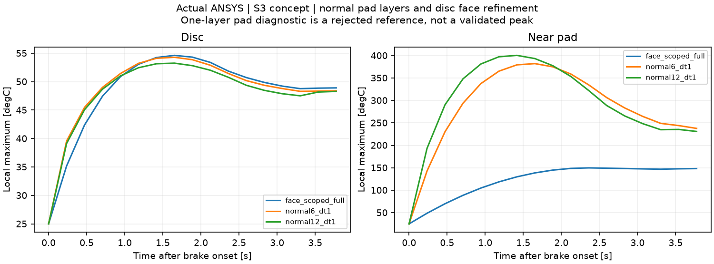
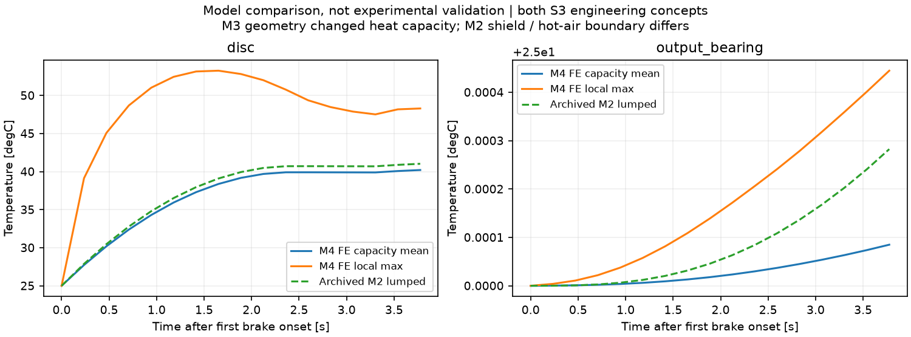

# 1. 当前状态与研究范围

**阶段状态：PARTIAL，计算与数值验证进行中。** 本报告记录实际 ANSYS 2024 R1 计算及尚未通过的项目，不能作为 M4 验收完成声明。开发分支为 `stage/M4-ansys`，草稿 [PR #5](https://github.com/alan9900/Thermal-coupling-analysis-under-drive-control-integration/pull/5)。最终数据表、测试状态和可复算输入随本阶段提交更新。模型结果均为 **S3 工程假设下的概念预测**，不是实际样机温度标定。

M3 已按研究者批准的概念几何范围归档。附注标签 `M3-v1.0` 已推送，远程解引用提交为 `7a6b9b1512495283fa12dd4a2a7ffdf698554d3e`；M0、M1、M2 标签保留。M3 验收不代表机械安全、疲劳寿命或制造认证。轴承轴向力、连接套传扭、接触热阻与真实冷却边界仍未完成标定。

研究对象保持 V0.4：1800 kg 后驱概念车，后轴左右独立双电机，每侧参考 60 kW、两级斜齿减速器总速比 9.0、50 mm 输出轴候选、输出端内移制动盘，无差速器。详细热场只计算单侧。M4 当前只使用真正没有新增隔热罩的 **Case0**，没有开展 Case A/B/C、Fluent 或 M5。

# 2. 实际运行环境与几何

本机实际可用软件为 **ANSYS Workbench / Mechanical / MAPDL 2024 R1（v241）**。没有将其记为 2025 版本。参数与数据处理使用 Python、CadQuery/OCP 和本机 DPF 7.1；M1/M2 的 MATLAB R2025a 归档输入保持不变。本轮 ANSYS 求解不等于重新运行 M1/M2 MATLAB 模型。

实际导入 `cad/m3_helical/Case0_d50_helical_thermal.step`，核对为 129 个部件分组、131 个实体；油液等效体包含 3 个不连通实体。抑制微小紧固件、密封和不作为本阶段有限元固体求解的空气/冷却液体积后，保留 28 个材料区域分组、30 个实体。油液采用静止导热与有限等效界面，不是已求解的流体域。

几何数据库原生长度、面积、体积单位分别为 mm、mm²、mm³，已显式转换到 SI。材料、热容和能量积分采用实际有限元体积，不能直接把导入器报告体积视为精确网格积分体积。详细证据见 `results/m4/import_checks.json`、`import_volume_comparison.csv` 与各工况的 `FE_capacity_checks.json`。

原始约 33.2 万实体单元网格可实际求解，但摩擦片厚度仅一层。该网格只保留为诊断参考；此前得到的局部峰值不作为收敛温度。修订网格把 8.5 mm 摩擦片厚度分别划分为 6、12、24 层，并把制动盘摩擦面尺寸分别设为 4、2、1 mm。三套实际 Mechanical 网格约为 35.2、43.9、81.8 万实体单元；基础网格最小单元质量约 0.050，需结合收敛结果评价，不代表每个局部单元均为优质网格。

# 3. 方程、热源与边界

有限元热平衡采用

$$
\mathbf{C}\dot{\mathbf{T}}+\mathbf{K}\mathbf{T}
=\mathbf{Q}_{\mathrm{source}}-\mathbf{Q}_{\mathrm{conv}}-\mathbf{Q}_{\mathrm{rad}}.
$$

材料取常数工程候选值。实际材料牌号、复合绕组各向异性、摩擦材料温变与油液温变数据仍未知，保留为 null。候选热物性来自 M3 工程参数；公开纯金属资料只能校验数量级，不能替代具体总成材料标定。

| 等效材料 | 密度 kg/m³ | 比热 J/(kg·K) | 导热系数 W/(m·K) | 等级 |
|---|---:|---:|---:|---|
| 铝壳 | 2710 | 900 | 170 | S3 |
| 钢 | 7800 | 460 | 45 | S3 |
| 铸铁类制动盘 | 7100 | 500 | 45 | S3 |
| 铜类绕组等效区 | 8960 | 385 | 390 | S3 |
| 摩擦片等效材料 | 2500 | 800 | 2 | S3 |
| 油液等效体 | 850 | 2000 | 0.13 | S3 |

轴承按候选质量调整有效密度，保留有限导热系数，不按满实体钢体积虚增热容。确切值见 `configs/m4_case0.json`。未标定参数和工程场景分开保存。

## 3.1 M1 热源接口

读取已经归档的 M1 派生热源时序，按功率分项加载：铜耗到绕组、铁耗到定子、转子/其他损耗到等效转子；齿轮啮合损耗候选各半分配到两级从动齿轮，轴承损耗候选均分到六个轴承等效区，其他传动损耗到油液。该空间分配是 S3 假设，没有齿面局部损耗标定。逆变器损耗独立记账，不加载到绕组；不再叠加电机—逆变器联合损耗或减速器总损耗。

制动摩擦热施加于制动盘两个摩擦环面以及两个摩擦片表面，不加载到整个盘帽。候选盘/片比例为 90%/10%，每一侧摩擦面各承担相应部件功率的一半。每次重划网格后按实际面积保持输入功率，而不是沿用旧网格热流密度。

$$
Q_{\mathrm{disc}}+Q_{\mathrm{pad}}=Q_{\mathrm{friction}},\qquad
q''_{f}=Q_f/A_{f,\mathrm{FE}}.
$$

## 3.2 接触与冷却

32 对显式面连接采用有限热接触导度或有限间隙等效换热；未把所有部件默认设为理想无热阻粘结。Mechanical 的 Bonded 类型只定义界面关联，仍显式给定有限 TCC。普通固体安装界面候选为 1000 W/(m²·K)，探索 100–10000；油液、气隙等连接保留其独立工程系数。

$$
q''_{c}=h_c(T_{\mathrm{target}}-T_{\mathrm{source}}).
$$

外部对流基准 15 W/(m²·K)，环境 25°C；电机水套壁面有限换热系数 300 W/(m²·K)，冷却液体温候选 25°C。冷却液流量、回路热容和泵能力未知，因此该边界是有限壁面换热加给定体温，不能称为完整冷却系统性能。

辐射采用 ANSYS radiosity，盘面发射率候选 0.8、壳体候选 0.7，`TOFFST=273.15`；Stefan–Boltzmann 系数为原生输入中的 $5.669\times10^{-8}$ W/(m²·K⁴)。

$$
q''_{\mathrm{rad}}\propto\sigma\left[(T_1+273.15)^4-(T_2+273.15)^4\right].
$$

辐射与固体导热允许随温差反向。当前辐射可见性只覆盖所定义的盘背面与壳体端面，未包含全部遮挡物。外部空气固定为环境边界，**尚未模拟制动盘热空气回流冲刷壳体**，不能据此认定真实系统的热空气耦合很弱。

# 4. 计算工况与数值验证

基准制动为 80 km/h、0.6g、整车总再生功率上限 30 kW、左右对称。它不是零再生制动。单次制动约 3.7754 s，单侧候选盘/片入热约 36.2267/4.0252 kJ。实际有限元离散载荷积分以各工况能量表为准。

| 工况 | 热源 | 控制窗口 |
|---|---|---|
| A | 电机与减速器内部损耗 | 首次驱动、制动阶段内部损耗、30 s 冷却 |
| B | 仅制动摩擦热 | 单次制动；诊断版另含 30 s 冷却 |
| C | 三类热源共同作用 | 与 A 同一时间轴 |
| D | 高负载预热后制动 | 首次驱动、60 s 高负载保持、制动、30 s 冷却 |

这是可控的首周期有限元研究窗口，不是 M2 已归档六周期工况的全部峰值。原始热源文件哈希、重分箱积分和逆变器外部能量保存在各 `study_settings.json` 与 `source_intervals.csv`。

整体能量检查采用真实有限元储热与原生边界热流：

$$
R_E(t)=E_{\mathrm{in}}(t)-\Delta U_{\mathrm{FE}}(t)
-E_{\mathrm{conv,out}}(t)-E_{\mathrm{rad,net,out}}(t),
\quad
\Delta U_{\mathrm{FE}}=\int_V\rho c_p[T(\mathbf{x},t)-T_0]dV.
$$

温度使用实际 RTH 节点场。储热用各实体单元的 $\int\rho c_pN_i dV$ 权重，不用节点算术平均冒充体积平均。排除接触、辐射虚节点；每个重新编号的网格独立生成热容权重。边界使用 SURF152 原生热流和 SURF252 净辐射记录。DPF 7.1 对部分 MISC 记录给出不匹配的通用单位元数据，报告保留该差异，并依据原生单元定义解释物理量。

能量残差允许值为总输入的 0.5%。网格与时间步采用预先登记的工程阈值，见 `configs/M4_validation_policy.json`；检查所有保留区域的局部峰值和热容加权平均，不能仅检查制动盘。结果以 `results/m4/convergence_checks.json` 为准，未完成的计算标为 PENDING。

实际完成的单实体原生验证中，10 kJ 输入使 3900 J/K 的实体从 25°C 升至 27.5641025641°C，随后有限对流冷却与后向欧拉解析递推一致，能量差约 $3.5\times10^{-10}$ J。这只验证单位、热容与时间积分，不能替代 Case0 空间收敛。

# 5. 当前结果与模型比较

本节随完成的计算更新。完整温度统计见 `results/m4/all_study_temperature_summary.csv`；各区域时序、能量表、场图、求解日志与哈希分别位于 `results/m4/studies/`。

{width=15cm}

粗网格厚度一层摩擦片的峰值与厚度加密结果差异很大，因此保留其失败诊断，不能把早期约 150°C 的摩擦片峰值当作可靠结果。盘面约 54.6°C 同样须通过各级网格和时间步核查。所有局部峰值还受到固定盘/片热分配、摩擦片材料与无移动接触假设影响。

{width=15cm}

M2 是集总温度，有限元同时具有局部最大值与热容加权平均。比较必须对齐同一次制动的起点和输入能量。CAD 修订增大了输出轴、轴承、齿轮与壳体等效热容；例如输出轴由 M2 的 552 J/K 变为 M4 约 2061 J/K，齿轮由 1150 J/K 变为约 3914 J/K，减速器壳体由 3600 J/K 变为约 8644 J/K。差异不是独立实验验证；具体分组表见 `M2_M4_capacity_comparison.csv`。

电机壳体与转接件、转子与轴的分组关系也不同。M2 包含护罩与局部热空气节点，M4 Case0 没有新增护罩，也未求解局部热空气回流。不能把两者温差全部归因于 CAD 改善散热。

# 6. 热流路径、敏感性及开放项

导热路径按原始 source→target 方向统一记录。ANSYS 自动非对称接触只保留一个分支，需要按保留分支翻转符号；不能把两个对偶面的热量相加。串联的盘—毂—轴—轴承热流分别表示不同截面，不作为互相独立的热侵入相加。

$$
E_{\mathrm{net}}=\int q(t)dt,\qquad
E_{+}=\int\max[q(t),0]dt.
$$

普通固体连接用原生有效接触面积检查输出覆盖；油液两条间隙等效连接另检查油液局部储热收支。辐射净流包含定义的开口环境效应，未分解前不能直接称为纯粹的盘→壳体交换。外部对流和水套对流分开记账。

接触和冷却敏感性保持同一几何、同一热源和时间表。固体安装 TCC 单独改变；冷却低/高边界候选分别为外部/水套 5/100 与 40/800 W/(m²·K)。这是一组明确的工程边界场景，不是实测上下置信限。真实接触热阻、实际冷却条件和温度标定仍为未知。

当前主要限制包括：固定而未标定的盘/片热量分配；无移动摩擦接触与闪温；材料常热物性；转子/其他损耗并非全部永磁体发热；静止油液及有限等效换热；部分辐射遮挡与热空气路径缺失；空载拖曳、搅油和损耗温度反馈尚未重新标定。斜齿传动未因齿轮类型变化而获得新的效率标定。

# 7. 可复算成果与验收边界

复算入口见 `docs/M4_RUNBOOK.md`。已保存完整 Mechanical 原生输入压缩包、配置、脚本、各次实际测试与失败证据；大容量 Workbench/RTH 原始文件位于 `E:/ansys_runs/m4_case0_20261021/`，通过各计算目录的 `native_archive_manifest.json` 登记长度与 SHA256。它们未无计划写入常规 Git 历史，也未声称已经上传为远程大文件档案。

本阶段保持独立草稿 PR，未合并 M4、未创建 `M4-v1.0`，未进入 M5。验收状态由补齐后的检查表与实际结果决定，不能因为求解器返回零错误或总体能量闭合就自动通过。

# 8. 资料依据

1. EPA/ORNL 热源与真实/估计数据边界：本仓库 M0/M1 归档数据及报告；电机内部损耗标定继续为 PARTIAL。
2. [ANSYS SURF152 单元输出定义](https://ansyshelp.ansys.com/public/Views/Secured/corp/v242/en/ans_elem/Hlp_E_SURF152.html)：边界热流率及对流记录的原生含义。
3. [ANSYS CONTA174 单元定义](https://ansyshelp.ansys.com/public/Views/Secured/corp/v242/en/ans_elem/Hlp_E_CONTA174.html)：有限接触导度、接触热流、方向及面积记录。
4. [ANSYS 热接触建模](https://ansyshelp.ansys.com/public/Views/Secured/corp/v242/en/ans_ctec/Hlp_ctec_thercon.html)：有限 TCC 的物理意义。资料并未给出本总成实测 TCC。
5. [ANSYS SURF252 单元定义](https://ansyshelp.ansys.com/public/Views/Secured/corp/v251/en/ans_elem/Hlp_E_SURF252.html)：面积、发射率及净辐射通量记录；运行版本实际为 v241，输出以本机记录交叉检查。
6. [ANSYS VFOPT](https://ansyshelp.ansys.com/public/Views/Secured/corp/v242/en/ans_cmd/Hlp_C_VFOPT.html)：只有相同网格/辐射面才复用原生视角矩阵，不跨结构复用。

资料检索日期：2026-10-21。上述方法依据不代表工程候选材料或接触参数已经被来源标定。
