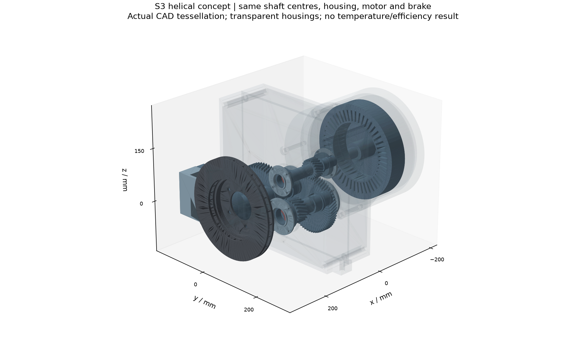
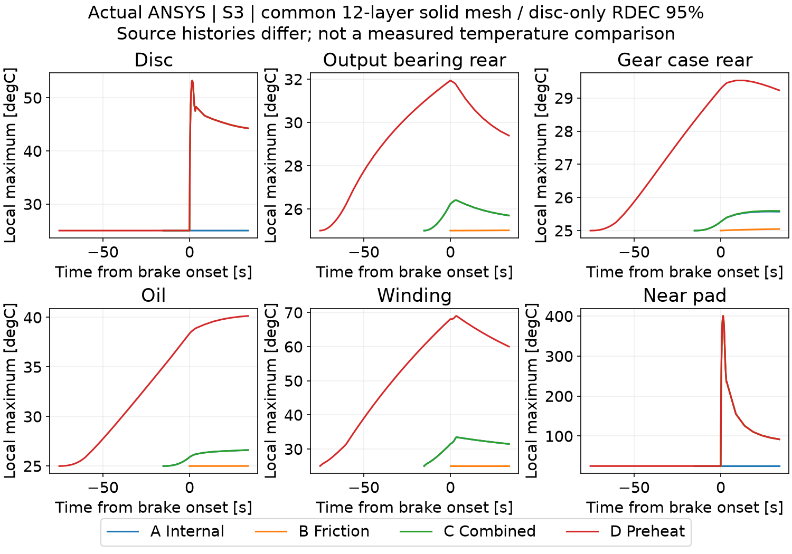

# 1 综合判断

本项目已经完成从资料与参数审查、守恒热源接口、瞬态热网络，到参数化三维几何和Case0有限元温度场的概念研究链。M0—M3已按研究者批准的限定范围验收并归档，M4已得到真实软件计算结果，但尚未完成全部数值验证，状态仍为PARTIAL。M5空气流动、M6优化和M7综合验证尚未启动。

**项目具有形成研究贡献的潜力，但目前证据不足以认定已经取得明确的原创机理或有效的新型热管理结构。** 已完成工作的价值主要体现在对象建模、输入贯通、能量审查及真实数据与工程假设的分离。下一步应把这些基础转化为可检验的热耦合规律、关键部件响应和结构权衡，避免以建成CAD、使用ANSYS或生成云图本身作为创新结论。

根据研究者最新决定，后续仿真等工作暂不考虑再生制动，研究重点为**驱动预热后，零再生摩擦制动热与电机及减速器既有热量共同作用下的各部件温升及热耦合**。本报告只总结与安排工作，不修改可执行模型、不生成新热源、不恢复MATLAB/ANSYS/Fluent求解。所有新零再生温度场任务均为PLANNED / NOT EXECUTED。

报告证据基线为提交`d4c06106c96ce07f7ff691a6b7b9ce8b58dd2f2d`，开发分支`stage/M4-ansys`，草稿[PR #5](https://github.com/alan9900/Thermal-coupling-analysis-under-drive-control-integration/pull/5)。M0—M3固定标签不覆盖；M4未合并、没有M4-v1.0正式标签。新计划见[NO_REGEN_WORK_PLAN.md](../docs/NO_REGEN_WORK_PLAN.md)。

# 2 研究对象与问题边界

研究对象为1800 kg后驱概念纯电车型。后轴左右各一套独立电机、两级固定减速器及减速器输出端内移制动盘，无机械差速器；前轴保留常规摩擦制动。整车动力学同时考虑前轴及两侧后轴，详细热场只分析单侧。它不是丰田或大众量产总成的真实改装验证。

| 项目 | 当前定义 | 来源或限定 |
|---|---|---|
| 整车 | 1800 kg，后轴静载55%，重心高0.55 m | 车型与载荷概念假设 |
| 单侧电机 | 参考MG2，60 kW、207 N·m、13500 rpm；软件牵引限扭130 N·m | Toyota/ORNL参考峰值；连续能力未知 |
| 传动 | 两级平行轴斜齿，均为20/60，总速比9.0 | 参数化概念几何；保留现有三轴位置 |
| 输出端 | 50 mm输出轴候选，280 mm制动盘 | 已做概念连接与空间检查；不代表强度或制造认证 |
| 热管理几何 | Case0无新增罩；A单层罩、B双层间隙、C隔热导流一体化 | 已建几何，尚未证明降温效果 |
| 研究主问题 | 制动热对盘毂、轴承、油液、壳体及电机的附加影响 | 需要匹配热史、界面与能量证据 |

方案早期曾有中央电机/差速器、前驱等历史版本，均已被V0.4取代。后续不再调整三轴布局或扩展齿轮制造、轴承疲劳、螺栓预紧等机械优化。参考零件资料只支持其公开参数，不能作为本概念总成冷却、寿命或制动法规认证。

来源分级沿用S1官方/OEM/原始试验资料、S2同类研究、S3工程估算、S4演示假设。未知标定参数保留null/NaN；S3区间表示探索范围，不能称为统计置信区间。

# 3 已完成工作的系统回顾

## 3.1 阶段总览

| 阶段 | 主要交付 | 实际证据 | 当前关卡 |
|---|---|---|---|
| M0 | 资料、参数、速度/功率及后轴制动能量审查 | MATLAB既有12组检查及18组制动积分；Python复核 | M0-v1.0已归档 |
| M1 | 整车动力学和单侧分项热源接口 | 原18组及新增11组测试；23轨迹、46单侧接口、322敏感性计算 | 概念范围验收；真实损耗标定PARTIAL |
| M2 | 13节点单侧瞬态热网络 | 11组测试，4基础场景、3路径移除、18敏感性及独立SciPy复核 | M2-v1.0概念范围已归档 |
| M3 | 参数化完整/热简化CAD，Case0/A/B/C及斜齿修订 | 18 STEP回读、3006对布尔检查、14啮合相位、541热容一致性记录 | M3-v1.0概念几何已归档 |
| M4 | Case0实际有限元场、热流与报告 | ANSYS 2024 R1实际运行；部分网格、辐射、能量验证 | PARTIAL，暂停计算 |
| M5—M7 | 空气流动、结构优化、综合验证 | 尚无执行证据 | NOT STARTED |

阶段批准只关闭对应限定范围的关卡。表中的测试是既有运行记录，本报告没有重新运行这些测试。后续各项物理未知量仍然有效，不能由阶段归档推定实物准确性。

## 3.2 M0 资料与动力学审查

已从EPA官方数据包读取MG2 EMOT文件并保存原包、来源和哈希。联合电功率表为14×39，转速0—13000 rpm、转矩数值范围−200—200 N·m，并另有137个配对的电机/逆变器驱动效率点。数值负转矩区为驱动损耗镜像估算，不是实测再生标定；绕组独立损耗图仍未知。

已核对参考电机60 kW、207 N·m、13500 rpm的资料边界，检查160 km/h目标与9:1速比的转速匹配。转速不过限不代表连续高速能力、供电与散热已验证。后驱制动动态载荷与前驱旧公式区分明确，前轴及左右后轴分别记账。

M0已有零再生解析筛查：100→0 km/h、0.6g、对称且忽略路阻时，单侧后盘约752.84 N·m、初始63.37 kW、接触摩擦功149.53 kJ。这些是动力学/能量结果，不能表述为已有零再生有限元温度场。

## 3.3 M1 热源模型与不确定性接口

热源链从车辆速度、加减速度及前后轴分配得到各侧电机转速/转矩，读取EPA联合损耗；减速器采用方向区分的参数化功率损耗；制动器按实际摩擦功加载。模型保留严格数据模式与工程研究模式：严格模式拒绝缺少标定的内部损耗，工程模式在独立文件输出明确分级的候选时序。

电机与逆变器联合损耗定义为：

$$
Q_{\mathrm{EMOT}}=P_{\mathrm{dc}}-T_m\omega_m\ge0.
$$

先借助有限覆盖的驱动效率分离或显式回退参数估计逆变器份额，再将剩余电机预算按铜耗、铁耗、转子/其他损耗权重分配：

$$
Q_j=(1-f_{\mathrm{inv}})Q_{\mathrm{EMOT}}
\frac{w_j}{w_{\mathrm{Cu}}+w_{\mathrm{Fe}}+w_{\mathrm{Ro}}}.
$$

铜耗权重包含电流代理、参考电阻及交流修正；铁耗采用转速一次/二次项；转子其他采用转速及负载相关项。归一化保证总量一致，**不证明真实内部损耗已辨识**。逆变器不加载绕组；转子/其他不等于磁钢独立发热；总损耗与分项不重复加载。当前热源未与求解温度实时反馈闭环。

盘/片热量名义90%/10%是工程候选。分项上下界按固定总预算计算，不能把不同参数组合产生的独立上界拼成一个物理工况。联合地图误差、空载拖曳与搅油等尚未形成完整标定模型。

## 3.4 M2 瞬态热网络及路径账本

已在MATLAB R2025a建立13动态节点LPTN，包含盘、片/钳、轴、轴承、齿轮、油、壳体、电机热区、护罩及局部空气，环境和冷却液作为边界。每个节点按热容、内部发热、双向界面热流和冷却建立瞬态平衡，辐射使用绝对温度。守恒检查覆盖输入、实体储热、环境及冷却带走的热量，且另设电驱子域。

路径输出分别保留有符号功率、净积分与各跨界边正向累计：

$$
E_{p,\mathrm{net}}=\int q_p(t)\,dt,\qquad
E_{p,+}=\sum_{e\in p}\int\max[q_e(t),0]\,dt.
$$

盘—轴—轴承的串联截面不能重复相加。路径通量本身没有热源来源标签，制动附加影响采用相同时间轴的匹配热源比较。

既有M2采用六次驱动—制动—停歇循环及600 s末段冷却，D另插入60 s高负载预热。候选参数下，C减A最大逐时附加温升约为输出轴轴承4.720 K、油液1.920 K、壳体1.835 K、绕组0.0333 K。这提示轴承/油液值得优先关注，但不能推广为真实总成的普遍主导规律。

## 3.5 M3 参数化几何与斜齿修订

已建立电机、两级减速器、轴承及输出轴、盘毂、制动盘、卡钳/支架、空气占位与可拆隔热导流结构。完成45/50 mm轴候选及安装关系的概念检查，最终保留50 mm输出轴，并针对疑似输出大齿轮干涉开展独立复核。

斜齿修订保持100/120 mm中心距、两级20/60齿、9.0总速比及原三轴坐标。原2.5/3.0 mm模数按端面模数解释，20°螺旋角对应法向模数2.34923/2.81908 mm，为非标准概念值；同级两轮旋向相反，真实螺旋实体经过几何反算和相位检查。

完整几何与热分析简化几何分别保存，检查质量/热容一致性并建立独立M3-to-M4映射。最终18个STEP、66个Git blob等证据完成核对。没有把无干涉解释为热态装配、疲劳寿命、制造或法规认证。中间轴轴向力数量级、连接套传扭、油膜与接触热阻仍需保留限制。

{width=15.5cm}

## 3.6 M4 实际有限元求解与成果归档

实际使用ANSYS Workbench/Mechanical/MAPDL 2024 R1，不是2025版。STEP导入129分组/131实体；保留28材料热区、30实体，建立32对显式有限面连接。摩擦热加载盘两侧摩擦环和摩擦片，电机铜/铁/转子及减速器分项加载对应等效区；固体体热源以功率除以实际有限元体积施加。

已实际运行原基准中的内部损耗、仅制动热、共同热源、预热后制动四类场景。完成温度时序、表面云图、热容积分、辐射/对流/接触输出和总体/子域能量核对。摩擦片厚度分别划分6/12/24层，制动盘摩擦面分别采用4/2/1 mm尺寸细化；部分辐射离散误差通过预先登记的工程阈值。默认形状检查保留493/494/500个警告单元，不能称全网格优质。

现有29幅原生云图（整体1幅、部件28幅）另有30页Word逐图讲解。大容量RTH、Workbench工程和视角矩阵主要保存在本地`E:/ansys_runs/m4_case0_20261021/`，常规Git保存可复算输入、有限结果、日志和哈希；没有宣称全部大文件已远程归档。

{width=15.5cm}

# 4 既有结果怎样解释

## 4.1 当前温度场对应的工况

以下M4数据均来自**原80 km/h、0.6g、整车再生上限30 kW**的历史Case0场景。A/C为首周期窗口，D包含首次驱动及60 s高负载保持、单次制动和30 s冷却；D总窗口约108.877 s。D预热是给定工程热负荷，60 s持续能力未被参考电机峰值资料证明。A/B/C/D表示热源组合，不是几何Case A/B/C隔热方案。

| 原场景 | 制动盘峰值°C | 输出后轴承°C | 后壳体°C | 油等效区°C | 绕组°C |
|---|---:|---:|---:|---:|---:|
| A 内部损耗 | 25.001 | 26.407 | 25.574 | 26.614 | 33.454 |
| B 仅制动热 | 53.104 | 25.012 | 25.048 | 25.005 | 25.000 |
| C 共同热源 | 53.252 | 26.407 | 25.595 | 26.614 | 33.454 |
| D 预热后制动 | 53.253 | 31.942 | 29.528 | 40.144 | 69.000 |

表中是各部件在自身时刻的记录峰值，不是同一瞬间。B采用已完成的两档时间步结果中较细者，最终三档时间步检查仍未闭合。小数位用于追溯，不能解释为真实温度精度。

## 4.2 温升较小与局部高温的原因

原单次制动仅约3.775 s，单侧盘片接触摩擦热40.25 kJ，其中盘36.23 kJ、片4.03 kJ。盘及盘帽热容约2370 J/K，全部36.23 kJ均匀留在盘内的平均温升尺度约15.3 K；摩擦环局部温升可高于均值，原盘峰值53.25°C具有可解释的能量数量级。

摩擦片局部峰值约400°C，而其对应时刻热容均温约79°C，说明固定表面热流与有限片厚下存在显著梯度。原一层片约150°C峰值已拒绝；细化后的400°C也仍受固定90/10热分配、无移动摩擦接触/闪温及常物性等限制，不是实测或允许温度。

整体图色标上限由高温摩擦片控制，25—69°C的大量部件落在蓝色端，不能据蓝色判断没有温升。短时传导与热容使轴承/壳体温升滞后；不能由单次制动得出长期热耦合可忽略。

## 4.3 守恒通过与仍需谨慎的结论

C/D总体储热、环境散热、液冷和净辐射账本最大相对残差分别约0.001957%/0.000507%。同网格、同内部损耗的C减A终点电驱储热增量约55.344 J，增量收支残差约0.019954%。这些结果支持当前离散模型的账本一致性，不等于真实温度已标定。

M2盘峰值约110°C，M4约53°C，对应循环次数、观察时长、护罩/空气节点、CAD热容及边界都不同，不能解释成结构使温度降低一半。M4没有新增罩，且未模拟制动热空气回流；后者必须标为NOT MODELLED，不能称其贡献为零。壳体净辐射还含开口环境交换，不能全归为盘—壳体双体传热。

# 5 创新点评估

## 5.1 对创新程度的判断

现阶段可认定项目具有明确研究对象和可复用分析基础；**尚不能认定已完成原创机理发现、首创结构或经验证的性能提升**。有限文献核对仅用于排除明显重复和建立参照，不是系统综述、全球首创证明或专利新颖性检索。

本次有限核对的5项原始研究覆盖下列邻近方向。元数据与摘要来自出版社、高校官方记录或作者预印本；本轮没有完整核读全部论文。

| 参照研究 | 已有工作 | 对本项目创新表述的约束 |
|---|---|---|
| L1 Gronwald与Kern 2021 | 几何驱动电机热网络、冷却参数与实验验证 | 建立电机LPTN及参数扫描不属于新的方法 |
| L2 Paar与Mütze 2016 | 齿轮箱集成IPM电机、敏感性及热流路径 | 电机—齿轮箱热耦合的广义问题已有研究 |
| L3 Park等 2025 | EMB执行电机在摩擦热空气作用下的热管理 | 对象为制动夹紧执行电机，不能当成本项目60 kW牵引电机或结构效果验证 |
| L4 Adamowicz与Grzes 2011 | 重复制动三维瞬态热分析及对流冷却 | 重复制动、有限元和对流分析本身不构成创新 |
| L5 Chang等 2026预印本 | 摘要涉及制动盘对轮毂牵引电机永磁体的热影响 | 制动热影响牵引电机已有直接相关先行研究，不能笼统宣称首次 |

L5仅核对预印本摘要及元数据，尚未核实同行评审期刊发表；其结果不作为本项目的温度或结构性能证据。上述材料说明潜在贡献需要落在具体拓扑、耦合规律及权衡条件上，尚不足以证明该具体组合在全部公开文献或专利中没有先例。不得迁移其他论文的降温数值或验证精度。[L1—L5]

## 5.2 候选贡献一 预热后零再生制动的部件响应与滞后

可检验的问题是：在相同驱动热史和零再生摩擦负荷下，盘、轴承、油液、壳体和绕组的附加温升及峰值滞后如何变化，哪些部件最受制动热影响。对象的特点是内移盘通过减速器输出端与电驱系统邻接，需同时保留减速器储热和传热，而不是只分析一个孤立制动盘或电机。

已有M2趋势及M4短窗口结果提供线索，但新零再生结果尚未生成。只有在匹配工况、延长观察和必要数值验证后，形成稳定可重复的响应关系或适用区间，才可将其写为机理贡献；零再生这一工况选择本身不构成创新。

## 5.3 候选贡献二 热路径的双向交换与来源归因

重点应是明确控制体边界后，解释预热电驱先向外散热、制动后局部热流可能反向的过程，并量化各路径的瞬时、累计正向和净交换差别。匹配热源时序的对照用于识别摩擦热额外影响，避免把串联截面或各独立上界重复计入。

当前已实现账本与受控源项比较，属于可靠的方法实现和研究特色。要形成更强贡献，仍需新零再生场景、关键参数变化及热空气路径的后续证据，说明何时会发生路径主导或方向改变。标准守恒积分、LPTN和有限元本身不作为原创算法。

## 5.4 候选贡献三 隔热与通风的温度权衡

Case A/B/C具备几何准备，可研究屏蔽辐射、改变热空气路径后，轴承/油液/绕组温升与盘片自身冷却之间是否存在冲突。可发表的增量应落在明确的几何范围、边界和工况内，给出权衡规律或经回代核对的设计选择。

目前没有结构热比较、Fluent空气流动或优化结果，不能称已经降温、提高效率或获得最优结构。单/双层隔热罩、斜齿替代直齿、常规DOE/代理模型及NSGA-II都是现有技术路线，组合使用不自动证明原创性。

## 5.5 研究质量与创新结论分开

官方损耗数据审计、严格/工程模式、热源接口守恒、CAD等热容映射、失败记录及Git阶段追溯，是可信研究的基础和工程交付价值。它们有助于可复算与评审，但不应单独包装成热学新机理。现阶段最稳妥表述为“具有潜在贡献的概念多热源研究平台”，把较强创新结论留待后续证据。

# 6 关键缺口与结论风险

| 缺口 | 对结论的影响 | 后续处理原则 |
|---|---|---|
| 铜/铁/转子损耗与电流未实测辨识 | 绕组、定子温度与损耗分配相关 | 保留S3与原始NaN；总损耗误差和分配误差分别扫描 |
| 空载拖曳、搅油及温度反馈不完整 | 零再生制动阶段可能遗漏内部热量 | 按控制状态建立明确近似或参数范围，不冒称物理零损耗 |
| 实际材料、绕组复合/铁心方向性及温变未知 | 热扩散与局部热点不确定 | 有来源候选、有效方向参数与敏感性；不套用允许温度 |
| 接触、油膜和实际冷却未标定 | 轴承/油液/壳体耦合可能改变 | 有限热阻和有限冷却；不默认全粘结或无限冷源 |
| 全工况空间/时间独立性未闭合 | 小温差与局部峰值的可信度有限 | 新输入下补充内部热区及预热步长检查 |
| 热空气回流未模拟 | 三条路径的真实贡献不能完整排序 | 经批准后M5处理；当前明确NOT MODELLED |
| 轴向承载、连接套和热态安装未验证 | 几何可分析不代表可制造或安全 | 保留概念范围，不扩展或隐藏机械缺陷 |

对于尚无测量依据的参数，优先以明确物理依据和范围继续概念研究，避免为追求全部真实参数无限停滞。若研究结论在合理范围内改变符号或主导关系，应报告结论依赖条件，而不是只给一个名义温度。

# 7 后续工作安排

## 7.1 统一零再生与保持暂停

后续各阶段暂不考虑再生：左右再生使能关闭、指令再生制动转矩与回收功率为零，前轴及两侧后轴按动态轴荷、附着与路阻分配。原始电池接受能力等未知值仍为null；新场景设置零回收只是控制条件。

驱动预热阶段保留电机和减速器合理内部损耗，温度场连续进入制动与冷却阶段。零再生不等于旋转电机物理损耗为零，也不能把旧再生铜耗叠加到全部摩擦制动上；未通电拖曳与零传递功率搅油的近似必须显式说明。60 kW参考峰值不作为长期预热能力证明。

**以下均是安排，未执行。恢复模型实施与计算须等待研究者新的明确命令。** 原含再生B时间步及C接触/冷却队列不再默认恢复。旧模型方法可复用，但旧输入对应的验证不能自动证明新零再生结果通过。

## 7.2 先完成M4 Case0

| 任务 | 工作内容 | 完成判据 |
|---|---|---|
| P1 热源与动力学 | 独立零再生配置及M1派生时序 | 再生为零；前轴/两侧后轴及储能与耗散闭合；输入和来源哈希齐全 |
| P2 热网络对照 | 新工况M2结果，与M4采用可比较热史 | 单独输出、不覆盖M2-v1.0；明确热容、边界及护罩/空气差异 |
| P3 基准温度场 | Case0单次及驱动预热后制动 | 28热区最高/热容均温、峰值时刻及同步整体云图完整 |
| P4 数值与不确定性 | 空间、时间、源项总量及接触/冷却/分热敏感性 | 事前声明判据；总体及子域收支闭合；失败及未执行项保留 |
| P5 机理与累积 | 匹配源项比较，逐步增加重复摩擦制动 | 滞后、方向改变及附加温升可追溯；不将独立上界拼接 |
| P6 阶段送审 | 报告、图、原始结果、脚本、日志和检查表 | PR审查；获准后合并main并创建M4正式Tag |

80 km/h、0.6g仅作为与旧工作比较的首个候选；100 km/h与其他减速度可用于后续范围研究。预热负荷/时长、循环次数/间隔、观察窗口及冷却条件应在执行时登记，目前没有新增冻结的工况参数或承诺日程。

## 7.3 配对场景与评价量

| 场景 | 作用 | 解释限制 |
|---|---|---|
| NR-I 内部损耗对照 | 与NR-C同运动/控制，只关闭摩擦热 | 热学消融诊断，不声称无摩擦仍能实现零再生减速 |
| NR-B 制动热单独作用 | 观察冷态或共同登记初态下摩擦热传播 | 不能用不同初态差值解释唯一来源 |
| NR-C 共同作用 | 同一物理时序中允许的内部损耗与摩擦热 | 不叠加不相容驱动/制动负荷 |
| NR-P 预热后制动 | 连续传递驱动预热的空间温度场 | 重点分析滞后与反向热流 |
| NR-R 重复制动 | 观察轴承、油液、壳体等热量积累 | 单次基准验证后开展，不用短时窗口替代耐久峰值 |

重点评价制动盘、轴承、润滑油、壳体和绕组，同时保存全部28热区。输出局部峰值、热容均温、峰值时刻、制动附加逐时温升、储热、边界热量及路径积分。同步整体图与独立部件峰值图分别标识，不能用区域峰值之差代替最大逐时附加温差。

## 7.4 M5至M7及最终研究成果

M4正式归档且取得新阶段授权后，M5先在零再生热负荷下研究Case0局部流动、热空气回流及散热边界，再按授权比较隔热导流结构。质量和能量、网格及边界敏感性应分别检查，MRF稳态不能冒称完整制动瞬态。

M6在可信边界和可行几何范围内开展DOE/代理模型及多目标比较，考察轴承、油液、壳体、绕组、盘片温度和附加质量的权衡，选取代表方案回代；不承诺未经计算的温降。M7整合零再生单次/重复、驱动预热及材料/冷却不确定性结果，形成可复算论文图表和结论；没有实测时坚持“数值验证”，不能写成实验标定。

阶段顺序仍为独立分支、定期提交、PR送审、研究者批准后合并与不可移动Tag。当前不会启动M5或继续机械制造细节优化。

# 8 成果入口与版本追溯

| 内容 | 仓库入口 |
|---|---|
| 权威车型与来源 | docs/REAR_DRIVE_V04_SOURCED_BASELINE.md；configs/baseline_vehicle.yaml |
| 阶段状态和批准范围 | docs/STAGE_VERSIONS.md；reports/M3_APPROVED_SCOPE_2026-10-21.md |
| M0资料与动力学 | scripts/m0；results/m0；data/raw/m0；reports/M0_report.md |
| M1热源 | scripts/m1；configs/m1_source_partition.yaml；results/m1；reports/M1_report.md |
| M2热网络 | scripts/m2；configs/m2_thermal_network.yaml；results/m2；reports/M2_report.md |
| M3完整与热简化几何 | cad/m3_helical；scripts/m3_helical；configs/M3_helical_to_M4_mapping.json |
| M4计算及验收证据 | scripts/m4；results/m4；docs/M4_RUNBOOK.md；reports/M4_report.md |
| 云图逐图说明 | reports/M4_contour_explained.docx；results/m4/contour_captures |
| 当前后续计划 | docs/NO_REGEN_WORK_PLAN.md；计划版本no-regen-plan-1.0 |

M0、M1、M2、M3正式标签分别固定既有验收提交，原始数据和报告保持历史状态。本报告是总结与创新评估补充，不覆盖阶段报告、模型参数或计算结果。数值表引用既有回执，文献核对只服务创新判断，没有新热分析执行。

# 9 参考资料与核查范围

本次核对日期为2026-10-22，范围是支持研究定位的5项邻近原始研究，不是系统检索或专利查新。正文各阶段成果另以本仓库既有报告和验收回执为依据。网页全文访问受限的资料仅据可见摘要、公开节选及官方元数据表述，不声称完整全文审查。

L1. Gronwald, P.-O.; Kern, T. A. (2021). *Experimental validation and parameter study of a 2D geometry-based, flexible designed thermal motor model for different cooled traction motor drives*. World Electric Vehicle Journal, 12(2), 76. [DOI 10.3390/wevj12020076](https://doi.org/10.3390/wevj12020076)；[TUHH官方记录](https://tore.tuhh.de/entities/publication/a9cd29db-97dc-4622-91fd-d48077379703)。本轮核对官方记录及摘要，未完整核读PDF。

L2. Paar, C. J.; Mütze, A. (2016). *Thermal Real-Time Monitoring of a Gearbox Integrated IPM Machine for Hybrid-Electric Traction*. IEEE Transactions on Transportation Electrification, 2(3), 369–379. [DOI 10.1109/TTE.2016.2566924](https://doi.org/10.1109/TTE.2016.2566924)；[Graz官方记录](https://tugraz.elsevierpure.com/en/publications/thermal-real-time-monitoring-of-a-gearbox-integrated-ipm-machine-/)。本轮核对元数据与摘要。

L3. Park, P.; Choi, H.; Lee, S.; Jeong, S.; Lee, H. (2025). *Development of a novel electro-mechanical brake motor thermal management system for nonuniform heating under extreme thermal conditions*. Energy Conversion and Management, 325, 119406. [DOI 10.1016/j.enconman.2024.119406](https://doi.org/10.1016/j.enconman.2024.119406)；[出版社页](https://www.sciencedirect.com/science/article/abs/pii/S0196890424013475)。本轮核对摘要及公开节选；没有将EMB执行电机等同牵引电机。

L4. Adamowicz, A.; Grzes, P. (2011). *Influence of convective cooling on a disc brake temperature distribution during repetitive braking*. Applied Thermal Engineering, 31(14–15), 2177–2185. [DOI 10.1016/j.applthermaleng.2011.05.016](https://doi.org/10.1016/j.applthermaleng.2011.05.016)；[出版社页](https://www.sciencedirect.com/science/article/pii/S1359431111002687)。本轮核对摘要及公开方法节选。

L5. Chang, J.; Jiang, R.; Sun, X. (2026). *A Novel Heat Exchange System of Axial Flux Hub Motor for In-Wheel Traction Applications*. SSRN预印本，2026-06-11发布。 [DOI 10.2139/ssrn.6920621](https://doi.org/10.2139/ssrn.6920621)；[原始预印本页](https://papers.ssrn.com/sol3/papers.cfm?abstract_id=6920621)。本轮仅核对页面摘要及元数据；未核读全文，未核实同行评审期刊发表，不引用其数值作为本项目验证。

内部依据包括M0、M1、M2报告，M3斜齿修订及批准范围，M4报告与验收JSON，阶段版本记录及无再生工作计划。对应输入文件和本报告的SHA256随交付记录保存，用于区分本次总结与原始阶段快照。
